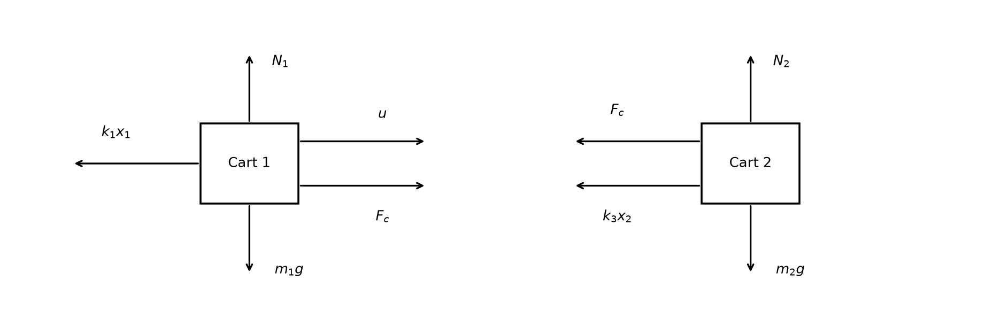
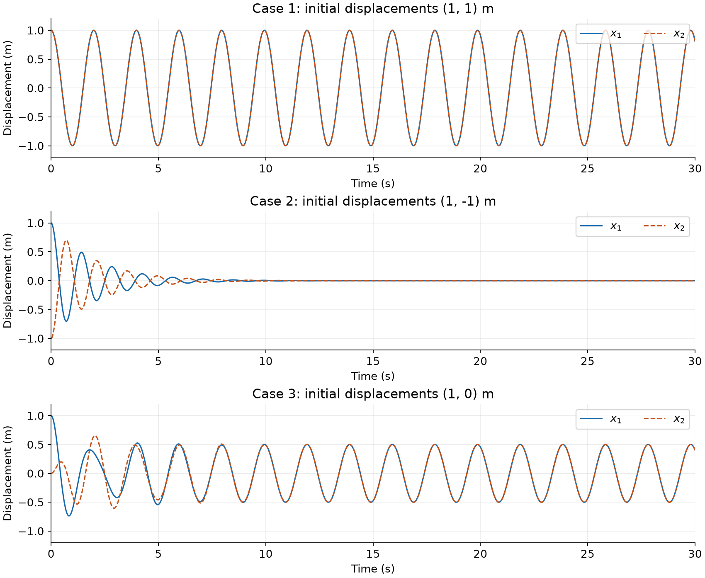
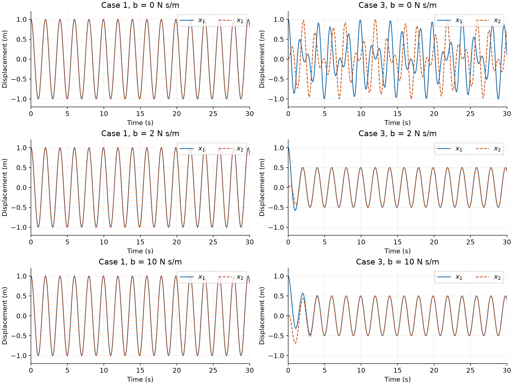
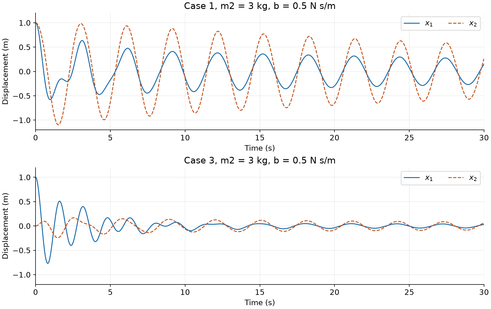
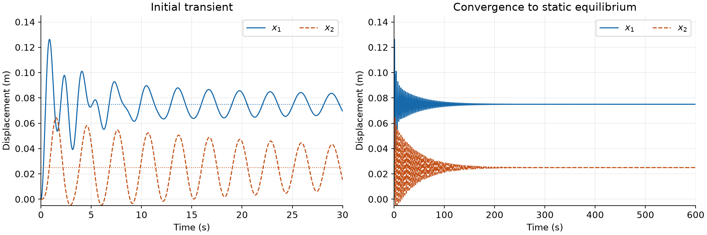

# ME404: Dynamics and Control of Mechanical Systems, Fall 2026
## Problem Set #1: Modeling and Dynamics — Answer Key

Angles are in radians. Transfer functions use zero initial conditions unless stated otherwise. Each answer uses the coordinate and sign conventions in the problem statement.

### Problem #1

#### (Part A) Dubin's Kinematics

The unit vector along the vehicle's heading is
$$
e_{x_b}=\begin{bmatrix}\cos\theta\\\sin\theta\end{bmatrix}.
$$
Because the cart has no sideways velocity, its inertial velocity is $v e_{x_b}$. Thus
$$
\boxed{\dot x=v\cos\theta,\qquad
\dot y=v\sin\theta,\qquad
\dot\theta=\omega.}
$$
Equivalently,
$$
\dot q=
\begin{bmatrix}
\cos\theta&0\\
\sin\theta&0\\
0&1
\end{bmatrix}
\begin{bmatrix}v\\\omega\end{bmatrix}.
$$
The no-slip constraint is $-\dot x\sin\theta+\dot y\cos\theta=0$.

#### (Part B) Dubin's Dynamics

**(a) Newton's and Euler's laws in the rotating body frame.**

Write the velocity as $\mathbf v=v_x e_{x_b}+v_y e_{y_b}$. Since
$$
\dot e_{x_b}=\omega e_{y_b},\qquad
\dot e_{y_b}=-\omega e_{x_b},
$$
the inertial acceleration is
$$
\mathbf a=(\dot v_x-\omega v_y)e_{x_b}
 +(\dot v_y+\omega v_x)e_{y_b}.
$$
Applying Newton's law along the body axes and Euler's law about the center of mass gives
$$
m(\dot v_x-\omega v_y)=F,\qquad
m(\dot v_y+\omega v_x)=0,\qquad
J\dot\omega=M.
$$
Therefore,
$$
\boxed{\dot v_x=\frac{F}{m}+\omega v_y,\qquad
\dot v_y=-\omega v_x,\qquad
\dot\omega=\frac{M}{J}.}
$$
The velocity-coupling terms arise from the rotating coordinates, even though there is no applied lateral force.

**(b) Full state model.**

Rotate both body-frame velocity components into the inertial frame:
$$
\begin{bmatrix}\dot x\\\dot y\end{bmatrix}
=\begin{bmatrix}\cos\theta&-\sin\theta\\
\sin\theta&\cos\theta\end{bmatrix}
\begin{bmatrix}v_x\\v_y\end{bmatrix}.
$$
For $q=(x,y,\theta,v_x,v_y,\omega)^T$ and $u=(F,M)^T$,
$$
\boxed{\dot q=
\begin{bmatrix}
v_x\cos\theta-v_y\sin\theta\\
v_x\sin\theta+v_y\cos\theta\\
\omega\\
F/m+\omega v_y\\
-\omega v_x\\
M/J
\end{bmatrix}.}
$$
Part A's position equations are recovered instantaneously when $v_y=0$ and $v_x=v$. However, $v_y=0$ generally does not remain true in this slipping model: if $\omega v_x\ne0$, then $\dot v_y\ne0$. Maintaining no slip during a turn would require a lateral constraint force.

### Problem #2

For compactness, define the constant combinations
$$
\begin{aligned}
A&=J_1+m_1l_{c1}^2+m_2l_1^2,\\
D&=J_2+m_2l_{c2}^2,\\
B&=m_2l_1l_{c2},\\
P&=(m_1l_{c1}+m_2l_1)g,\\
Q&=m_2l_{c2}g.
\end{aligned}
$$
Here $A,B,D$ have units of moment of inertia, and $P,Q$ have units of torque. The symbol $g$ alone denotes gravitational acceleration; $g(\theta)$ below denotes the gravity vector.

#### (a) Center-of-mass kinematics and energies

With $O$ as the origin and the inertial $y$-axis upward,
$$
r_{c1}=
\begin{bmatrix}l_{c1}\cos\theta_1\\l_{c1}\sin\theta_1\end{bmatrix},
\qquad
r_{c2}=
\begin{bmatrix}
l_1\cos\theta_1+l_{c2}\cos(\theta_1+\theta_2)\\
l_1\sin\theta_1+l_{c2}\sin(\theta_1+\theta_2)
\end{bmatrix}.
$$
Differentiation gives
$$
\dot r_{c1}=l_{c1}\dot\theta_1
\begin{bmatrix}-\sin\theta_1\\\cos\theta_1\end{bmatrix},
$$
$$
\dot r_{c2}=l_1\dot\theta_1
\begin{bmatrix}-\sin\theta_1\\\cos\theta_1\end{bmatrix}
+l_{c2}(\dot\theta_1+\dot\theta_2)
\begin{bmatrix}-\sin(\theta_1+\theta_2)\\\cos(\theta_1+\theta_2)\end{bmatrix}.
$$
In particular,
$$
\|\dot r_{c2}\|^2=l_1^2\dot\theta_1^2
+l_{c2}^2(\dot\theta_1+\dot\theta_2)^2
+2l_1l_{c2}\cos\theta_2\,\dot\theta_1(\dot\theta_1+\dot\theta_2).
$$
The absolute angular velocities of the links are $\dot\theta_1$ and $\dot\theta_1+\dot\theta_2$. Consequently,
$$
\begin{aligned}
T&=\frac12m_1\|\dot r_{c1}\|^2+\frac12J_1\dot\theta_1^2
+\frac12m_2\|\dot r_{c2}\|^2
+\frac12J_2(\dot\theta_1+\dot\theta_2)^2\\
&=\boxed{\frac12A\dot\theta_1^2
+\frac12D(\dot\theta_1+\dot\theta_2)^2
+B\cos\theta_2\,\dot\theta_1(\dot\theta_1+\dot\theta_2).}
\end{aligned}
$$
Taking potential energy to be zero when the centers of mass are at $y=0$,
$$
\boxed{V=P\sin\theta_1+Q\sin(\theta_1+\theta_2).}
$$
The parameter $l_2$ does not appear separately: its effect is already represented by $l_{c2}$ and $J_2$. No uniform-link assumption is needed.

#### (b) Nonlinear equations of motion

The virtual work of the motors is
$$
\delta W=\tau_1\delta\theta_1
+\tau_2\bigl[\delta(\theta_1+\theta_2)-\delta\theta_1\bigr]
=\tau_1\delta\theta_1+\tau_2\delta\theta_2.
$$
Thus the generalized forces are $(\tau_1,\tau_2)^T$, including the elbow motor's reaction torque on link 1. Lagrange's equations are
$$
\frac{d}{dt}\frac{\partial T}{\partial\dot\theta_i}
-\frac{\partial T}{\partial\theta_i}
+\frac{\partial V}{\partial\theta_i}=\tau_i.
$$
Useful intermediate derivatives are
$$
\begin{aligned}
\frac{\partial T}{\partial\dot\theta_1}
&=(A+D+2B\cos\theta_2)\dot\theta_1
+(D+B\cos\theta_2)\dot\theta_2,\\
\frac{\partial T}{\partial\dot\theta_2}
&=(D+B\cos\theta_2)\dot\theta_1+D\dot\theta_2,\\
\frac{\partial T}{\partial\theta_1}&=0,\qquad
\frac{\partial T}{\partial\theta_2}
=-B\sin\theta_2\,\dot\theta_1(\dot\theta_1+\dot\theta_2).
\end{aligned}
$$
Substituting gives
$$
\boxed{\begin{aligned}
&(A+D+2B\cos\theta_2)\ddot\theta_1
+(D+B\cos\theta_2)\ddot\theta_2\\
&\quad-B\sin\theta_2(2\dot\theta_1\dot\theta_2+\dot\theta_2^2)
+P\cos\theta_1+Q\cos(\theta_1+\theta_2)=\tau_1,\\[2pt]
&(D+B\cos\theta_2)\ddot\theta_1+D\ddot\theta_2
+B\sin\theta_2\dot\theta_1^2
+Q\cos(\theta_1+\theta_2)=\tau_2.
\end{aligned}}
$$
One valid representation of $M\ddot\theta+C\dot\theta+g(\theta)=\tau$ is
$$
\boxed{M(\theta)=
\begin{bmatrix}
A+D+2B\cos\theta_2&D+B\cos\theta_2\\
D+B\cos\theta_2&D
\end{bmatrix},}
$$
$$
\boxed{C(\theta,\dot\theta)=
\begin{bmatrix}
-B\sin\theta_2\dot\theta_2&-B\sin\theta_2(\dot\theta_1+\dot\theta_2)\\
B\sin\theta_2\dot\theta_1&0
\end{bmatrix},}
$$
$$
\boxed{g(\theta)=
\begin{bmatrix}
P\cos\theta_1+Q\cos(\theta_1+\theta_2)\\
Q\cos(\theta_1+\theta_2)
\end{bmatrix}.}
$$
The matrix $C$ is not unique; the velocity-force vector $C\dot\theta$ is the quantity fixed by the equations. The displayed choice also makes $\dot M-2C$ skew-symmetric, as expected from the kinetic-energy balance.

#### (c) Nonlinearity and inertia coupling

The nonlinear terms are the configuration-dependent factors $\cos\theta_2$ multiplying accelerations, the quadratic velocity terms multiplied by $\sin\theta_2$, and the trigonometric gravity terms.

The off-diagonal entries represent inertial coupling: accelerating either joint generally requires torque at the other joint because both coordinates affect link 2's motion. In particular, changing $\theta_1$ translates the elbow and rotates link 2, while changing $\theta_2$ changes link 2's motion relative to link 1.

Symmetry follows directly from
$$
\boxed{M_{12}=M_{21}=D+B\cos\theta_2.}
$$
It also follows because $M$ is the Hessian of $T$ with respect to the generalized velocities. As a useful check,
$$
\det M=AD-B^2\cos^2\theta_2\ge AD-B^2,
$$
and expanding the lower bound gives
$$
\begin{aligned}
AD-B^2={}&J_1J_2+J_1m_2l_{c2}^2+J_2m_2l_1^2\\
&+J_2m_1l_{c1}^2+m_1m_2l_{c1}^2l_{c2}^2>0.
\end{aligned}
$$
The term $m_2^2l_1^2l_{c2}^2$ cancels exactly. For positive masses and link inertias $J_i>0$, the remaining terms establish that $\det M>0$ at every configuration. Together with $M_{22}=D>0$, this proves that $M$ is positive definite.

#### (d) Linearization about the upward equilibrium

At $\theta_1=\pi/2$, $\theta_2=0$, and $\dot\theta=0$, both gravity components vanish. With $\tau=0$, the equations therefore permit $\ddot\theta=0$: this is an equilibrium.

Let $\varphi_1=\theta_1-\pi/2$ and $\varphi_2=\theta_2$. To first order,
$$
\cos\theta_2\approx1,\qquad
\cos\theta_1\approx-\varphi_1,\qquad
\cos(\theta_1+\theta_2)\approx-(\varphi_1+\varphi_2).
$$
Hence
$$
\boxed{M_0\ddot\varphi+K\varphi=\tau,}
$$
where
$$
\boxed{M_0=
\begin{bmatrix}A+D+2B&D+B\\D+B&D\end{bmatrix}
=\begin{bmatrix}
J_1+m_1l_{c1}^2+J_2+m_2(l_1+l_{c2})^2
&J_2+m_2l_{c2}(l_1+l_{c2})\\
J_2+m_2l_{c2}(l_1+l_{c2})&J_2+m_2l_{c2}^2
\end{bmatrix},}
$$
$$
\boxed{K=-\begin{bmatrix}P+Q&Q\\Q&Q\end{bmatrix}
=-g\begin{bmatrix}
m_1l_{c1}+m_2l_1+m_2l_{c2}&m_2l_{c2}\\
m_2l_{c2}&m_2l_{c2}
\end{bmatrix}.}
$$
There is no first-order contribution from $C\dot\theta$: it is quadratic in velocities about a rest equilibrium. At this particular equilibrium, the additional factor $\sin\theta_2\approx\varphi_2$ makes its leading contribution third order in small deviations. Variations of $M$ also contribute no linear correction beyond $M_0\ddot\varphi$.

The negative stiffness is physically appropriate: gravity drives a small displacement away from the upward configuration. For $P,Q>0$, $K$ is negative definite. Since $M_0$ is positive definite, $M_0^{-1}(-K)$ has positive eigenvalues $\mu_i$, giving linearized poles $s=\pm\sqrt{\mu_i}$. The positive real poles establish instability.

#### (e) Four transfer functions and characteristic polynomial

The outputs are the angular deviations $\varphi_1,\varphi_2$, and the inputs are $\tau_1,\tau_2$. With zero initial deviations and velocities,
$$
\begin{bmatrix}
(A+D+2B)s^2-(P+Q)&(D+B)s^2-Q\\
(D+B)s^2-Q&Ds^2-Q
\end{bmatrix}
\begin{bmatrix}\Phi_1\\\Phi_2\end{bmatrix}
=\begin{bmatrix}\mathcal T_1\\\mathcal T_2\end{bmatrix}.
$$
The common characteristic polynomial is
$$
\begin{aligned}
\chi(s)&=\det(M_0s^2+K)\\
&=\bigl[(A+D+2B)s^2-(P+Q)\bigr](Ds^2-Q)
-\bigl[(D+B)s^2-Q\bigr]^2\\
&=\boxed{(AD-B^2)s^4-(DP+AQ)s^2+PQ.}
\end{aligned}
$$
The monic state-space characteristic polynomial is $\chi(s)/(AD-B^2)$. Inverting the $2\times2$ matrix gives all four transfer functions, with the other input set to zero in each ratio:
$$
\boxed{\frac{\Phi_1}{\mathcal T_1}=\frac{Ds^2-Q}{\chi(s)},\qquad
\frac{\Phi_1}{\mathcal T_2}=\frac{Q-(D+B)s^2}{\chi(s)},}
$$
$$
\boxed{\frac{\Phi_2}{\mathcal T_1}=\frac{Q-(D+B)s^2}{\chi(s)},\qquad
\frac{\Phi_2}{\mathcal T_2}
=\frac{(A+D+2B)s^2-(P+Q)}{\chi(s)}.}
$$
The equality of the cross transfer functions follows from the symmetric mass and stiffness matrices. To locate the poles, treat $\chi(s)$ as a quadratic in $s^2$. Its discriminant is
$$
(DP+AQ)^2-4(AD-B^2)PQ=(DP-AQ)^2+4B^2PQ>0
$$
for $B,P,Q>0$. The two roots in $s^2$ are therefore real and distinct. Their sum $(DP+AQ)/(AD-B^2)$ and product $PQ/(AD-B^2)$ are positive, so both roots are positive. Thus the poles form two distinct real pairs $\pm\lambda_1,\pm\lambda_2$, with $\lambda_i>0$, consistent with the upward equilibrium's instability.

### Problem #3

#### (a) Free-body diagrams and equations of motion

Define the signed coupling force on cart 1 by
$$
F_c=k_2(x_2-x_1)+b(\dot x_2-\dot x_1).
$$
Cart 2 experiences the opposite force, $-F_c$. The arrows below indicate positive directions for the labeled signed quantities; a negative value reverses the force. The vertical forces satisfy $N_i=m_i g$.



Horizontal force balance gives
$$
m_1\ddot x_1=u-k_1x_1+k_2(x_2-x_1)+b(\dot x_2-\dot x_1),
$$
$$
m_2\ddot x_2=-k_3x_2-k_2(x_2-x_1)-b(\dot x_2-\dot x_1).
$$
Equivalently,
$$
\boxed{\begin{aligned}
m_1\ddot x_1+b(\dot x_1-\dot x_2)+(k_1+k_2)x_1-k_2x_2&=u,\\
m_2\ddot x_2+b(\dot x_2-\dot x_1)+(k_2+k_3)x_2-k_2x_1&=0.
\end{aligned}}
$$
The spring $k_2$ and damper $b$ connect the two carts, so their equal-and-opposite forces enter both equations. Their extension and extension rate depend only on relative displacement and relative velocity, respectively; translating both carts equally does not deform either coupling element.

#### (b) Transfer functions, characteristic polynomial, and zeros

Define
$$
A_1(s)=m_1s^2+bs+k_1+k_2,\qquad
A_2(s)=m_2s^2+bs+k_2+k_3,\qquad
H(s)=bs+k_2.
$$
With zero initial conditions, the transformed equations are
$$
\begin{bmatrix}A_1&-H\\-H&A_2\end{bmatrix}
\begin{bmatrix}X_1\\X_2\end{bmatrix}
=\begin{bmatrix}U\\0\end{bmatrix}.
$$
Thus
$$
\boxed{\frac{X_1(s)}{U(s)}=\frac{A_2(s)}{\Delta(s)},\qquad
\frac{X_2(s)}{U(s)}=\frac{H(s)}{\Delta(s)},}
$$
where
$$
\begin{aligned}
\Delta(s)&=A_1(s)A_2(s)-H(s)^2\\
&=\boxed{m_1m_2s^4+b(m_1+m_2)s^3
+\bigl[m_1(k_2+k_3)+m_2(k_1+k_2)\bigr]s^2
+b(k_1+k_3)s+k_1k_2+k_1k_3+k_2k_3.}
\end{aligned}
$$
For generic parameters without pole-zero cancellations, the two finite zeros of $X_1/U$ are
$$
\boxed{z_{1,\pm}=\frac{-b\pm\sqrt{b^2-4m_2(k_2+k_3)}}{2m_2}.}
$$
This formula also applies at $b=0$, when $z_{1,\pm}=\pm i\sqrt{(k_2+k_3)/m_2}$. For $b>0$, the single finite zero of $X_2/U$ is
$$
\boxed{z_2=-\frac{k_2}{b}.}
$$
The zeros of $X_1/U$ are the roots of $A_2(s)$, the characteristic polynomial of cart 2 with cart 1 clamped at $x_1=0$. At such a root $s=z$, an exponential motion of cart 2 can balance an applied force on cart 1 through $U=-H(z)X_2$, while $X_1=0$. For $b=0$, this is the familiar tuned-absorber cancellation at the real forcing frequency $\sqrt{(k_2+k_3)/m_2}$; for $b>0$, the zeros lie off the imaginary axis and do not give exact cancellation of a sustained sinusoidal input.

The numerator of $X_2/U$ is the coupling force per unit displacement of cart 1, $bs+k_2$, which is only first order. For $b>0$ and an exponential motion at $s=-k_2/b$, the coupling spring and damper forces cancel, so cart 2 can remain still.

This also explains the generic relative degrees: force acts directly on cart 1's acceleration, giving relative degree two, while transmission through the damper to cart 2 gives relative degree three for $b>0$. If $b=0$ and $k_2>0$, $X_2/U$ has a constant numerator, no finite zeros, and relative degree four. Exceptional common numerator/denominator factors must be canceled before counting transfer-function zeros.

#### (c) Numerical modes

For the specified parameters,
$$
A_1=A_2=s^2+0.5s+15,\qquad H=0.5s+5.
$$
Using a difference of squares,
$$
\boxed{\Delta(s)=(s^2+10)(s^2+s+20)
=s^4+s^3+30s^2+10s+200.}
$$
Comparison with $s^2+2\zeta\omega_n s+\omega_n^2$ gives:

| Mode | Mode shape | Natural frequency $\omega_n$ | Damping ratio $\zeta$ | Poles |
| --- | --- | --- | --- | --- |
| In phase | $(1,1)^T$ | $\sqrt{10}\approx3.1623$ rad/s | $0$ | $\pm i\sqrt{10}$ |
| Out of phase | $(1,-1)^T$ | $\sqrt{20}\approx4.4721$ rad/s | $1/(2\sqrt{20})\approx0.1118$ | $-1/2\pm i\sqrt{79}/2$ |

The in-phase mode is undamped despite $b>0$. Both damper ends move together, so it has no relative velocity and dissipates no energy. The unforced system is therefore not asymptotically stable.

#### (d) Nonzero initial displacements

For $x_i(0)=a_i$ and $\dot x_i(0)=0$,
$$
\mathcal L\{\ddot x_i\}=s^2X_i-sa_i,\qquad
\mathcal L\{\dot x_1-\dot x_2\}=s(X_1-X_2)-(a_1-a_2).
$$
With $u=0$, retaining these terms gives
$$
\begin{bmatrix}A_1&-H\\-H&A_2\end{bmatrix}
\begin{bmatrix}X_1\\X_2\end{bmatrix}
=\begin{bmatrix}R_1\\R_2\end{bmatrix},
$$
where
$$
R_1=m_1sa_1+b(a_1-a_2),\qquad
R_2=m_2sa_2+b(a_2-a_1).
$$
The general answer is
$$
\boxed{X_1=\frac{A_2R_1+HR_2}{\Delta},\qquad
X_2=\frac{HR_1+A_1R_2}{\Delta}.}
$$
For the parameters of (c), introduce
$$
c=\frac{x_1+x_2}{2},\qquad d=\frac{x_1-x_2}{2}.
$$
Adding and subtracting the unforced equations gives
$$
\ddot c+10c=0,\qquad \ddot d+\dot d+20d=0.
$$
Therefore
$$
C(s)=\frac{a_1+a_2}{2}\frac{s}{s^2+10},\qquad
D(s)=\frac{a_1-a_2}{2}\frac{s+1}{s^2+s+20},
$$
and $X_1=C+D$, $X_2=C-D$. The three cases simplify to:

**Case 1: $a_1=a_2=1$ m.**
$$
\boxed{X_1=X_2=\frac{s}{s^2+10}.}
$$
The entire out-of-phase factor cancels: this initial condition excites only the undamped in-phase mode.

**Case 2: $a_1=1$ m, $a_2=-1$ m.**
$$
\boxed{X_1=\frac{s+1}{s^2+s+20},\qquad
X_2=-\frac{s+1}{s^2+s+20}.}
$$
The in-phase factor cancels: this initial condition excites only the damped out-of-phase mode.

**Case 3: $a_1=1$ m, $a_2=0$.**
$$
\boxed{\begin{aligned}
X_1&=\frac12\frac{s}{s^2+10}+\frac12\frac{s+1}{s^2+s+20}
=\frac{s^3+s^2+15s+5}{(s^2+10)(s^2+s+20)},\\
X_2&=\frac12\frac{s}{s^2+10}-\frac12\frac{s+1}{s^2+s+20}
=\frac{5s-5}{(s^2+10)(s^2+s+20)}.
\end{aligned}}
$$
Both modes are excited. The cancellations in cases 1 and 2 are properties of the initial-condition response; they do not remove those modes from the underlying system.

#### (e) Closed-form responses and plots

Define
$$
f(t)=\cos(\sqrt{10}\,t),\qquad
h(t)=e^{-t/2}\left[
\cos\left(\frac{\sqrt{79}}{2}t\right)
+\frac{1}{\sqrt{79}}\sin\left(\frac{\sqrt{79}}{2}t\right)
\right].
$$
These are the inverse transforms of $s/(s^2+10)$ and $(s+1)/(s^2+s+20)$, respectively. In particular,
$$
\frac{s+1}{s^2+s+20}
=\frac{s+1/2}{(s+1/2)^2+79/4}
+\frac{1/2}{(s+1/2)^2+79/4}.
$$
For $t\ge0$, the displacements in meters are

| Initial condition | $x_1(t)$ | $x_2(t)$ |
| --- | --- | --- |
| Case 1: $(1,1)$ m | $f(t)$ | $f(t)$ |
| Case 2: $(1,-1)$ m | $h(t)$ | $-h(t)$ |
| Case 3: $(1,0)$ m | $[f(t)+h(t)]/2$ | $[f(t)-h(t)]/2$ |



In case 1, $x_1=x_2$ and $\dot x_1=\dot x_2$ for all time. The coupling spring is unextended, and the damper's force and dissipated power are both zero:
$$
F_b=b(\dot x_2-\dot x_1)=0,\qquad
P_{\mathrm{diss}}=b(\dot x_2-\dot x_1)^2=0.
$$
The outer springs exchange energy with the carts' kinetic energy indefinitely.

Superposition follows from
$$
\begin{bmatrix}1\\0\end{bmatrix}
=\frac12\begin{bmatrix}1\\1\end{bmatrix}
+\frac12\begin{bmatrix}1\\-1\end{bmatrix}.
$$
The case 3 trajectory is exactly half the case 1 trajectory plus half the case 2 trajectory, component by component. As $h(t)$ decays, both carts approach the same persistent oscillation $\tfrac12\cos(\sqrt{10}\,t)$; they do not converge to rest.

#### (f) Changing damping and then breaking mass symmetry

**Equal masses, with $b=0,2,10$ N·s/m.**

Keeping the other parameters at their values in (c), the modal equations become
$$
\ddot c+10c=0,\qquad
\ddot d+2b\dot d+20d=0,
$$
where the numerical coefficients use SI units and $m_1=m_2=1$ kg. Thus
$$
\Delta_b(s)=(s^2+10)(s^2+2bs+20),\qquad
\zeta_d=\frac{b}{\sqrt{20}}.
$$
For case 1, $x_1=x_2=f(t)$ for all three choices of $b$.

For case 3,
$$
\boxed{x_1=\frac{f+h_b}{2},\qquad x_2=\frac{f-h_b}{2},}
$$
where $h_b(0)=1$, $\dot h_b(0)=0$, and the exact functions are
$$
\begin{aligned}
h_0(t)&=\cos(\sqrt{20}\,t),\\
h_2(t)&=e^{-2t}\left[\cos(4t)+\frac12\sin(4t)\right],\\
h_{10}(t)&=e^{-10t}\left[
\cosh(4\sqrt5\,t)+\frac{\sqrt5}{2}\sinh(4\sqrt5\,t)
\right].
\end{aligned}
$$
For stable numerical evaluation of $h_{10}$, one may equivalently use
$$
h_{10}(t)=\frac{2+\sqrt5}{4}e^{(-10+4\sqrt5)t}
+\frac{2-\sqrt5}{4}e^{(-10-4\sqrt5)t}.
$$



| $b$ (N·s/m) | Out-of-phase response | Effect on case 3 |
| --- | --- | --- |
| $0$ | Undamped; poles $\pm i\sqrt{20}$ | Both frequencies persist, producing two-frequency motion with a slow envelope and energy exchange between the carts. |
| $2$ | Underdamped; $\zeta_d=1/\sqrt5\approx0.4472$, poles $-2\pm4i$ | The relative oscillation decays faster than for $b=0.5$; the common oscillation persists. |
| $10$ | Overdamped; $\zeta_d=\sqrt5$, poles $-10\pm4\sqrt5\approx-1.0557,-18.9443$ | The relative displacement returns without oscillation, but its slow tail decays more slowly than the $b=2$ envelope. The common oscillation still persists. |

Critical damping of the relative mode occurs at $b=\sqrt{20}\approx4.4721$ N·s/m. Increasing $b$ beyond this does not continually speed up the response.

**Unequal masses: $m_2=3$ kg and $b=0.5$ N·s/m.**

Here
$$
A_1=s^2+0.5s+15,\quad A_2=3s^2+0.5s+15,\quad H=0.5s+5,
$$
$$
\boxed{\Delta_3(s)=3s^4+2s^3+60s^2+10s+200.}
$$
The initial-condition transforms are
$$
\boxed{\begin{aligned}
\text{Case 1:}\quad
X_1&=\frac{3s^3+2s^2+30s}{\Delta_3(s)},&
X_2&=\frac{3s^3+2s^2+50s}{\Delta_3(s)},\\
\text{Case 3:}\quad
X_1&=\frac{3s^3+2s^2+15s+5}{\Delta_3(s)},&
X_2&=\frac{5s-5}{\Delta_3(s)}.
\end{aligned}}
$$
The poles, common to both cases, are approximately
$$
\boxed{s=-0.02213\pm2.05818i,\qquad
s=-0.31120\pm3.95462i.}
$$
An exact time-domain specification for each numerator $N_i(s)$ above is
$$
x_i(t)=\sum_{\Delta_3(p)=0}
\frac{N_i(p)}{\Delta_3'(p)}e^{pt},
$$
with conjugate terms combined to give a real response. The plots evaluate the same responses numerically.



Both modes now decay in both cases. The slow pair has a decay time constant of about $1/0.02213\approx45.2$ s, so substantial motion can remain at $t=30$ s. In case 1 the carts no longer move together; in case 3 there is no persistent common oscillation after the transients.

The reason is that equal displacement no longer produces equal acceleration. For case 1 at $t=0$,
$$
\ddot x_1(0)=-10\ \mathrm{m/s^2},\qquad
\ddot x_2(0)=-\frac{10}{3}\ \mathrm{m/s^2}.
$$
Although the damper initially has zero force, relative velocity soon develops and it begins dissipating energy. More generally, a nonzero common motion $x_1=x_2=x$ would have to satisfy both $\ddot x+10x=0$ and $3\ddot x+10x=0$, which is impossible unless $x=0$.

The mechanical energy satisfies
$$
E=\frac12m_1\dot x_1^2+\frac12m_2\dot x_2^2
+\frac12k_1x_1^2+\frac12k_2(x_1-x_2)^2+\frac12k_3x_2^2,
$$
$$
\dot E=-b(\dot x_1-\dot x_2)^2\le0
\qquad (u=0).
$$
For the unequal masses and fixed equal outer springs, no nonzero normal mode can avoid relative velocity. This removes the undamped mode. More generally, for $b>0$, an undamped oscillatory mode must have $\dot x_1=\dot x_2$, hence equal displacement amplitudes $x_1=x_2=x$. Substituting into the unforced equations gives
$$
m_1\ddot x+k_1x=0,\qquad m_2\ddot x+k_3x=0.
$$
A nonzero common oscillation therefore exists precisely when $k_1/m_1=k_3/m_2$; equality of masses and outer springs is one way to satisfy that condition. Linearity and superposition still hold after changing the mass, but the simple in-phase/out-of-phase modal separation does not.

#### (g) Unit-step steady state for $m_2=3$ kg

With zero initial conditions and a unit step force, $U(s)=1/s$, so
$$
X_1(s)=\frac{3s^2+0.5s+15}{s\Delta_3(s)},\qquad
X_2(s)=\frac{0.5s+5}{s\Delta_3(s)}.
$$
The poles of $sX_i(s)$ are strictly in the left half-plane, as verified in (f), so the final value theorem applies:
$$
\boxed{x_1(\infty)=\lim_{s\to0}sX_1(s)=\frac{15}{200}=0.075\ \mathrm m,}
$$
$$
\boxed{x_2(\infty)=\lim_{s\to0}sX_2(s)=\frac{5}{200}=0.025\ \mathrm m.}
$$
At static equilibrium all velocities and accelerations vanish. The force balances reduce to
$$
15x_1-5x_2=1,\qquad -5x_1+15x_2=0.
$$
The second equation gives $x_2=x_1/3$; substitution into the first gives $x_1=3/40$ m and $x_2=1/40$ m, agreeing with the final value theorem. Mass and damping affect the transient but not this static balance.



Numerical integration through $t=600$ s gives $x_1\approx0.075000$ m and $x_2\approx0.025000$ m, each within $10^{-6}$ m of its predicted limit. The longer time window is useful because of the slowly decaying pole pair.

For comparison, the final value theorem would not apply to the original equal-mass step responses: their undamped poles at $\pm i\sqrt{10}$ produce persistent oscillation, even though the same static force-balance solution exists.

### Reproducing the figures and numerical checks

The accompanying [plotting script](./ps1-answers-plots.py) generates every figure using NumPy, SciPy, and Matplotlib:

```sh
python ps1-answers-plots.py
```

It checks the closed-form responses in (e), every equal-mass damping variant in (f), the unequal-mass initial-condition transforms against numerical integration, and the step-response limits in (g).
