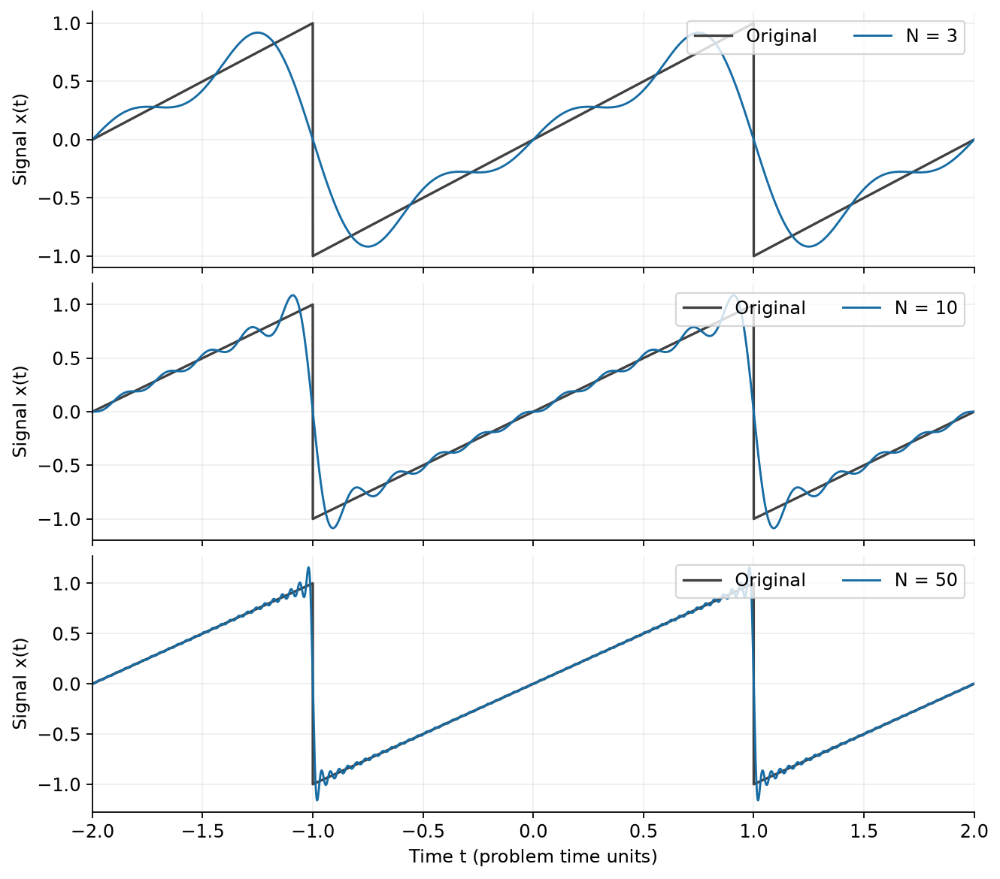
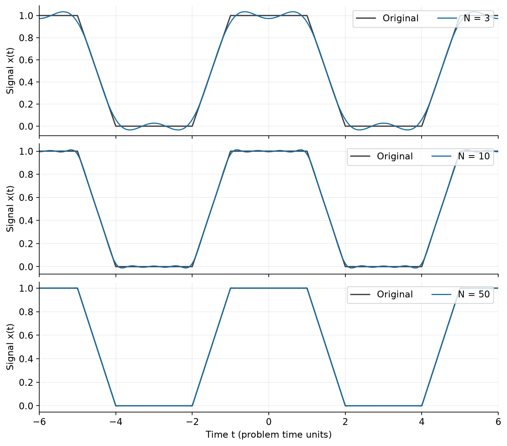
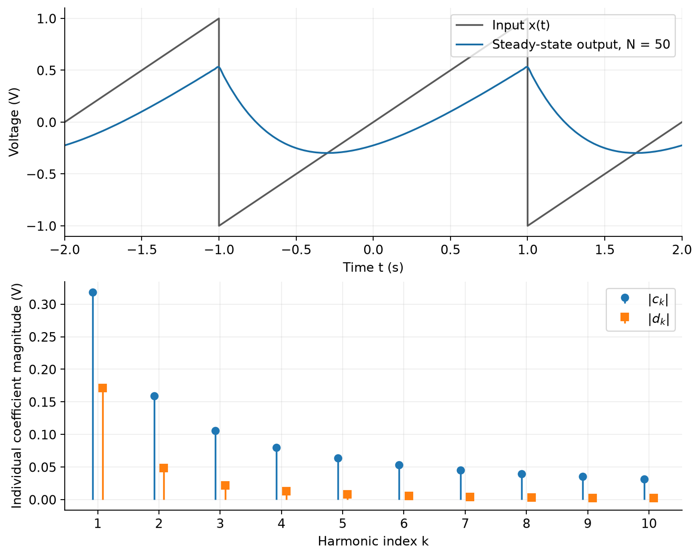
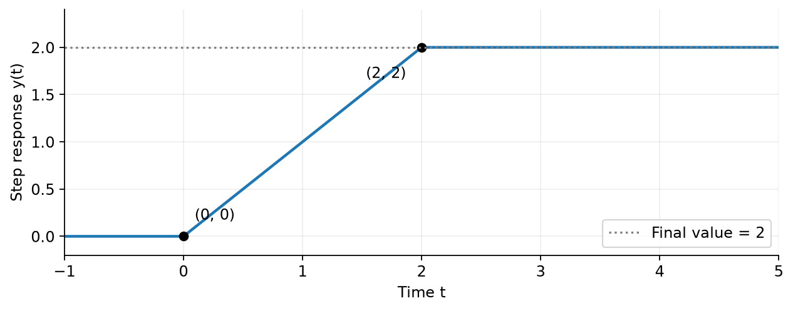
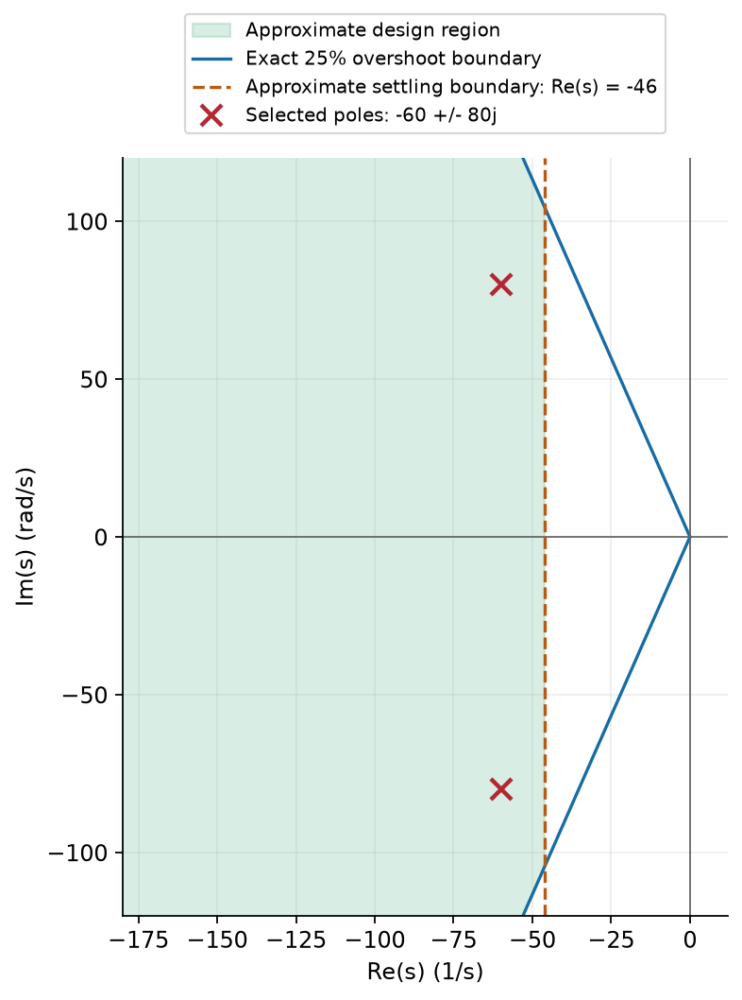
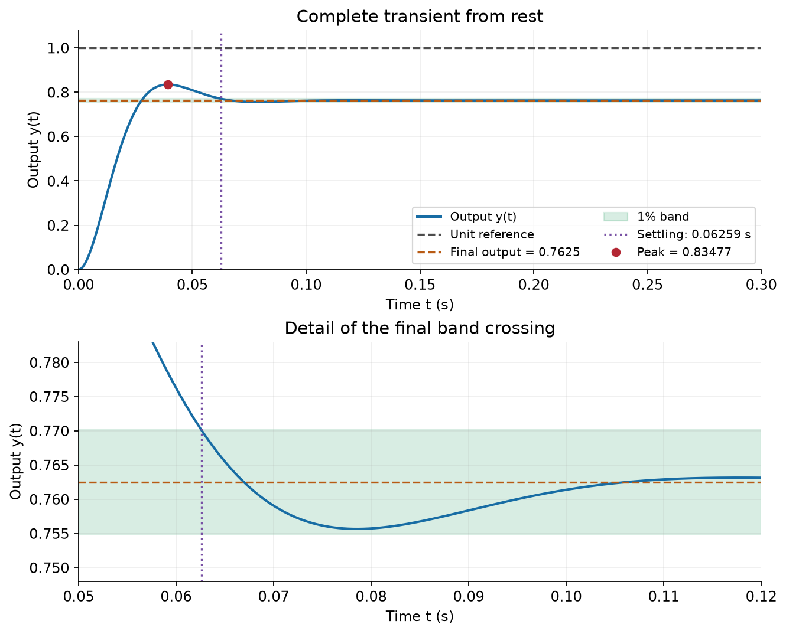

# ME404: Dynamics and Control of Mechanical Systems, Fall 2026
## Problem Set #2: Signals and Systems - Answer Key

The time origins and signal directions are those in the problem statement. We use $j^2=-1$, angular frequencies in radians per unit time, and zero initial conditions for transfer functions unless stated otherwise. All initial-value solutions below apply for $t\ge0$. Problem 5 gives one acceptable design; other designs that satisfy the stated requirements are equally valid.

### Problem #1

#### (Part A) Sawtooth wave

**(i) Period and waveform.** Successive downward jumps are two time units apart, so
$$
\boxed{T=2,\qquad \omega_0=\pi.}
$$
A convenient definition is
$$
x(t)=t\quad(-1\le t<1),\qquad x(t+2)=x(t).
$$
This chooses the value $-1$ at each jump. Any other assigned value at the jumps gives the same Fourier coefficients.

**(ii) Symmetry and coefficients.** Away from the jumps, $x(-t)=-x(t)$: the waveform is real and odd. Thus its mean is zero, and its nonzero Fourier coefficients must be purely imaginary, with $c_{-k}=-c_k$.

The mean is
$$
c_0=\frac12\int_{-1}^{1}t\,dt=0.
$$
For a nonzero integer $k$, expand the exponential and use odd/even symmetry:
$$
\begin{aligned}
c_k&=\frac12\int_{-1}^{1}t[\cos(k\pi t)-j\sin(k\pi t)]\,dt\\
&=-j\int_0^1 t\sin(k\pi t)\,dt.
\end{aligned}
$$
Integration by parts gives
$$
\int_0^1t\sin(k\pi t)\,dt
=\left[-\frac{t\cos(k\pi t)}{k\pi}
+\frac{\sin(k\pi t)}{(k\pi)^2}\right]_0^1
=-\frac{(-1)^k}{k\pi}.
$$
Therefore,
$$
\boxed{c_0=0,\qquad c_k=\frac{j(-1)^k}{k\pi}\quad(k\ne0).}
$$
These coefficients have zero real part, as predicted. In particular, $c_1=-j/\pi$ and $c_2=j/(2\pi)$; these signs depend on keeping the time origin fixed.

**(iii) Reconstruction and reality.** Directly,
$$
c_{-k}=\frac{j(-1)^{-k}}{-k\pi}
=-\frac{j(-1)^k}{k\pi}=\overline{c_k}.
$$
Each conjugate pair contributes a real quantity:
$$
c_ke^{jk\omega_0t}+c_{-k}e^{-jk\omega_0t}
=2\operatorname{Re}\{c_ke^{jk\omega_0t}\}.
$$
For this waveform,
$$
\boxed{x_N(t)=\frac{2}{\pi}\sum_{k=1}^{N}
\frac{(-1)^{k+1}}{k}\sin(k\pi t).}
$$
At every odd integer time the sum is zero, the midpoint of the jump from $1$ to $-1$. The figures use $N=3,10,50$, meaning $2N+1$ coefficient slots, including $c_0$.



#### (Part B) Slew-rate limited wave

**(i) Period and waveform.** The next rising ramp after $[-2,-1]$ occurs on $[4,5]$, so
$$
\boxed{T=6,\qquad \omega_0=\frac{\pi}{3}.}
$$
Keeping the time origin shown in the figure, use
$$
\boxed{x(t)=\begin{cases}
0,&-3\le t<-2,\\
t+2,&-2\le t<-1,\\
1,&-1\le t<1,\\
2-t,&1\le t<2,\\
0,&2\le t<3,
\end{cases}\qquad x(t+6)=x(t).}
$$
The pieces agree at each boundary, including the periodic boundary.

**(ii) Symmetry and coefficients.** The waveform is real and even. Consequently, its coefficients are real and satisfy $c_{-k}=c_k$. The two unit-base triangles contribute area $1$ in total and the plateau contributes area $2$, giving mean $3/6=1/2$:
$$
\boxed{c_0=\frac16\left(\frac12+2+\frac12\right)=\frac12.}
$$
For $k\ne0$, write $\alpha=k\pi/3$. Even symmetry reduces the integral to
$$
c_k=\frac13\left[\int_0^1\cos(\alpha t)\,dt
+\int_1^2(2-t)\cos(\alpha t)\,dt\right].
$$
The two integrals are
$$
\int_0^1\cos(\alpha t)\,dt=\frac{\sin\alpha}{\alpha},
$$
$$
\begin{aligned}
\int_1^2(2-t)\cos(\alpha t)\,dt
&=\left[\frac{(2-t)\sin(\alpha t)}{\alpha}
-\frac{\cos(\alpha t)}{\alpha^2}\right]_1^2\\
&=-\frac{\sin\alpha}{\alpha}
+\frac{\cos\alpha-\cos(2\alpha)}{\alpha^2}.
\end{aligned}
$$
The sine terms cancel. Hence
$$
\boxed{c_k=\frac{3}{\pi^2k^2}
\left[\cos\left(\frac{k\pi}{3}\right)
-\cos\left(\frac{2k\pi}{3}\right)\right],\quad k\ne0.}
$$
All nonzero even-index coefficients vanish. For odd $k$, the bracket is $-2$ when $k$ is a multiple of $3$ and $1$ otherwise. For example,
$$
c_1=\frac3{\pi^2},\quad c_2=0,\quad
c_3=-\frac2{3\pi^2},\quad c_5=\frac3{25\pi^2}.
$$
The real, even coefficient sequence and mean agree with the symmetry and area predictions.

**(iii) Reconstruction and reality.** Since the formula is real and even in $k$,
$$
c_{-k}=c_k=\overline{c_k},\qquad
\boxed{x_N(t)=\frac12+2\sum_{k=1}^{N}c_k\cos(k\pi t/3).}
$$



#### (Part C) Comparing the reconstructions

The sawtooth has jumps in its value and $|c_k|=1/(\pi|k|)$. The trapezoid is continuous, with jumps only in its slope; its nonzero coefficients decay as $1/k^2$. Thus, at the same $N$, the trapezoid reconstruction generally has smaller error and becomes accurate more quickly. Near a sawtooth jump, the oscillations become narrower as $N$ increases, but the limiting overshoot is about $8.95\%$ of the jump height, approximately $0.179$ for a jump of height $2$. This is the Gibbs phenomenon. The series converges to zero at the jump itself and to the waveform at each fixed continuity point. At a trapezoid corner, the value is continuous: the small rounding and ripples shrink to zero. Its $1/k^2$ coefficient bound gives an absolutely summable tail and uniform convergence of the signal reconstruction; there is no persistent Gibbs overshoot in its value.

#### (Part D) Sawtooth through an RC filter

**(i) Harmonic response.** Here $T=2\ \mathrm{s}$, $\omega_0=\pi\ \mathrm{rad/s}$, and $\tau=RC=0.5\ \mathrm{s}$. For an input term $c_ke^{jk\omega_0t}$, seek a particular response $d_ke^{jk\omega_0t}$. Substitution into $\tau\dot y+y=x$ gives
$$
(1+jk\omega_0\tau)d_ke^{jk\omega_0t}=c_ke^{jk\omega_0t}.
$$
Therefore,
$$
\boxed{d_k=G(jk\omega_0)c_k=\frac{c_k}{1+jk\pi/2}.}
$$
In particular,
$$
\boxed{d_0=0,\qquad
d_k=\frac{j(-1)^k}{\pi k(1+jk\pi/2)}\quad(k\ne0).}
$$
Each harmonic has frequency $k\omega_0$, so each experiences its own gain and phase. Multiplying every coefficient by $G(j\omega_0)$ would incorrectly treat all harmonics as having the fundamental frequency.

Because the circuit parameters are real,
$$
d_{-k}=\frac{\overline{c_k}}{1-jk\pi/2}
=\overline{\left(\frac{c_k}{1+jk\pi/2}\right)}
=\overline{d_k}.
$$
Thus the output is real. An equivalent real expression, useful for checking the code, is
$$
\boxed{y_{ss,N}(t)=\sum_{k=1}^{N}
\frac{(-1)^k}{1+(k\pi/2)^2}
\left[\cos(k\pi t)-\frac{2}{k\pi}\sin(k\pi t)\right].}
$$

**(ii) Output and coefficient plots.** The first panel below uses $N=50$. The stems in the second panel are individual complex-coefficient magnitudes:
$$
|c_k|=\frac1{\pi k},\qquad
|d_k|=\frac1{\pi k\sqrt{1+(k\pi/2)^2}},\qquad k=1,\ldots,10.
$$
The corresponding real sinusoid amplitudes would be $2|c_k|$ and $2|d_k|$.



**(iii) Smoothness and initial conditions.** At large $|k|$,
$$
|G(jk\pi)|\sim\frac2{\pi|k|},\qquad
\boxed{|d_k|\sim\frac2{\pi^2k^2}.}
$$
The filter adds a factor proportional to $1/|k|$ to the decay. The output therefore has $1/k^2$ coefficient decay, like the nonzero coefficients of the continuous trapezoid, rather than the sawtooth's $1/|k|$ decay.

A finite input step through a finite resistor produces finite current. Integrating the capacitor equation across a jump time $t_j$ yields
$$
\tau[y(t_j^+)-y(t_j^-)]+
\lim_{\epsilon\to0^+}\int_{t_j-\epsilon}^{t_j+\epsilon}y(t)\,dt
=\lim_{\epsilon\to0^+}\int_{t_j-\epsilon}^{t_j+\epsilon}x(t)\,dt=0.
$$
For bounded voltages both integrals vanish, so $y(t_j^+)=y(t_j^-)$. Its slope can jump: $\Delta\dot y=\Delta x/\tau=-4\ \mathrm{V/s}$ at each downward sawtooth jump. Thus the output has corners but no voltage jumps.

The harmonic sum constructs the periodic particular solution. A general response after switching on at $t=0$ is
$$
\boxed{y(t)=y_{ss}(t)+[y(0^+)-y_{ss}(0)]e^{-t/\tau},\quad t\ge0.}
$$
The transient enforces the actual initial capacitor voltage and decays because the pole is $-1/\tau=-2\ \mathrm{s}^{-1}$. Zero initial capacitor voltage is generally different from the initial value of the periodic solution.

**Independent time-domain check.** On $-1<t<1$, solve $0.5\dot y+y=t$:
$$
y_{ss}(t)=t-\frac12+A e^{-2(t+1)}.
$$
Continuity and periodicity require $y_{ss}(-1^+)=y_{ss}(1^-)$, so
$$
-\frac32+A=\frac12+Ae^{-4},\qquad A=\frac2{1-e^{-4}}.
$$
Hence, with periodic extension,
$$
\boxed{y_{ss}(t)=t-\frac12+
\frac{2e^{-2(t+1)}}{1-e^{-4}},\quad -1\le t<1.}
$$
In particular, $y_{ss}(0)=-1/2+1/\sinh 2\approx-0.2243\ \mathrm V$. If $y(0^+)=0$, the omitted initial transient is approximately $0.2243e^{-2t}\ \mathrm V$.

#### Code for Problem 1

The accompanying [Python plotting script](ps2-answers-plots.py) contains all waveform definitions and plotting commands. It produces the three figures above and checks the coefficients against numerical integration of the original waveforms. The core summation is:

```python
import numpy as np

def fourier_sum(t, N, period, coefficient):
    result = np.full_like(t, np.real(coefficient(0)), dtype=float)
    for k in range(1, N + 1):
        result += 2*np.real(coefficient(k)*np.exp(1j*k*2*np.pi*t/period))
    return result

def saw_coefficient(k):
    return 0.0 if k == 0 else 1j*(-1.0)**k/(np.pi*k)

def trapezoid_coefficient(k):
    if k == 0:
        return 0.5
    return 3*(np.cos(k*np.pi/3)-np.cos(2*k*np.pi/3))/(np.pi*k)**2

def output_coefficient(k):
    return saw_coefficient(k)/(1 + 0.5j*k*np.pi)

t = np.linspace(-2, 2, 12001)
x50 = fourier_sum(t, 50, 2, saw_coefficient)
y50 = fourier_sum(t, 50, 2, output_coefficient)
```

Here `np` is NumPy, a library for numerical arrays. `np.linspace` creates equally spaced times; arithmetic on the resulting array operates element by element. Python writes the imaginary unit as `1j` and powers with `**`. `range(1, N + 1)` visits $k=1,\ldots,N$. The factor $2\operatorname{Re}$ includes both positive and negative harmonics without storing complex-valued output. Use period `6` and times from `-6` to `6` for the trapezoid.

### Problem #2

For the unilateral transform, the derivative formulas are
$$
\mathcal L\{\dot y\}=sY-y(0),\qquad
\mathcal L\{\ddot y\}=s^2Y-sy(0)-\dot y(0).
$$

#### (a) $\ddot y+\dot y+3y=0$, $y(0)=1$, $\dot y(0)=2$

**Predict.** The natural poles satisfy $s^2+s+3=0$:
$$
\boxed{s=-\frac12\pm j\frac{\sqrt{11}}2.}
$$
Both have negative real part, so the response is an oscillation with decaying envelope. There are no forcing poles.

**Solve.** Transforming with the initial terms visible gives
$$
(s^2Y-s-2)+(sY-1)+3Y=0,
$$
$$
\boxed{Y(s)=\frac{s+3}{s^2+s+3}.}
$$
Complete the square and split the numerator:
$$
Y(s)=\frac{s+1/2}{(s+1/2)^2+11/4}
+\frac{5/2}{(s+1/2)^2+11/4}.
$$
Using the exponentially weighted cosine and sine transform pairs,
$$
\boxed{y(t)=e^{-t/2}\left[
\cos\left(\frac{\sqrt{11}}2t\right)
+\frac5{\sqrt{11}}\sin\left(\frac{\sqrt{11}}2t\right)\right].}
$$

**Verify.** Let $b=\sqrt{11}/2$. Differentiating gives
$$
\dot y=e^{-t/2}\left[2\cos(bt)-\frac8{\sqrt{11}}\sin(bt)\right],
$$
$$
\ddot y=e^{-t/2}\left[-5\cos(bt)-\frac7{\sqrt{11}}\sin(bt)\right].
$$
Thus $y(0)=1$ and $\dot y(0)=2$. In $\ddot y+\dot y+3y$, the cosine coefficient is $-5+2+3=0$ and the sine coefficient is $(-7-8+15)/\sqrt{11}=0$. The envelope decays as $e^{-t/2}$, as predicted.

#### (b) $\ddot y+\dot y=\sin t$, $y(0)=1$, $\dot y(0)=2$

**Predict.** The homogeneous characteristic equation is $s(s+1)=0$, giving natural poles $0$ and $-1$. Its constant mode persists and its exponential mode decays. The sinusoidal forcing introduces poles $\pm j$ into $Y(s)$; these are distinct from the natural poles and produce a persistent sinusoid, with no resonance.

**Solve.** The transformed equation is
$$
(s^2Y-s-2)+(sY-1)=\frac1{s^2+1}.
$$
Hence
$$
\boxed{Y(s)=\frac{s+3+1/(s^2+1)}{s(s+1)}
=\frac{s^3+3s^2+s+4}{s(s+1)(s^2+1)}.}
$$
Write
$$
Y(s)=\frac A s+\frac B{s+1}+\frac{Cs+D}{s^2+1}.
$$
Cover-up at the real simple poles gives
$$
A=\left.sY(s)\right|_{s=0}=4,\qquad
B=\left.(s+1)Y(s)\right|_{s=-1}=-\frac52.
$$
After multiplying through by the common denominator,
$$
s^3+3s^2+s+4
=4(s+1)(s^2+1)-\frac52s(s^2+1)+(Cs+D)s(s+1).
$$
Matching the $s^3$ and $s$ coefficients gives
$$
4-\frac52+C=1,\qquad 4-\frac52+D=1,
$$
so $C=D=-1/2$. Thus
$$
Y(s)=\frac4s-\frac{5}{2(s+1)}
-\frac{s}{2(s^2+1)}-\frac1{2(s^2+1)},
$$
$$
\boxed{y(t)=4-\frac52e^{-t}-\frac12\cos t-\frac12\sin t.}
$$

**Verify.** The derivatives are
$$
\dot y=\frac52e^{-t}+\frac12\sin t-\frac12\cos t,\qquad
\ddot y=-\frac52e^{-t}+\frac12\cos t+\frac12\sin t.
$$
Then $y(0)=4-5/2-1/2=1$, $\dot y(0)=5/2-1/2=2$, and $\ddot y+\dot y=\sin t$. Only the exponential decays; the constant and the forced sinusoid persist. The response is bounded but has no final limit.

#### (c) $\ddot y+y=t$, $y(0)=1$, $\dot y(0)=-1$

**Predict.** The natural poles are $\pm j$, giving undamped homogeneous oscillations. The ramp forcing introduces a double pole at $s=0$ into $Y(s)$ and an unbounded ramp contribution in time.

**Solve.** Transforming gives
$$
(s^2Y-s+1)+Y=\frac1{s^2},
$$
$$
\boxed{Y(s)=\frac{s-1+1/s^2}{s^2+1}
=\frac{s^3-s^2+1}{s^2(s^2+1)}.}
$$
The repeated pole requires both powers:
$$
Y(s)=\frac A s+\frac B{s^2}+\frac{Cs+D}{s^2+1}.
$$
Multiplication by $s^2(s^2+1)$ yields
$$
s^3-s^2+1=As(s^2+1)+B(s^2+1)+(Cs+D)s^2.
$$
Matching powers gives
$$
A+C=1,\quad B+D=-1,\quad A=0,\quad B=1,
$$
so $C=1$ and $D=-2$. Consequently,
$$
Y(s)=\frac1{s^2}+\frac{s}{s^2+1}-\frac2{s^2+1},
\qquad
\boxed{y(t)=t+\cos t-2\sin t.}
$$

**Verify.** Here
$$
\dot y=1-\sin t-2\cos t,\qquad
\ddot y=-\cos t+2\sin t.
$$
Thus $y(0)=1$, $\dot y(0)=-1$, and $\ddot y+y=t$. The natural oscillations persist, while the forcing adds the growing term $t$, consistent with the prediction.

#### (d) Initial-condition effects

Let $\delta y$ be the difference between two responses with the same forcing and different initial conditions. Subtracting their equations removes the forcing, so $\delta y$ satisfies the homogeneous equation.

| System | Difference between responses | Long-time initial-condition effect |
| --- | --- | --- |
| (a) | $e^{-t/2}[A\cos(bt)+B\sin(bt)]$, $b=\sqrt{11}/2$ | Every initial-condition effect decays. |
| (b) | $A+Be^{-t}$ | A constant offset can persist. |
| (c) | $A\cos t+B\sin t$ | An undamped oscillation can persist. |

For (b), specifically, $A=\delta y(0)+\delta\dot y(0)$ and $B=-\delta\dot y(0)$. Only special differences with $A=0$ decay completely. A positive coefficient on $\dot y$ is therefore **not sufficient** to make every initial-condition effect decay: (b) still has a natural pole at zero. In (c), the growing ramp is caused by the forcing; the persistent initial-condition effect is oscillatory.

#### (e) Optional: final values

For these rational transforms, the Final Value Theorem applies if every pole of the reduced expression $sY(s)$ lies strictly in the open left half-plane.

**(a)**
$$
sY(s)=\frac{s(s+3)}{s^2+s+3}.
$$
Its poles are $-1/2\pm j\sqrt{11}/2$, so the theorem applies:
$$
\boxed{y(\infty)=\lim_{s\to0}sY(s)=0.}
$$

**(b)**
$$
sY(s)=4-\frac{5s}{2(s+1)}-\frac{s(s+1)}{2(s^2+1)}.
$$
The poles at $\pm j$ violate the theorem's condition. Although
$$
\boxed{\lim_{s\to0}sY(s)=4,}
$$
the time response approaches an oscillation about $4$, not a constant. A finite algebraic limit at $s=0$ alone does not establish a time-domain final value.

**(c)**
$$
sY(s)=\frac1s+\frac{s(s-2)}{s^2+1}.
$$
There are poles at $0$ and $\pm j$, so the theorem does not apply. The explicit response $t+\cos t-2\sin t$ tends to $+\infty$ and has no finite final value.

### Problem #3

#### (a) Convolution and the unit-step response

For an initially resting LTI system,
$$
y(t)=\int_{-\infty}^{\infty}u(\tau)h(t-\tau)\,d\tau.
$$
The unit-step input is nonzero when $\tau\ge0$. The impulse-response factor is nonzero when
$$
0\le t-\tau\le2
\quad\Longleftrightarrow\quad t-2\le\tau\le t.
$$
The overlap is therefore $[0,\infty)\cap[t-2,t]$. On this overlap the integrand is $1$.

| Time range | Overlap in $\tau$ | Integral |
| --- | --- | --- |
| $t<0$ | Empty | $0$ |
| $0\le t<2$ | $[0,t]$ | $\int_0^t1\,d\tau=t$ |
| $t\ge2$ | $[t-2,t]$ | $\int_{t-2}^t1\,d\tau=2$ |

At $t=0$, the overlap is a single point and has zero length. Thus
$$
\boxed{y(t)=\begin{cases}
0,&t<0,\\
t,&0\le t<2,\\
2,&t\ge2.
\end{cases}}
$$
The sketch starts at $(0,0)$, rises with slope $1$ to $(2,2)$, and remains at its final value $2$.



#### (b) Transfer function from the integral

Direct evaluation gives
$$
H(s)=\int_0^2 e^{-st}\,dt
=\left[-\frac{e^{-st}}s\right]_0^2,
$$
$$
\boxed{H(s)=\frac{1-e^{-2s}}s\quad(s\ne0),\qquad H(0)=2.}
$$
The apparent singularity at zero is removable: the original integral equals $2$ at $s=0$. In fact, the finite integration interval makes the transform finite for every finite complex $s$.

#### (c) Recovering the step response by Laplace transforms

Since $U(s)=1/s$,
$$
Y(s)=H(s)U(s)=\frac{1-e^{-2s}}{s^2}.
$$
The undelayed term gives $t\,1(t)$. The time-delay property gives
$$
\mathcal L^{-1}\!\left\{\frac{e^{-2s}}{s^2}\right\}
=(t-2)1(t-2).
$$
Both the ramp argument and its switching time shift. Hence
$$
\boxed{y(t)=t\,1(t)-(t-2)1(t-2)
=\begin{cases}0,&t<0,\\t,&0\le t<2,\\2,&t\ge2.\end{cases}}
$$
This agrees with convolution. At $t=2$, the delayed ramp starts at zero, so it cannot create a jump in $y$. The one-sided values are both $2$, while the slope changes from $1$ to $0$. Equivalently, away from the corners, $\dot y=h$; integrating a bounded step discontinuity produces a continuous corner.

### Problem #4

All intermediate variables below are Laplace-domain signals; the argument $(s)$ on each block is suppressed for readability. Denominators are assumed to define well-posed interconnections as stated in the problem.

#### (a) Local feedback and parallel feedforward

Let $V$ be the output of $G_1$. The feedback is taken from $V$, before the final addition:
$$
E=R-V,\qquad V=G_1E,\qquad Y=V+G_2R.
$$
Eliminating $E$ gives $(1+G_1)V=G_1R$, so
$$
\boxed{T(s)=\frac{G_1}{1+G_1}+G_2
=\frac{G_1+G_2+G_1G_2}{1+G_1}.}
$$
**Check $G_2=0$.** The diagram leaves only the local unity negative-feedback loop around $G_1$. The formula reduces to $T=G_1/(1+G_1)$, as expected.

#### (b) Two local feedback loops

Let $V$ and $W$ be the outputs of $G_1$ and $G_4$, respectively. Then
$$
V=G_1(R-G_2V),\qquad
W=G_4(G_3V-G_5W),\qquad Y=G_6W+G_7R.
$$
The first two equations give
$$
\frac VR=\frac{G_1}{1+G_1G_2},\qquad
W=\frac{G_4}{1+G_4G_5}G_3V.
$$
Consequently,
$$
\boxed{T(s)=\frac{G_1G_3G_4G_6}
{(1+G_1G_2)(1+G_4G_5)}+G_7.}
$$
**Check $G_7=0$.** The upper feedforward path vanishes. The surviving path is the first closed loop, $G_3$, the second closed loop, and $G_6$ in cascade. Multiplying those four transfer functions gives exactly the first term above.

#### (c) Feedforward into and around a feedback loop

**Block reduction.** First reduce the unity-feedback loop around $G_2$ to
$$
F_2=\frac{G_2}{1+G_2}.
$$
The signal from the main path entering the next summing junction is $G_3F_2G_1R$. The path through $G_6$ enters that same junction, so their combined external input to the $G_4$ loop is $(G_3F_2G_1+G_6)R$. Reduce the unity-feedback loop around $G_4$ to
$$
F_4=\frac{G_4}{1+G_4}.
$$
After $G_5$ and the final addition of $G_7R$,
$$
\boxed{T(s)=G_5\frac{G_4}{1+G_4}
\left(\frac{G_1G_2G_3}{1+G_2}+G_6\right)+G_7.}
$$

**Independent signal equations.** Let $E_2$ and $E_4$ be the summing-junction outputs entering $G_2$ and $G_4$, and let $V_2$ and $V_4$ be those blocks' outputs. Read directly from the diagram:
$$
\begin{aligned}
E_2&=G_1R-V_2,&V_2&=G_2E_2,\\
E_4&=G_3V_2+G_6R-V_4,&V_4&=G_4E_4,\\
Y&=G_5V_4+G_7R.
\end{aligned}
$$
Eliminate the junction signals:
$$
(1+G_2)V_2=G_1G_2R,
$$
$$
(1+G_4)V_4=G_4(G_3V_2+G_6R).
$$
Substitute the first expression into the second, then into $Y$:
$$
\frac YR=\frac{G_1G_2G_3G_4G_5}{(1+G_2)(1+G_4)}
+\frac{G_4G_5G_6}{1+G_4}+G_7,
$$
which agrees with the block reduction.

**Check $G_3=0$.** The main path into the second summing junction vanishes. The surviving contributions are $R\to G_6\to$ the closed $G_4$ loop $\to G_5\to Y$, and $R\to G_7\to Y$. The result reduces to
$$
\boxed{T(s)\big|_{G_3=0}=\frac{G_4G_5G_6}{1+G_4}+G_7.}
$$
The $G_6$ contribution enters before $G_4$ and is included in the signal returned by its feedback path, so it contains the factor $1/(1+G_4)$. The $G_7$ contribution is added after the feedback takeoff and never enters that loop.

### Problem #5

#### (a) Closed-loop transfer function and parameters

The open-loop transfer function is
$$
L(s)=C(s)P(s)=\frac{100K}{(s+a)(s+25)}.
$$
Using unity negative feedback,
$$
\boxed{T(s)=\frac{L(s)}{1+L(s)}
=\frac{100K}{s^2+(a+25)s+25a+100K}.}
$$
Match the denominator to $s^2+2\zeta\omega_ns+\omega_n^2$:
$$
\boxed{\omega_n=\sqrt{25a+100K},\qquad
\zeta=\frac{a+25}{2\sqrt{25a+100K}},}
$$
$$
\boxed{\sigma=\zeta\omega_n=\frac{a+25}{2},\qquad
T(0)=\frac{100K}{25a+100K}.}
$$
For $K,a>0$, both denominator coefficients are positive, so the second-order closed loop is stable. Its step final value is $y_\infty=T(0)$, strictly between $0$ and $1$.

#### (b) Overshoot and approximate pole region

For an underdamped, zero-free second-order system, scaling the step response by $y_\infty$ leaves the overshoot ratio unchanged:
$$
M_p=\frac{y_{\mathrm{peak}}-y_\infty}{y_\infty}
=e^{-\pi\zeta/\sqrt{1-\zeta^2}}.
$$
The requirement $M_p\le0.25$ gives
$$
\frac{\pi\zeta}{\sqrt{1-\zeta^2}}\ge\ln4,
$$
$$
\pi^2\zeta^2\ge(\ln4)^2(1-\zeta^2),
$$
$$
\boxed{\zeta\ge\zeta_{\min}
=\frac{\ln4}{\sqrt{\pi^2+(\ln4)^2}}
\approx0.403713.}
$$
This overshoot constraint is exact for the present underdamped transfer function.

The approximate $1\%$ settling-time rule gives the initial design constraint
$$
\frac{4.6}{\sigma}\le0.1
\quad\Longrightarrow\quad
\boxed{\sigma\ge46\ \mathrm{s}^{-1},\qquad a\ge67\ \mathrm{s}^{-1}.}
$$
For poles $s=-\sigma\pm j\omega_d$, the approximate design region is
$$
\boxed{\operatorname{Re}s\le-46,\qquad
|\operatorname{Im}s|\le(-\operatorname{Re}s)\frac{\pi}{\ln4}.}
$$
The overshoot wedge has half-angle $\cos^{-1}\zeta_{\min}\approx66.19^\circ$ measured from the negative real axis. The vertical settling boundary is approximate: passing this geometric check does not by itself prove that the true settling time is at most $0.1$ s.



#### (c) One acceptable design

Choose $\zeta=0.6$ and $\omega_n=100\ \mathrm{rad/s}$. Then $\sigma=60\ \mathrm{s}^{-1}$, comfortably inside the approximate region. Solve the matching equations:
$$
a=2\zeta\omega_n-25=120-25=95,
$$
$$
K=\frac{\omega_n^2-25a}{100}
=\frac{10000-2375}{100}=76.25.
$$
Thus
$$
\boxed{a=95,\qquad K=76.25,\qquad
T(s)=\frac{7625}{s^2+120s+10000}.}
$$
The closed-loop poles are
$$
\boxed{s=-60\pm j80\ \mathrm{s}^{-1}.}
$$
Separately, the compensator is
$$
\boxed{C(s)=\frac{76.25}{s+95},\qquad
\text{compensator pole}=-95\ \mathrm{s}^{-1},\qquad
C(0)=\frac{76.25}{95}\approx0.802632.}
$$
The numerator parameter $K$ is not the compensator's DC gain.

#### (d) Response and verification

The final output is
$$
\boxed{y_\infty=T(0)=\frac{7625}{10000}=0.7625.}
$$
For the unit step,
$$
Y(s)=\frac{7625}{s[(s+60)^2+80^2]}
=0.7625\left[\frac1s-
\frac{s+60}{(s+60)^2+80^2}
-\frac{60}{(s+60)^2+80^2}\right].
$$
Inverting gives the complete response from rest:
$$
\boxed{y(t)=0.7625\left[1-e^{-60t}
\left(\cos80t+\frac34\sin80t\right)\right],\quad t\ge0.}
$$
It has $y(0)=0$ and $\dot y(0)=0$. Differentiation gives
$$
\dot y(t)=0.7625\frac{10000}{80}e^{-60t}\sin80t.
$$
The first maximum therefore occurs at $t_p=\pi/80$. Predicted metrics are
$$
\boxed{M_p=e^{-3\pi/4}\approx0.0947802
\quad\Longrightarrow\quad \mathrm{PO}\approx9.47802\%,}
$$
$$
\boxed{t_p\approx0.0392699\ \mathrm{s},\qquad
y_{\mathrm{peak}}=0.7625(1+e^{-3\pi/4})\approx0.8347699.}
$$
The approximate settling time is $4.6/60\approx0.0766667$ s. A rigorous envelope bound follows from the amplitude of $\cos80t+(3/4)\sin80t$:
$$
\frac{|y(t)-y_\infty|}{y_\infty}
\le\frac{e^{-60t}}{\sqrt{1-0.6^2}}=1.25e^{-60t}.
$$
Thus the response is guaranteed to remain inside the $1\%$ band for
$$
\boxed{t\ge t_{s,\mathrm{env}}
=\frac{\ln125}{60}\approx0.0804719\ \mathrm{s}<0.1\ \mathrm{s}.}
$$
This also verifies the settling requirement independently of the grid calculation.

The actual band is
$$
\boxed{0.754875\le y(t)\le0.770125.}
$$
Simulation with a $10^{-5}$ s spacing on $0\le t\le0.3$ s gives a last band crossing between $0.06258$ and $0.06259$ s. Refining that crossing with the exact response gives
$$
\boxed{t_s\approx0.0625864105\ \mathrm{s}.}
$$
This crossing is on the return from the first peak through the upper band edge. The second extremum's relative deviation is $e^{-3\pi/2}\approx0.0089833<0.01$, and later extrema are smaller. Consequently, no later excursion leaves the band. The numerical simulation also agrees with the exact response throughout the plotted interval.

| Quantity | Prediction | Numerical verification |
| --- | --- | --- |
| Final output | $0.7625$ | Response converges to $0.7625$. |
| Percent overshoot | $9.47802\%$ | $9.47802\%$, below $25\%$. |
| Peak time | $0.0392699$ s | Sampled maximum at $0.03927$ s. |
| $1\%$ settling time | Estimate $0.0766667$ s; upper bound $0.0804719$ s | $0.0625864$ s, below $0.1$ s. |



The following core calculation is included in the [complete plotting script](ps2-answers-plots.py). SciPy's `step` simulates the transfer function. The last out-of-band sample brackets the settling time, and `brentq` refines that bracket by solving a scalar equation. The theoretical envelope and later extrema establish continued settling beyond the finite simulation horizon.

```python
import numpy as np
from scipy.signal import TransferFunction, step
from scipy.optimize import brentq

K, a = 76.25, 95.0
system = TransferFunction([100*K], [1, a+25, 25*a+100*K])
t = np.linspace(0, 0.3, 30001)
t, y = step(system, T=t)
y_final = 100*K/(25*a + 100*K)
tolerance = 0.01                    # Required 1% criterion
outside = np.flatnonzero(np.abs(y-y_final) > tolerance*abs(y_final))
last = outside[-1]                 # Python index -1 means last entry
assert last < len(t)-1             # Response has reentered the band

def exact_response(t):
    return y_final*(1-np.exp(-60*t)*(np.cos(80*t)+0.75*np.sin(80*t)))

ts = brentq(lambda t: abs(exact_response(t)-y_final)
            - tolerance*abs(y_final), t[last], t[last+1])
percent_overshoot = 100*(np.max(y)-y_final)/abs(y_final)
print(percent_overshoot, ts)
```

In Python, square brackets construct a list of polynomial coefficients in descending powers of $s$. `np.abs` takes elementwise absolute values; `np.flatnonzero` returns the indices at which the condition is true. `lambda t: ...` defines the one-input function passed to the root finder. The exact-response function above is specific to this chosen design.

#### (e) Steady-state tracking error

For a unit reference,
$$
\boxed{e_\infty=1-y_\infty=1-0.7625=0.2375.}
$$
The output settles with a $23.75\%$ error relative to the commanded value. Meeting the overshoot and settling-time specifications does not guarantee accurate reference tracking: both specifications here describe the transient relative to the actual final output. Indeed, even the peak $0.83477$ is below the reference $1$. A separate steady-state accuracy requirement would be needed to rule out this design.

### Reproducing the figures and checks

Install the numerical packages in your Python environment and run the accompanying script from this directory:

```sh
python -m pip install numpy scipy matplotlib
python ps2-answers-plots.py
```

It saves six figures in `ps2-answers-figures/`. In addition to plotting, it checks the Fourier coefficients by quadrature, compares the reconstructed RC output with the independent time-domain solution, compares the simulated controller response with its exact expression, and reports the $1\%$ settling measurement.

The separate [symbolic verification script](ps2-answers-checks.py) uses SymPy to check the Fourier integrals, transformed IVPs, initial conditions, differential-equation residuals, convolution transform, and block-diagram eliminations:

```sh
python -m pip install sympy
python ps2-answers-checks.py
```

### References

- Oppenheim, Willsky, and Nawab, *Signals and Systems*, 2nd ed., §§2.2 and 2.3.8 (convolution and step response), §§3.2-3.4 and 3.8 (exponential response, Fourier coefficients, convergence, and filtering), and Problem 3.22 (source waveforms).
- Franklin, Powell, and Emami-Naeini, *Feedback Control of Dynamic Systems*, 8th and 7th eds., §§3.1-3.4 (Laplace transforms, block diagrams, natural responses, and time-domain specifications). Problem 5 is adapted from Problem 3.26 in the 8th edition, corresponding to Problem 3.27 in the 7th edition. In both editions, Eq. (3.73) supplies the approximate settling-time rule; the actual band crossing and the envelope bound are evaluated explicitly above.
