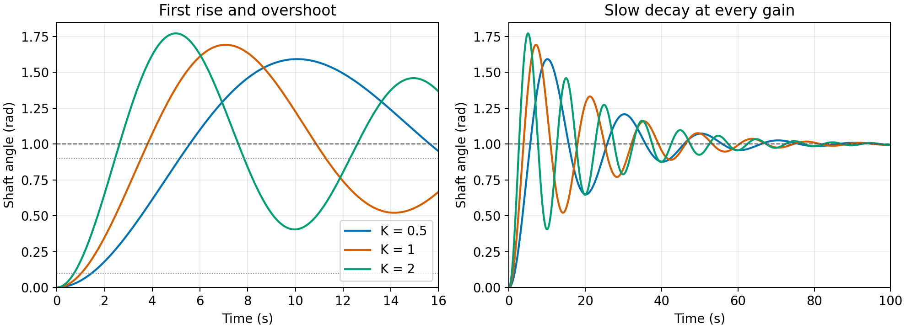
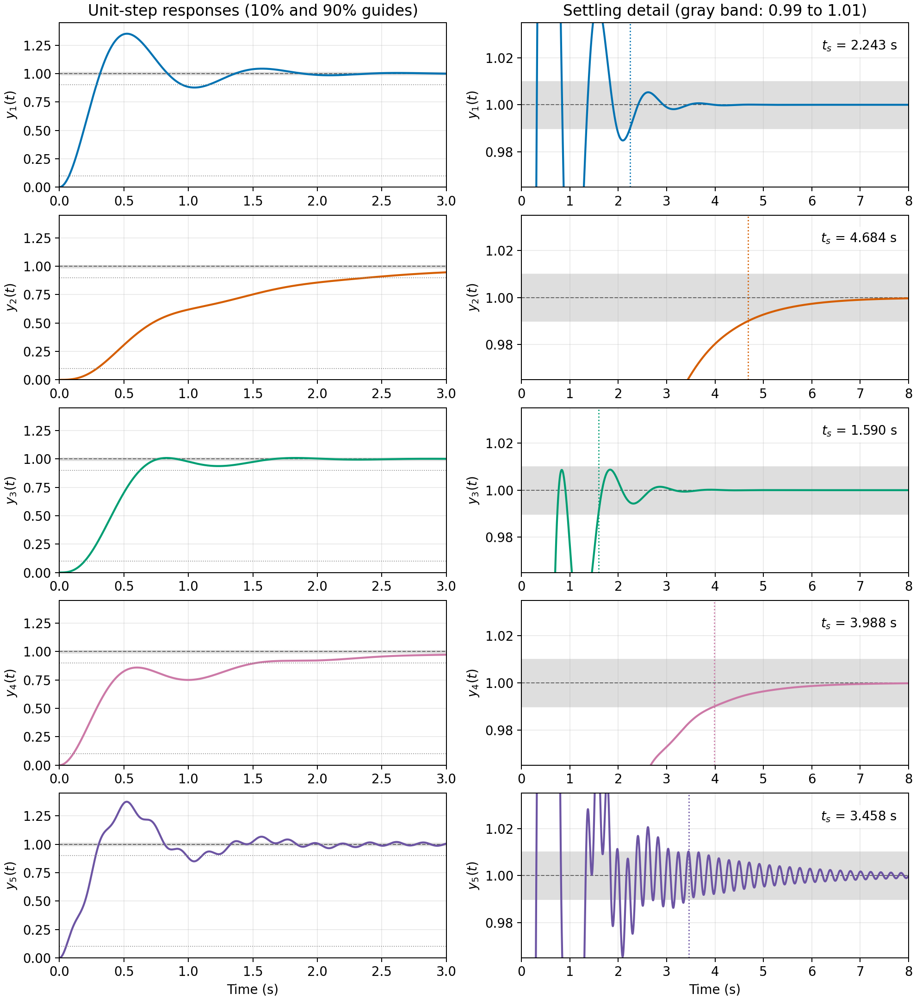

# ME404: Dynamics and Control of Mechanical Systems, Fall 2026
## Problem Set #3: Dynamic Response, Stability, and Feedback — Answer Key

This key follows the notation and diagrams in [Problem Set 3](ps3.md). Angles are in radians, and transfer functions use zero initial conditions. For Problems 1 and 2, rise time means the **first 10% to first 90% crossings** of the final output, overshoot is measured relative to that final output, and settling time uses a **1% band**. Numerical response specifications below are computed from the complete transfer functions.

### Problem #1: DC Motor Position Control

First evaluate the two constant combinations in the equation of motion:
$$
b_{\mathrm{eff}}=b+\frac{K_tK_e}{R_a}
=0.001+\frac{0.02(0.02)}{10}=0.00104,
\qquad
\frac{K_t}{R_a}=0.002.
$$
Thus the numerical equation, using SI units, is
$$
0.01\ddot\theta_m+0.00104\dot\theta_m=0.002v_a,
\qquad\text{or}\qquad
\ddot\theta_m+0.104\dot\theta_m=0.2v_a.
$$
The back-emf term contributes to the effective damping and must be retained.

#### (a) Voltage-to-speed transfer function

Define $\omega_m=\dot\theta_m$. Taking the Laplace transform of
$\dot\omega_m+0.104\omega_m=0.2v_a$ gives
$$
(s+0.104)\Omega_m(s)=0.2V_a(s).
$$
Therefore,
$$
\boxed{\frac{\Omega_m(s)}{V_a(s)}=\frac{0.2}{s+0.104}.}
$$

#### (b) Steady-state speed at 10 V

The speed transfer function has a stable pole at $-0.104$. With $V_a(s)=10/s$, the final value theorem gives
$$
\omega_m(\infty)=\lim_{s\to0}s\frac{0.2}{s+0.104}\frac{10}{s}
=\frac{2}{0.104}.
$$
Hence
$$
\boxed{\omega_m(\infty)=\frac{250}{13}\approx19.2308\ \mathrm{rad/s}.}
$$
Equivalently, set acceleration to zero in the equation of motion:
$0.00104\omega_m=0.002(10)$. The complete speed response from rest is
$\omega_m(t)=(250/13)(1-e^{-0.104t})$ for $t\ge0$.

#### (c) Voltage-to-position transfer function

Since $\Omega_m=s\Theta_m$ for zero initial angle,
$$
\boxed{P(s)=\frac{\Theta_m(s)}{V_a(s)}
=\frac{0.2}{s(s+0.104)}.}
$$
A constant nonzero voltage produces a nonzero final speed, so the open-loop position does not approach a finite limit.

#### (d) Closed-loop position servo

Substitute $V_a=K(\Theta_r-\Theta_m)$ into $\Theta_m=PV_a$:
$$
(1+KP)\Theta_m=KP\Theta_r.
$$
Thus
$$
\boxed{T_K(s)=\frac{\Theta_m(s)}{\Theta_r(s)}
=\frac{KP}{1+KP}
=\frac{0.2K}{s^2+0.104s+0.2K}.}
$$
For $K>0$, both coefficients of the monic second-order denominator are positive, so the servo is asymptotically stable. Also, $T_K(0)=1$: a unit-step reference has final position 1 rad.

Comparing with $\omega_n^2/(s^2+2\zeta\omega_ns+\omega_n^2)$,
$$
\boxed{\omega_n=\sqrt{0.2K},\qquad
\zeta=\frac{0.052}{\sqrt{0.2K}},\qquad
\sigma=\zeta\omega_n=0.052\ \mathrm{s}^{-1}.}
$$
The gain $K$ has units of V/rad. Critical damping occurs at
$$
K_{\mathrm{crit}}=\frac{0.052^2}{0.2}=0.01352.
$$
For $K>K_{\mathrm{crit}}$, the poles are $-0.052\pm j\omega_d$, with
$\omega_d=\sqrt{0.2K-0.052^2}$.

#### (e) Gain bound for less than 20% overshoot

For $0<\zeta<1$, use the fractional overshoot
$$
M_p=e^{-\pi\zeta/\sqrt{1-\zeta^2}}.
$$
The strict inequality $M_p<0.2$ requires
$$
\frac{\pi\zeta}{\sqrt{1-\zeta^2}}>\ln5
\quad\Longrightarrow\quad
\zeta^2>\frac{(\ln5)^2}{\pi^2+(\ln5)^2}.
$$
Consequently,
$$
\zeta>\zeta_{\min}
=\frac{\ln5}{\sqrt{\pi^2+(\ln5)^2}}
\approx0.45594981,
$$
and
$$
K<\frac{0.052^2}{0.2\zeta_{\min}^2}
=\frac{0.052^2}{0.2}\left(1+\frac{\pi^2}{(\ln5)^2}\right).
$$
For $0<K\le K_{\mathrm{crit}}$, the response is monotone and has zero overshoot. Combining the cases,
$$
\boxed{0<K<K_{20},\qquad K_{20}\approx0.06503432\ \mathrm{V/rad}.}
$$
The endpoint $K_{20}$ gives exactly 20% overshoot and is excluded. It is an upper bound, not an attained maximum for the strict specification.

#### (f) Gain range for rise time less than 4 s

**Using the standard approximation.** The moderate-damping fit
$t_r\approx1.8/\omega_n$ gives
$$
\frac{1.8}{\sqrt{0.2K}}<4
\quad\Longrightarrow\quad
\boxed{K>1.0125\ \mathrm{V/rad}\quad\text{(estimate)}.}
$$
This fit is inaccurate at the small damping ratios associated with these gains. It does not give the actual boundary of the acceptable gain range.

**Using the actual 10–90% crossings.** On the underdamped branch, the unit-step response is
$$
y_K(t)=1-e^{-0.052t}\left[
\cos(\omega_dt)+\frac{0.052}{\omega_d}\sin(\omega_dt)
\right],\qquad
\omega_d=\sqrt{0.2K-0.052^2}.
$$
For $\alpha=0.1,0.9$, find the first solution $t_\alpha$ of
$$
e^{-0.052t_\alpha}\left[
\cos(\omega_dt_\alpha)+\frac{0.052}{\omega_d}\sin(\omega_dt_\alpha)
\right]=1-\alpha.
$$
Both roots lie between 0 and the first peak time $\pi/\omega_d$: the response increases throughout this interval. Numerically solve
$$
t_{0.9}(K)-t_{0.1}(K)=4.
$$
This gives $K_\star\approx0.43408170$. Evaluating the first crossings as $K$ varies gives
$$
\boxed{K>K_\star\approx0.43408170\ \mathrm{V/rad}.}
$$
This is a numerical boundary obtained from the exact response, rather than from the rise-time fit. The critically damped and overdamped responses are slower and do not satisfy the specification. At $K=K_\star$, the rise time is exactly 4 s, so that endpoint is excluded.

There is **no gain satisfying both** parts (e) and (f): $K<K_{20}$ and $K>K_\star$ are disjoint.

#### (g) Step responses for $K=0.5,1,2$

For these underdamped responses, the first peak is the largest, and
$$
t_p=\frac{\pi}{\omega_d},\qquad
M_p=e^{-0.052\pi/\omega_d}.
$$
The plot readings, with more precise values obtained from the crossings, are:

| $K$ (V/rad) | $\zeta$ | $t_{0.1}$ (s) | $t_{0.9}$ (s) | $t_r$ (s) | Overshoot |
| --- | --- | --- | --- | --- | --- |
| $0.5$ | $0.1644$ | $1.46295$ | $5.15092$ | $3.68797$ | $59.23\%$ |
| $1$ | $0.1163$ | $1.02673$ | $3.52947$ | $2.50274$ | $69.23\%$ |
| $2$ | $0.0822$ | $0.72219$ | $2.44276$ | $1.72057$ | $77.17\%$ |



All three gains exceed the bound in (e), and all three overshoots exceed 20%. All three gains exceed the numerical threshold in (f), and all three rise times are less than 4 s. The approximate threshold $K>1.0125$ misses the acceptable cases $K=0.5$ and $K=1$ because the damping is far below the range where the fit is accurate.

Increasing $K$ raises the oscillation frequency and reduces rise time, while the pole real part remains $-0.052$. This explains the persistent slow decay in all three curves.

The following MATLAB code reproduces the response plots and measurements. `stepinfo` receives the known final value explicitly; using the last sample as the final value would introduce an avoidable error.

```matlab
s = tf('s');
gains = [0.5 1 2];
t = (0:0.002:200)';
figure; hold on
for k = gains
    T = 0.2*k/(s^2 + 0.104*s + 0.2*k);
    y = step(T,t);
    info = stepinfo(y,t,1,'RiseTimeLimits',[0.1 0.9], ...
        'SettlingTimeThreshold',0.01);
    plot(t,y,'DisplayName',sprintf('K = %g',k));
    fprintf('K = %.1f: rise = %.5f s, overshoot = %.3f%%\n', ...
        k,info.RiseTime,info.Overshoot);
end
yline(1,'--'); yline(0.1,':'); yline(0.9,':');
xlim([0 16]); grid on; legend('show');
xlabel('Time (s)'); ylabel('Motor angle (rad)');
```

### Problem #2: Comparing Time-Response Specifications

Each transfer function is stable and has unit DC gain. In particular,
$$
G_5(0)=\frac{(36040/401)(401)}{40(901)}=1.
$$
Thus the rise thresholds are 0.1 and 0.9, and the settling band is $[0.99,1.01]$ for every system.

#### Responses and measurement procedure

Write $Q(s)=s^2+4s+40=(s+2)^2+6^2$. The unit-step transforms $Y_i=G_i/s$ have the partial-fraction forms
$$
\begin{aligned}
Y_1&=\frac1s-\frac{s+4}{Q(s)},\\
Y_2&=\frac1s-\frac{40}{37(s+1)}+\frac{3s-28}{37Q(s)},\\
Y_3&=\frac1s-\frac{40}{37(s+3)}+\frac{3s-108}{37Q(s)},\\
Y_4&=\frac1s-\frac{20}{37(s+1)}-\frac{17s+88}{37Q(s)}.
\end{aligned}
$$
For example, rewrite $3s-28=3(s+2)-34$ in $Y_2$ and use the transforms of $e^{-2t}\cos6t$ and $e^{-2t}\sin6t$. The resulting responses are
$$
\begin{aligned}
y_1(t)&=1-e^{-2t}\left(\cos6t+\frac13\sin6t\right),\\
y_2(t)&=1-\frac{40}{37}e^{-t}
+e^{-2t}\left(\frac3{37}\cos6t-\frac{17}{111}\sin6t\right),\\
y_3(t)&=1-\frac{40}{37}e^{-3t}
+e^{-2t}\left(\frac3{37}\cos6t-\frac{19}{37}\sin6t\right),\\
y_4(t)&=1-\frac{20}{37}e^{-t}
-e^{-2t}\left(\frac{17}{37}\cos6t+\frac9{37}\sin6t\right).
\end{aligned}
$$

For $G_5$, let $N=100519071$ and $\nu=\sqrt{3603}/2\approx30.01250$. Partial fractions give
$$
Y_5(s)=\frac1s
-\frac{901(105171s+440684)}{NQ(s)}
-\frac{20000(288s-613)}{N(s^2+s+901)}.
$$
Using $s^2+s+901=(s+1/2)^2+\nu^2$ gives
$$
y_5(t)=1+e^{-2t}(A\cos6t+B\sin6t)
+e^{-t/2}(C\cos\nu t+D\sin\nu t),
$$
where the exact coefficients are
$$
A=-\frac{901(105171)}{N},\qquad
B=-\frac{901(230342)}{6N},\qquad
C=-\frac{5760000}{N},\qquad
D=\frac{15140000}{N\nu}.
$$
The second oscillatory term has amplitude $\sqrt{C^2+D^2}\approx0.05752$ and decays as $e^{-t/2}$. Even with this modest amplitude, it matters for a 1% settling specification.

For each response, solve $y_i(t)=0.1$ and $y_i(t)=0.9$ for the first crossings. Evaluate all relevant extrema to find overshoot. Settling time is the **last** crossing of either $y_i=0.99$ or $y_i=1.01$, after which the response stays inside the band. The calculations use a 30 s horizon; the sums of the absolute decaying modal terms are already below 0.01 there and continue decreasing, so later band exits are excluded.

| System | Overshoot | $t_r$, 10–90% (s) | $t_s$, 1% (s) |
| --- | --- | --- | --- |
| $G_1$ | $35.092\%$ | $0.21228$ | $2.24297$ |
| $G_2$ | $0\%$ | $2.10323$ | $4.68404$ |
| $G_3$ | $0.8718\%$ | $0.42989$ | $1.59039$ |
| $G_4$ | $0\%$ | $1.41678$ | $3.98781$ |
| $G_5$ | $37.495\%$ | $0.22963$ | $3.45776$ |

For an analytic check on the zero overshoots, use $a\cos x+b\sin x\le\sqrt{a^2+b^2}$. For $t\ge0$,
$$
y_2(t)-1\le-\frac{40}{37}e^{-t}
+\frac{\sqrt{370}}{111}e^{-2t}<0,
$$
$$
y_4(t)-1\le-\frac{20}{37}e^{-t}
+\frac{\sqrt{370}}{37}e^{-2t}<0,
$$
because $\sqrt{370}<20$ and $e^{-2t}\le e^{-t}$. Neither response exceeds its final value, even though $y_4$ is not monotone.

#### (a) Overshoot no greater than 5%

$$
\boxed{G_2,\ G_3,\ G_4.}
$$

#### (b) Rise time no greater than 0.5 s

$$
\boxed{G_1,\ G_3,\ G_5.}
$$

#### (c) Settling time no greater than 2.5 s

$$
\boxed{G_1,\ G_3.}
$$

Only $\boxed{G_3}$ meets all three specifications simultaneously.



The extra pole at $-1$ slows $G_2$ substantially. The faster extra pole at $-3$ in $G_3$ suppresses most of $G_1$'s overshoot while retaining a short rise time. In $G_4$, the zero at $-2$ improves rise time relative to $G_2$, but the remaining $-1$ pole still produces a slow tail. In $G_5$, the lightly damped pole pair $-0.5\pm j\nu$ prevents settling by 2.5 s. Using only the common poles $-2\pm6j$ would miss this effect.

The complete [MATLAB script](ps3_answers.m) constructs all five models, plots their responses, and calls

```matlab
info = stepinfo(y,t,1,'RiseTimeLimits',[0.1 0.9], ...
    'SettlingTimeThreshold',0.01);
```

Explicitly setting `SettlingTimeThreshold` is essential: MATLAB's usual 2% setting answers a different question.

### Problem #3: Magnetic Levitation Stability

Here stability means that **all internal closed-loop modes have strictly negative real parts**. Assume real, finite parameters and retain the plant and controller dynamics. Set $q=KK_0$ to simplify the algebra.

The loop transfer function and reference-to-output transfer function are
$$
L(s)=\frac{q(s+z)}{(s+p)(s^2-a^2)},\qquad
\frac{Y}{R}=\frac{q(s+z)}{(s+p)(s^2-a^2)+q(s+z)}.
$$
Before any pole-zero cancellation, the characteristic polynomial is
$$
\begin{aligned}
\Delta(s)&=(s+p)(s^2-a^2)+q(s+z)\\
&=\boxed{s^3+ps^2+(q-a^2)s+(qz-pa^2).}
\end{aligned}
$$
Its Routh array is
$$
\begin{array}{c|cc}
s^3&1&q-a^2\\
s^2&p&qz-pa^2\\
s^1&\dfrac{p(q-a^2)-(qz-pa^2)}p&0\\
s^0&qz-pa^2&0
\end{array}
=
\begin{array}{c|cc}
s^3&1&q-a^2\\
s^2&p&qz-pa^2\\
s^1&\dfrac{q(p-z)}p&0\\
s^0&qz-pa^2&0.
\end{array}
$$
Since the leading coefficient is positive, strict stability is equivalent to
$$
\boxed{p>0,\qquad q(p-z)>0,\qquad qz-pa^2>0.}
$$
These inequalities also imply $q-a^2>0$: indeed,
$p(q-a^2)=q(p-z)+(qz-pa^2)>0$.

To express the conditions more directly, $qz>pa^2\ge0$ implies that $q$ and $z$ have the same sign. If $q<0$, then $z<0$, while $p>0$ would make $q(p-z)<0$, a contradiction. Thus $q>0$, $z>0$, and $p>z$. The necessary and sufficient conditions can therefore be written as
$$
\boxed{p>z>0,\qquad KK_0>\frac{pa^2}{z}.}
$$
For the usual physical assumptions $a>0$ and $K_0>0$, this becomes
$$
\boxed{0<z<p,\qquad K>\frac{pa^2}{K_0z}.}
$$
The controller pole must lie farther into the left half-plane than its zero, and the gain must exceed the stated threshold. There is no upper gain bound in this ideal model. If signs of $K$ and $K_0$ are not prescribed, the product condition is the appropriate statement; it requires them to have the same sign.

The inequalities must be strict. At $qz=pa^2$, $\Delta(0)=0$, so a mode lies at the origin. At $p=z$ with $q>a^2$,
$$
\Delta(s)=(s+p)(s^2+q-a^2),
$$
which has an imaginary-axis pair. Neither boundary is asymptotically stable. Applying the test to the full characteristic polynomial also avoids incorrectly accepting a system whose unstable internal mode is hidden by cancellation in $Y/R$.

As a check, $a=K_0=z=1$, $p=2$, and $K=3$ satisfy the conditions and give
$$
\Delta(s)=s^3+2s^2+2s+1=(s+1)(s^2+s+1).
$$
Its roots are $-1$ and $-1/2\pm j\sqrt3/2$, all strictly in the left half-plane.

### Problem #4: Feedback and Sensitivity

Use $G_a,G_b,G_c$ to distinguish the overall gains of the three topologies. The feedback signals enter **positive summing inputs**, while each amplifier has gain $-K$. Writing the signal equations first keeps both signs explicit.

#### (a) Nominal feedback and scaling gains

**Topology (a): input scaling.** Three cascaded stages give
$$
G_a=\beta_1(-K)^3=-\beta_1K^3.
$$
At $K=10$, the requirement $G_a=-10$ gives
$$
\boxed{\beta_1=\frac{10}{10^3}=0.01.}
$$

**Topology (b): local feedback around each stage.** If $x$ is one stage's input and $v$ is its output,
$$
v=-K(x+\beta_2v)
\quad\Longrightarrow\quad
\frac vx=-\frac{K}{1+K\beta_2}.
$$
Cascading three identical stages gives
$$
G_b=-\left(\frac{K}{1+K\beta_2}\right)^3.
$$
Let $c=\sqrt[3]{10}$. At $K=10$, each stage must have gain $-c$, so
$$
\frac{10}{1+10\beta_2}=c
\quad\Longrightarrow\quad
\boxed{\beta_2=\frac1c-\frac1{10}
=10^{-1/3}-0.1\approx0.36415888.}
$$

**Topology (c): feedback around all three stages.** The signal equation is
$$
Y=-K^3(R+\beta_3Y),
$$
so
$$
G_c=-\frac{K^3}{1+\beta_3K^3}.
$$
At $K=10$,
$$
\frac{1000}{1+1000\beta_3}=10
\quad\Longrightarrow\quad
\boxed{\beta_3=\frac{99}{1000}=0.099.}
$$

#### (b) Sensitivity to the common amplifier gain $K$

Hold the values $\beta_i$ fixed. Because each overall gain is real and negative near the nominal point, differentiate $\ln|G|$:
$$
S_K^G=K\frac{d\ln|G|}{dK}.
$$
For topology (a),
$$
\ln|G_a|=\ln\beta_1+3\ln K
\quad\Longrightarrow\quad
\boxed{S_K^{G_a}=3.}
$$
For topology (b),
$$
\ln|G_b|=3\ln K-3\ln(1+K\beta_2),
$$
$$
S_K^{G_b}=3-\frac{3K\beta_2}{1+K\beta_2}
=\boxed{\frac3{1+K\beta_2}.}
$$
For topology (c),
$$
\ln|G_c|=3\ln K-\ln(1+\beta_3K^3),
$$
$$
S_K^{G_c}=3-\frac{3\beta_3K^3}{1+\beta_3K^3}
=\boxed{\frac3{1+\beta_3K^3}.}
$$
At $K=10$ and the nominal $\beta_i$ values,

| Topology | $S_K^G$ at the nominal point |
| --- | --- |
| (a) Input scaling | $3$ |
| (b) Local feedback | $3c/10\approx0.6463304$ |
| (c) Overall feedback | $3/100=0.03$ |

Thus **topology (c) is least sensitive to $K$**. A common 1% increase in all three stage gains produces approximately a 0.03% increase in $|G_c|$, compared with 0.646% for (b) and 3% for (a). The factors of three arise because $K$ changes in all three stages together.

#### (c) Sensitivity to feedback gains and the precision requirement

For topology (b), vary the common $\beta_2$ in all three feedback paths while holding $K$ fixed:
$$
S_{\beta_2}^{G_b}
=\beta_2\frac{\partial}{\partial\beta_2}
\left[3\ln K-3\ln(1+K\beta_2)\right]
=\boxed{-\frac{3K\beta_2}{1+K\beta_2}.}
$$
At the nominal point, $1+10\beta_2=10/c$, giving
$$
\boxed{S_{\beta_2}^{G_b}=-3\left(1-\frac c{10}\right)
\approx-2.3536696.}
$$
For topology (c),
$$
S_{\beta_3}^{G_c}
=\beta_3\frac{\partial}{\partial\beta_3}
\left[3\ln K-\ln(1+\beta_3K^3)\right]
=\boxed{-\frac{\beta_3K^3}{1+\beta_3K^3}.}
$$
Since $\beta_3K^3=99$ at the nominal point,
$$
\boxed{S_{\beta_3}^{G_c}=-\frac{99}{100}=-0.99.}
$$
The negative signs mean that increasing the feedback gains reduces the magnitude of the overall gain. A common 1% increase in the three $\beta_2$ values changes $|G_b|$ by approximately $-2.354\%$, while a 1% increase in $\beta_3$ changes $|G_c|$ by approximately $-0.99\%$.

Feedback reduces sensitivity to amplifier or actuator gain, but accurate output still depends on accurate feedback or sensor calibration. In the high-loop-gain limit,
$$
G_b\approx-\frac1{\beta_2^3},\qquad
G_c\approx-\frac1{\beta_3}.
$$
These limits explain why the sensor sensitivities approach $-3$ and $-1$ even while the sensitivities to $K$ approach zero. For these static gain models, precision in the feedback elements is therefore more important than comparable fractional precision in the amplifier gains. Feedback cannot correct a calibration error in the measurement it uses as its reference for the output.

### Reproducing the calculations

The [MATLAB script](ps3_answers.m) requires Control System Toolbox. Run `ps3_answers` from its directory to plot Problems 1 and 2, print their measurements, compute both motor gain thresholds, and evaluate the nominal sensitivities. The rise-time boundary uses `fzero` on the analytical response; the other response measurements use `step` and `stepinfo`.

The accompanying [Python verification and plotting script](ps3-answers-check.py) uses NumPy for numerical arrays, SymPy for exact symbolic algebra, and Matplotlib for figures. It verifies the partial fractions and their inverse transforms, the motor constants, the magnetic-levitation characteristic polynomial, and the sensitivity derivatives. It also compares the responses with independent numerical integration and checks that halving the numerical crossing grid preserves the reported specifications. Run it with these packages installed:

```sh
python ps3-answers-check.py
```

The numerical results and figures in this key were generated and checked with that Python script. The MATLAB code is supplied for course use; it was not executed in the authoring environment.

### References

- Franklin, Powell, and Emami-Naeini, *Feedback Control of Dynamic Systems*, **8th edition**, Sections 3.4–3.6 and 4.1; Problems 3.34, 3.45, 3.56, and 4.2. The corresponding problem statements and diagrams were checked against the **7th edition**, Problems 3.35, 3.46, 3.57, and 4.2.
- Ogata, *Modern Control Engineering*, **5th edition**, Sections 5–3 and 5–6, for transient-response definitions and the Routh criterion. Ogata discusses other rise-time and settling-band conventions; this key consistently uses the assignment's 10–90% rise time and 1% band.
- Course notes: [Time-Domain Specifications](../../book-notes/time-domain-specs_student.md), [Stability](../../book-notes/stability_student.md), and [Feedback Properties](../../book-notes/feedback-properties_student.md).
