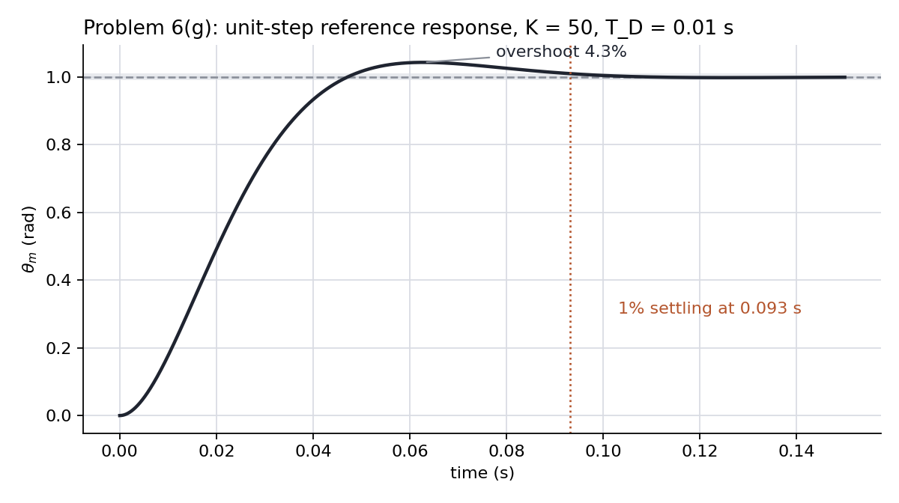
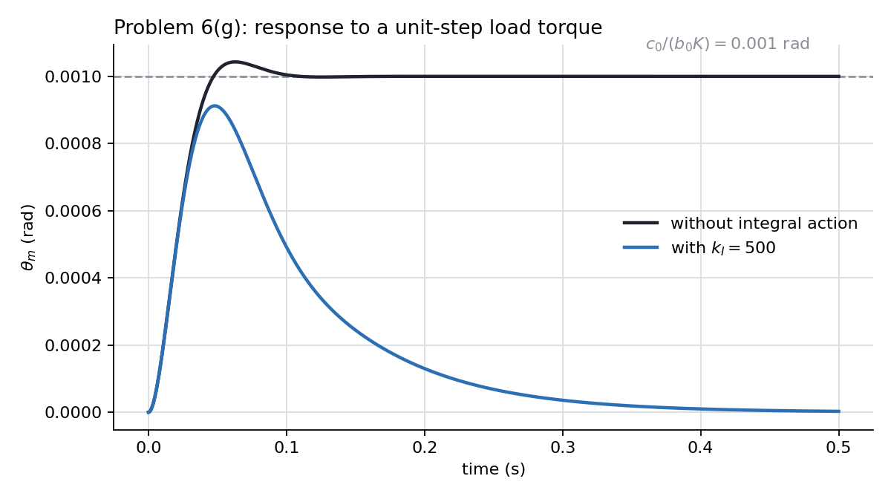
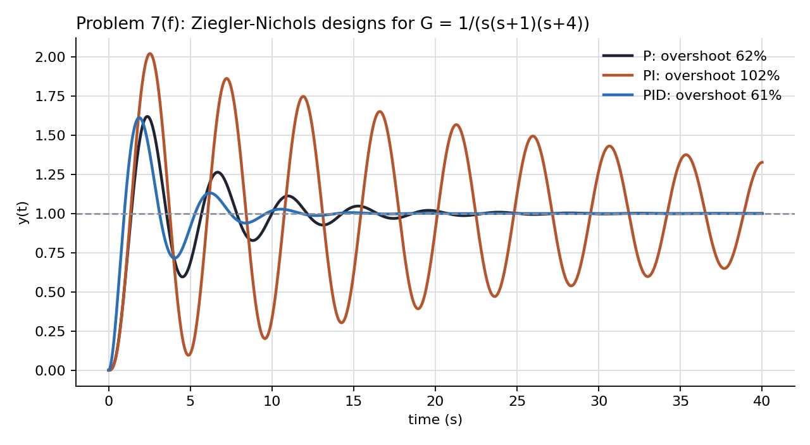
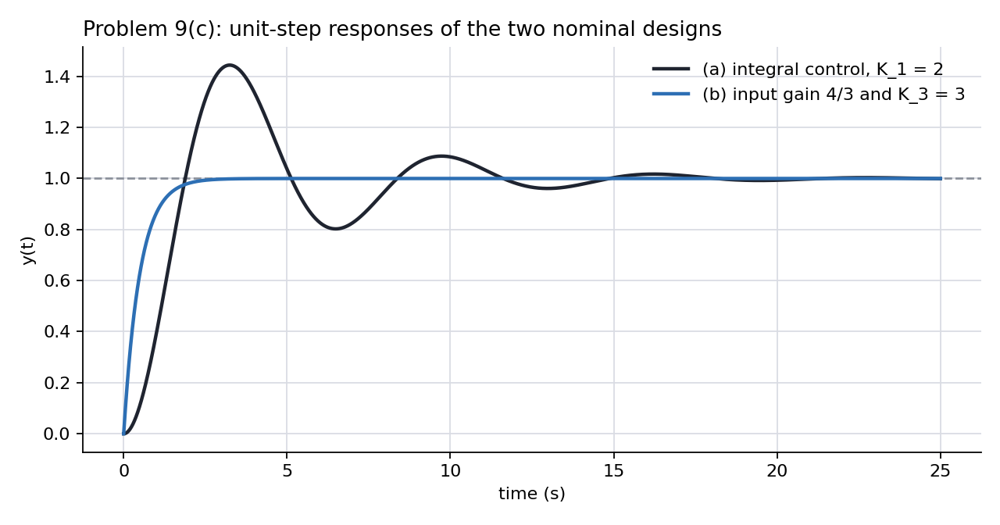
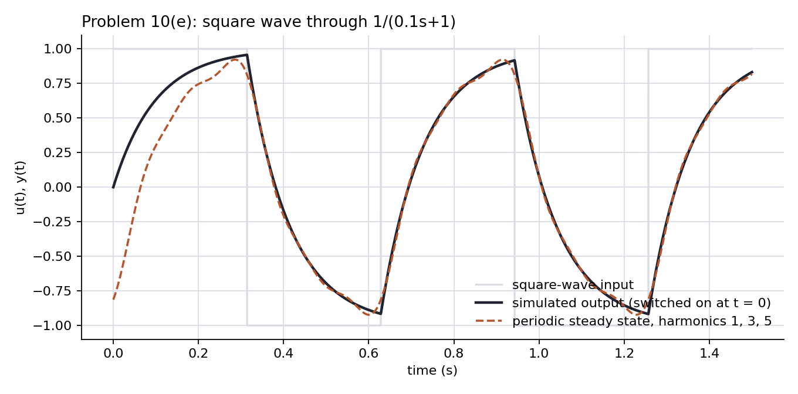

# ME404: Dynamics and Control of Mechanical Systems, Fall 2026
## Problem Set #4: Midterm Study Guide (Chapters 1–4) — Answer Key

This key follows the notation and diagrams in [Problem Set 4](ps4.md). Throughout, $D_c(s)$ is the controller, $G(s)$ the plant, $\mathcal T(s)=Y/R$ the closed-loop transfer function, and $E=R-Y$ the system error. Transfer functions use zero initial conditions. Rise time is the interval between the first crossings of 10% and 90% of the final output, overshoot is measured relative to the final output, and settling time uses a **1% band**. Every Final Value Theorem (FVT) calculation below is preceded by a stability check, because the theorem is meaningless without one.

The symbolic identities for Problems 2–10 quoted below were rederived, and the sampled response metrics were measured using an independent Runge–Kutta integration in `ps4-answers-check.py`; Problem 1 and the explanatory prose are not machine-checked. The MATLAB equivalent of the **(MATLAB)** parts is `ps4_answers.m`, which was run in MATLAB R2026a and reproduces the same numbers.

---

### Problem #1: Short Answers

#### (a) What feedback buys and costs

Feedback **buys** (any two): stabilization of an unstable plant, since open loop cannot move a pole; rejection of disturbances, by the factor $S=1/(1+GD_c)$; insensitivity of the overall gain to plant variation, by the same factor; and tracking without an exact plant model. It **costs** (any two): a sensor, whose noise reaches the output through $\mathcal T$ and whose calibration limits the achievable accuracy; control effort, because large loop gain means large $u$ and possible saturation; the possibility of instability, since a stable plant can be destabilized by too much gain; and added complexity. See [Feedback Properties, §7.3](../../book-notes/feedback-properties_student.md#section-7-3).

#### (b) Moving a pole pair radially outward

For a zero-free second-order system, whose response is determined entirely by the pole pair, moving $-1\pm2j$ to $-2\pm4j$ keeps the angle from the negative real axis fixed, so $\zeta=1/\sqrt5$ is unchanged, while $\omega_n$ doubles from $\sqrt5$ to $2\sqrt5$ and $\sigma$ doubles from 1 to 2. Therefore the overshoot, which depends on $\zeta$ alone, is unchanged; the rise time $t_r\simeq1.8/\omega_n$ halves; and the settling time $t_s\simeq4.6/\sigma$ halves. The response has the same shape played twice as fast. (If other poles or zeros are present, moving one pair alone does not simply rescale time; that is the lesson of Problem 3.)

#### (c) Why a right-half-plane zero produces undershoot

Write $H(s)=\left(1-\dfrac sz\right)H_0(s)=H_0(s)-\dfrac1z\,sH_0(s)$, so that in the time domain $y(t)=y_0(t)-\dfrac1z\dot y_0(t)$, where $y_0$ is the step response of the zero-free second-order part $H_0$, which has positive DC gain. At $t=0^+$ both $y_0$ and $\dot y_0$ are zero, but $\dot y_0$ grows first: for $H_0=\omega_n^2/(s^2+2\zeta\omega_ns+\omega_n^2)$, $y_0\approx\tfrac12\omega_n^2t^2$ and $\dot y_0\approx\omega_n^2t$ for small $t$, so $y\approx-\dfrac{\omega_n^2}{z}t$. The response leaves zero with a **negative slope** and goes negative, because the derivative term is of lower order in $t$ and dominates at first; for $H_4$ of Problem 3, $y_4\approx-\tfrac{25}{4}t$. Later $y_0$ grows toward its positive final value and the response turns around. With a left-half-plane zero the derivative term enters with a positive sign and, for the underdamped pair used in Problem 3, the same mechanism speeds up the rise and *adds* overshoot (an overdamped $H_0$ with a distant LHP zero can stay monotone). (The argument is for this canonical form; a general transfer function with an RHP zero need not start in the wrong direction.)

#### (d) The Final Value Theorem and $Y(s)=3/[s(s^2+9)]$

The FVT applies only if every pole of $sY(s)$ lies strictly in the left half-plane. Here $sY(s)=3/(s^2+9)$ has poles at $\pm3j$, on the imaginary axis, so the hypothesis fails. The formal limit $1/3$ is the time *average* of $y(t)$, not its limit: inverting, $y(t)=\tfrac13(1-\cos3t)$, which oscillates between $0$ and $2/3$ forever and has no final value.

#### (e) Type is robust; error constants are not

For a Type 1 unity-feedback loop, $D_cG$ contains one integrator, so the position constant $K_p=\lim_{s\to0}D_cG$ is infinite and the step error $1/(1+K_p)$ is zero. A 20% gain change does not remove the integrator (and by assumption does not destabilize the loop), so the step error stays zero: type is a structural property. The ramp error is $1/K_v$ with $K_v=\lim_{s\to0}sD_cG$ proportional to the loop gain, so it changes *inversely* with the gain: a 20% gain increase gives $K_v'=1.2K_v$ and a ramp error $1/(1.2K_v)$, about 17% smaller, while a 20% decrease raises the error by 25%. The error *constant* depends on the numbers, not just the structure. See [System Type, §5.3](../../book-notes/system-type_student.md#section-5-3).

#### (f) Which integrator counts for a plant-input disturbance

With $W$ at the plant input and $R=0$, $E/W=-G/(1+D_cG)$. A constant disturbance is rejected only if $D_c(0)=\infty$, that is, only if the **controller** contains the integrator: in steady state the integrator's input $e$ must be zero or its output would keep changing, and its constant output supplies the $u=-w$ that cancels the disturbance. An integrator in the plant sits *downstream* of the disturbance entry point; it integrates $u+w$, and canceling $w$ then requires a nonzero constant $u$, which a controller without an integrator can only produce from a nonzero constant error. Only integrators between the error and the point where the disturbance enters count. (This assumes the usual case in which the plant has a nonzero DC response apart from its integrator; a plant with a zero at the origin would block a constant disturbance on its own.)

#### (g) $S+\mathcal T=1$

$S(s)+\mathcal T(s)=1$ at every $s$, including every $s=j\omega$. The reference reaches the error through $S$, an output disturbance reaches the output through $S$, and sensor noise reaches the output through $\mathcal T$. Making $|S|$ and $|\mathcal T|$ both small at the same frequency is impossible, since the identity is between complex numbers and gives $|S|+|\mathcal T|\ge1$. The usual resolution is to make $|S|$ small at low frequency, where disturbances live, and $|\mathcal T|$ small at high frequency, where noise lives. (A disturbance at the plant *input* reaches the output through $GS$; the identity then constrains its effect *relative to open loop*, which is $S$, rather than the absolute gain $|GS|$.)

#### (h) Why Ziegler–Nichols ultimate-gain tuning fails for $G=1/[(s+1)(s+2)]$

Under proportional control the characteristic polynomial is $s^2+3s+2+K$, which has all coefficients positive for every $K>0$: a second-order polynomial with positive coefficients is stable, so no gain produces a sustained (marginal) oscillation; for $K>1/4$ the response is underdamped, but every oscillation decays. There is no ultimate gain $K_u$ and no ultimate period $P_u$ to feed into the table. The method needs a plant whose phase reaches $-180^\circ$ at a finite frequency, so that a complex pole pair crosses the imaginary axis at finite gain. For a plant without zeros, that means at least third order; a time delay or a right-half-plane zero can supply the extra phase lag at lower order.

#### (i) Derivative action: not alone for tracking, and filtered in practice

Pure derivative control has zero gain at $s=0$, so it produces no control action at all in response to a constant error; it can only reshape the transient, never set the steady state, so for setpoint tracking it is paired with P or PI. It is filtered because the gain of $k_Ds$ grows without bound with frequency, so high-frequency sensor noise would reach the actuator amplified; the filtered form $k_Ds/(T_fs+1)$ caps the high-frequency gain at $k_D/T_f$.

#### (j) Steady-state response of $G=2/(s+2)$ to $4\cos2t$

$G(j2)=\dfrac{2}{2+2j}=\dfrac{1}{1+j}=\dfrac{1}{\sqrt2}\angle-45^\circ$, so

$$
\boxed{y_{ss}(t)=\frac{4}{\sqrt2}\cos\!\left(2t-\frac\pi4\right)=2.83\cos(2t-0.785).}
$$

The word *steady-state* is needed because the complete response also contains a transient $Ce^{-2t}$ from the pole at $-2$ (needed to satisfy the initial condition); the sinusoid above is what remains after that term has decayed.

---

### Problem #2: Magnetic Levitation, From Physics to a Transfer Function

The model is $m\ddot x=mg-ki^2/x^2$ with $m=0.1$ kg, $k=10^{-4}\ \mathrm{N\,m^2/A^2}$, $g=10\ \mathrm{m/s^2}$, and $x_0=0.05$ m. Write it as $\ddot x=f(x,i)$ with

$$
f(x,i)=g-\frac{k}{m}\frac{i^2}{x^2}.
$$

#### (a) Equilibrium current

At equilibrium $\ddot x=0$, so the magnetic force balances the weight:

$$
\frac{ki_0^2}{x_0^2}=mg
\quad\Longrightarrow\quad
i_0=x_0\sqrt{\frac{mg}{k}}=0.05\sqrt{\frac{(0.1)(10)}{10^{-4}}}=0.05\times100
\quad\Longrightarrow\quad
\boxed{i_0=5\ \mathrm A.}
$$

#### (b) Linearization

With $x=x_0+\delta x$ and $i=i_0+\delta i$, expand $f$ to first order about $(x_0,i_0)$, where $f(x_0,i_0)=0$:

$$
\delta\ddot x=\left.\frac{\partial f}{\partial x}\right|_0\delta x+\left.\frac{\partial f}{\partial i}\right|_0\delta i .
$$

The partial derivatives are

$$
\frac{\partial f}{\partial x}=\frac{2k}{m}\frac{i^2}{x^3},
\qquad
\frac{\partial f}{\partial i}=-\frac{2k}{m}\frac{i}{x^2}.
$$

Using the equilibrium relation $ki_0^2/x_0^2=mg$, we simplify these to $\partial f/\partial x|_0=2g/x_0$ and $\partial f/\partial i|_0=-2g/i_0$. Numerically,

$$
\left.\frac{\partial f}{\partial x}\right|_0=\frac{2(10)}{0.05}=400\ \mathrm{s^{-2}},
\qquad
\left.\frac{\partial f}{\partial i}\right|_0=-\frac{2(10)}{5}=-4\ \mathrm{m/(s^2\,A)},
$$

so

$$
\boxed{\delta\ddot x=400\,\delta x-4\,\delta i.}
$$

What was thrown away: all terms of second and higher order in $\delta x$ and $\delta i$ (for example, $\delta x^2$, $\delta x\,\delta i$). The linear model is trustworthy while $|\delta x|\ll x_0$ and $|\delta i|\ll i_0$, that is, for gaps within a few millimeters of 5 cm and currents within a fraction of an ampere of 5 A.

The signs are physical: increasing the gap weakens the magnet ($1/x^2$) so the ball accelerates away, a *destabilizing* spring; increasing the current pulls the ball up, so $\delta i$ enters with a negative sign on $\delta\ddot x$.

#### (c) Transfer function, poles, and stability

Taking the Laplace transform with zero initial conditions gives $s^2\delta X=400\,\delta X-4\,\delta I$, so

$$
\boxed{\frac{\delta X(s)}{\delta I(s)}=\frac{-4}{s^2-400}=\frac{-4}{(s-20)(s+20)},\qquad\text{poles at }s=\pm20\ \mathrm{rad/s}.}
$$

The pole at $+20$ makes the open-loop plant **unstable**. The negative gain says that more current moves the ball up (decreasing $x$). Physically, the plant is an inverted "spring." With the current held at $i_0$, the linear model's free response is $\delta x(t)=\delta x_0\cosh20t+\dfrac{\delta\dot x_0}{20}\sinh20t$, so for a ball displaced $\delta x_0=1$ mm and released from rest, $\delta x(t)=\delta x_0\cosh20t$. The first doubling, $\cosh20t=2$, takes

$$
t_2=\frac{\cosh^{-1}2}{20}=\frac{1.317}{20}=0.066\ \mathrm s,
$$

and once the decaying $e^{-20t}$ term is negligible, the response grows like $\tfrac12\delta x_0e^{20t}$, so the doubling interval approaches $\ln2/20=0.035$ s. (Exactly, the $n$-th interval is $[\cosh^{-1}2^{n+1}-\cosh^{-1}2^n]/20$: 65.8, 37.3, 35.3, 34.8 ms, and so on.) Extrapolating the linear model, a 1 mm displacement reaches 1 cm (a 20% change in the gap, beyond where the linearization is accurate) in about 0.15 s, which is why the ball cannot be held by hand-tuning a constant current.

#### (d) Positive gain form and the failure of proportional control

With $u=-\delta i$,

$$
\frac{\delta X}{U}=\frac{4}{s^2-400}=\frac{K_0}{s^2-a^2},
\qquad
\boxed{K_0=4,\quad a=20.}
$$

Proportional feedback $u=-K_P\,\delta x$ (equivalently $\delta i=K_P\,\delta x$) gives

$$
\delta\ddot x=400\,\delta x-4K_P\,\delta x
\quad\Longrightarrow\quad
s^2+(4K_P-400)=0 .
$$

There is **no $s^1$ term**, so Routh's necessary condition fails for every $K_P$ and the loop is never asymptotically stable. For $K_P<100$ the roots are real, $\pm\sqrt{400-4K_P}$, and one is in the right half-plane. At $K_P=100$ there is a double pole at the origin and $\delta x(t)=A+Bt$ drifts. For $K_P>100$ the roots are $\pm j\sqrt{4K_P-400}$, on the imaginary axis: the ball oscillates about the set point without decaying, at a frequency that grows with $K_P$. Proportional control turns an unstable "negative spring" into a positive spring but adds no damping. The controller must add a term proportional to $\delta\dot x$ (derivative or rate feedback), or a lead compensator as in Problem Set 3.

#### (e) PD control

With $\delta i=K_P\,\delta x+K_D\,\delta\dot x$,

$$
\delta\ddot x=400\,\delta x-4K_P\,\delta x-4K_D\,\delta\dot x
\quad\Longrightarrow\quad
\boxed{s^2+4K_Ds+(4K_P-400)=0 .}
$$

A second-order polynomial is stable if and only if all coefficients are positive:

$$
\boxed{K_D>0,\qquad K_P>100\ \mathrm{A/m}.}
$$

The target polynomial is $(s+20)^2+20^2=s^2+40s+800$. Matching coefficients,

$$
4K_D=40\ \Rightarrow\ \boxed{K_D=10\ \mathrm{A\,s/m}},
\qquad
4K_P-400=800\ \Rightarrow\ \boxed{K_P=300\ \mathrm{A/m}.}
$$

The closed loop then has $\omega_n=\sqrt{800}=28.3$ rad/s and $\zeta=0.707$.

---

### Problem #3: Reading the Response From the Poles and Zeros

All six transfer functions have unit DC gain, so every step response ends at $y_\infty=1$ and overshoot is measured relative to 1.

#### (a) Poles, zeros, and predictions

The dominant pair $s^2+6s+25$ has poles $-3\pm4j$: $\omega_n=5$, $\sigma=3$, $\omega_d=4$, $\zeta=0.6$. The formula-sheet estimates for that pair are

$$
t_r\simeq\frac{1.8}{5}=0.36\ \mathrm s,
\qquad
M_p=e^{-0.6\pi/\sqrt{1-0.36}}=e^{-2.356}=9.5\%,
\qquad
t_s\simeq\frac{4.6}{3}=1.53\ \mathrm s,
\qquad
t_p=\frac\pi4=0.785\ \mathrm s .
$$

| | poles | zeros | $\zeta,\ \omega_n,\ \sigma$ | predicted $t_r,\ M_p,\ t_s$ | does the formula apply? |
|---|---|---|---|---|---|
| $H_1$ | $-3\pm4j$ | none | $0.6,\ 5,\ 3$ | $0.36,\ 9.5\%,\ 1.53$ | yes, exactly for $M_p$ |
| $H_2$ | $-1\pm\sqrt{24}j=-1\pm4.90j$ | none | $0.2,\ 5,\ 1$ | $0.36,\ 52.7\%,\ 4.6$ | yes; $M_p=e^{-0.2\pi/0.980}$ |
| $H_3$ | $-3\pm4j,\ -4$ | none | $0.6,\ 5,\ 3$ | pair alone: $0.36,\ 9.5\%,\ 1.53$ | no: the extra pole at $-4$ is only $1.3\sigma$ away; expect a slower rise, *less* overshoot, and a settling time longer than $H_1$'s actual value (the pair's envelope estimate may still overstate it) |
| $H_4$ | $-3\pm4j$ | $+4$ (RHP) | $0.6,\ 5,\ 3$ | pair alone: $0.36,\ 9.5\%,\ 1.53$ | no: $H_4=H_1-\tfrac14sH_1$, so expect initial undershoot followed by a 10–90% rise *faster* than $H_1$'s, *more* overshoot, and a longer settling time |
| $H_5$ | $-3\pm4j$ | $-2$ (LHP, inside $\sigma$) | $0.6,\ 5,\ 3$ | pair alone: $0.36,\ 9.5\%,\ 1.53$ | no: $H_5=H_1+\tfrac12sH_1$, so expect a much faster rise, much *more* overshoot, and a longer settling time |
| $H_6$ | $-5$ | none | first order, $\sigma=5$ | $\ln9/5=0.439,\ 0,\ \ln100/5=0.921$ | yes, exactly (first-order formulas) |

The derivative decompositions follow from writing each numerator as $25(1\mp s/z)$: $H_4=H_1(1-s/4)$ and $H_5=H_1(1+s/2)$, so $y_4=y_1-\tfrac14\dot y_1$ and $y_5=y_1+\tfrac12\dot y_1$.

#### (b) Matching to the panels

| panel | system | feature used |
|---|---|---|
| (A) | $H_4$ | the only response that goes **negative** first (undershoot to $-0.37$): the RHP zero |
| (B) | $H_1$ | modest overshoot near 10%, peak near $0.8$ s, settles by about $1.3$ s: the bare dominant pair |
| (C) | $H_6$ | monotone exponential rise, no overshoot, already within 1% before $1$ s: the first-order lag |
| (D) | $H_5$ | the fastest rise and a very large overshoot (about 76%): the LHP zero close to the origin |
| (E) | $H_3$ | the slowest rise of the second-order group and almost no overshoot: the extra real pole |
| (F) | $H_2$ | large, lightly damped ringing with period $2\pi/4.90=1.28$ s that lasts past $3$ s: $\zeta=0.2$ |

#### (c) Which meet the specifications

Measured values (from the check script; MATLAB's `stepinfo` with the stated options reproduces them to the digits shown):

| | $t_r$ (s) | $M_p$ | $t_s$ (s) | $M_p\le10\%$ | $t_r\le0.4$ s | $t_s\le1.5$ s |
|---|---:|---:|---:|:-:|:-:|:-:|
| $H_1$ | 0.371 | 9.5% | 1.25 | ✓ | ✓ | ✓ |
| $H_2$ | 0.241 | 52.7% | 4.59 | ✗ | ✓ | ✗ |
| $H_3$ | 0.575 | 1.9% | 1.41 | ✓ | ✗ | ✓ |
| $H_4$ | 0.282 | 12.9% | 1.84 | ✗ | ✓ | ✗ |
| $H_5$ | 0.079 | 76.3% | 1.56 | ✗ | ✓ | ✗ |
| $H_6$ | 0.439 | 0 | 0.92 | ✓ | ✗ | ✓ |

(i) $M_p\le10\%$: $H_1,H_3,H_6$. (ii) $t_r\le0.4$ s: $H_1,H_2,H_4,H_5$. (iii) $t_s\le1.5$ s: $H_1,H_3,H_6$. $\boxed{\text{Only }H_1\text{ meets all three.}}$ Note that $H_6$ fails the rise-time specification by exactly the first-order formula, $t_r=\ln9/5=0.439$ s, even though its settling time is the best of the six.

Two cautions about deciding (c) by hand. First, $4.6/\sigma$ is an envelope estimate: it predicts $1.53$ s for $H_1$, which would *fail* (iii), while the last entry into the 1% band is actually at $1.25$ s. Second, $H_5$ settles at $1.56$ s, too close to the $1.5$ s line to read from the figure. Decide the clear cases from the figure and the formulas, flag these two, and let `stepinfo` in (d) settle them. On the exam the thresholds are chosen far enough from the responses that the figure decides.

#### (d) (MATLAB) Comparison with the predictions

`stepinfo` with the stated options reproduces the table in (c), as does the Python check script. The second-order formulas are furthest off for $H_5$ (predicted 9.5% overshoot and 0.36 s rise, measured 76% and 0.08 s) and for $H_3$ (predicted 0.36 s rise, measured 0.58 s). In $H_5$ the zero at $-2$ is closer to the origin than the poles' real part, so the derivative term $\tfrac12\dot y_1$ is comparable to $y_1$ itself and dominates the early response. In $H_3$ the extra pole at $-4$ is only $1.3$ times $\sigma$, far short of the factor of four or more needed for the dominant-pair approximation, so its slow mode is a large part of the response. Note also that the actual settling time of $H_1$ (1.25 s) is shorter than the $4.6/\sigma=1.53$ s estimate: the rule is an estimate of the envelope, and the last 1% band crossing happens earlier.

---

### Problem #4: Laplace Solution of Initial-Value Problems and the Final Value Theorem

The derivative rules are $\mathcal L\{\dot y\}=sY(s)-y(0)$ and $\mathcal L\{\ddot y\}=s^2Y(s)-sy(0)-\dot y(0)$.

#### (a) $\ddot y+3\dot y+2y=4\cdot1(t)$, $y(0)=1$, $\dot y(0)=0$

**Predict.** The homogeneous equation has characteristic polynomial $s^2+3s+2=(s+1)(s+2)$: natural poles at $-1$ and $-2$, both in the LHP, so the natural response decays. The step forcing adds a pole at $s=0$ to $Y(s)$, which carries the constant final value.

**Solve.** Transforming,

$$
s^2Y-s(1)-0+3\bigl(sY-1\bigr)+2Y=\frac4s
\quad\Longrightarrow\quad
(s^2+3s+2)Y=s+3+\frac4s=\frac{s^2+3s+4}{s}.
$$

$$
Y(s)=\frac{s^2+3s+4}{s(s+1)(s+2)}=\frac{A}{s}+\frac{B}{s+1}+\frac{C}{s+2}.
$$

Cover-up: $A=\dfrac{4}{(1)(2)}=2$, $B=\dfrac{1-3+4}{(-1)(1)}=-2$, $C=\dfrac{4-6+4}{(-2)(-1)}=1$. Hence

$$
\boxed{y(t)=2-2e^{-t}+e^{-2t},\qquad t\ge0.}
$$

**Verify.** $y(0)=2-2+1=1$ ✓; $\dot y(t)=2e^{-t}-2e^{-2t}$ so $\dot y(0)=0$ ✓. Substituting, $\ddot y=-2e^{-t}+4e^{-2t}$, and $\ddot y+3\dot y+2y=(-2+6-4)e^{-t}+(4-6+2)e^{-2t}+4=4$ ✓. FVT: $sY(s)=\dfrac{s^2+3s+4}{(s+1)(s+2)}$ has poles at $-1,-2$, strictly in the LHP, so the theorem applies and $y(\infty)=\lim_{s\to0}sY=4/2=2$, which agrees with $y(t)\to2$. This is the final value, the forcing amplitude $4$ times the DC gain $1/2$ of $1/(s^2+3s+2)$; the initial conditions only affect the decaying terms.

#### (b) $\ddot y+4y=8\cdot1(t)$, $y(0)=0$, $\dot y(0)=2$

**Predict.** Characteristic polynomial $s^2+4$: natural poles at $\pm2j$, on the imaginary axis, so the natural response is a persistent oscillation at 2 rad/s that neither grows nor decays. The forcing adds a pole at $s=0$.

**Solve.**

$$
s^2Y-s(0)-2+4Y=\frac8s
\quad\Longrightarrow\quad
Y(s)=\frac{2+8/s}{s^2+4}=\frac{2s+8}{s(s^2+4)}=\frac{A}{s}+\frac{Bs+C}{s^2+4}.
$$

Cover-up at $s=0$: $A=8/4=2$. Matching numerators, $2s+8=2(s^2+4)+(Bs+C)s=(2+B)s^2+Cs+8$, so $B=-2$ and $C=2$:

$$
Y(s)=\frac2s-\frac{2s}{s^2+4}+\frac{2}{s^2+4}
\quad\Longrightarrow\quad
\boxed{y(t)=2-2\cos2t+\sin2t,\qquad t\ge0.}
$$

**Verify.** $y(0)=2-2=0$ ✓; $\dot y=4\sin2t+2\cos2t$, $\dot y(0)=2$ ✓; $\ddot y=8\cos2t-4\sin2t$, and $\ddot y+4y=8\cos2t-4\sin2t+8-8\cos2t+4\sin2t=8$ ✓. FVT: $sY(s)=\dfrac{2s+8}{s^2+4}$ has poles at $\pm2j$, so the hypothesis **fails**. The formal limit $\lim_{s\to0}sY(s)=8/4=2$ exists, but it is *not* the final value: $y(t)$ oscillates about 2 with amplitude $\sqrt{2^2+1^2}=\sqrt5$ forever. The number 2 is the average of the oscillation, which is all the formula can extract once an undamped mode is present.

#### (c) $\dot y+2y=2r$, $r=t$, $y(0)=1$

**Predict.** Characteristic polynomial $s+2$: one natural pole at $-2$, decaying. The ramp forcing $2/s^2$ adds a *double* pole at the origin.

**Solve.**

$$
sY-1+2Y=\frac{2}{s^2}
\quad\Longrightarrow\quad
Y(s)=\frac{1+2/s^2}{s+2}=\frac{s^2+2}{s^2(s+2)}=\frac{A}{s}+\frac{B}{s^2}+\frac{C}{s+2}.
$$

Cover-up on the highest powers: $B=\dfrac{0+2}{0+2}=1$ (multiply by $s^2$, set $s=0$) and $C=\dfrac{4+2}{4}=\dfrac32$. The coefficient $A$ of the simple pole inside a repeated pole is not given by cover-up; match the $s^2$ coefficients of $s^2+2=As(s+2)+B(s+2)+Cs^2$: $1=A+C$, so $A=-\tfrac12$. (Check the $s^1$ coefficient: $0=2A+B=-1+1$ ✓.)

$$
\boxed{y(t)=t-\frac12+\frac32e^{-2t},\qquad t\ge0.}
$$

**Verify.** $y(0)=-\tfrac12+\tfrac32=1$ ✓. $\dot y=1-3e^{-2t}$, and $\dot y+2y=1-3e^{-2t}+2t-1+3e^{-2t}=2t$ ✓. FVT: $sY(s)=\dfrac{s^2+2}{s(s+2)}$ still has a pole at $s=0$, so the hypothesis fails; the formal limit is $\lim_{s\to0}sY(s)=+\infty$, and indeed $y\to\infty$, as a ramp into a stable system with nonzero DC gain must.

**The tracking lag.** $y(t)-r(t)=-\tfrac12+\tfrac32e^{-2t}\to\boxed{-\tfrac12}$: in steady state the output is a ramp with the same unit slope as $r$ (the system has unit DC gain), running a constant $\tfrac12$ below it. Since $t-\tfrac12=r(t-\tfrac12)$, the output is the reference delayed by $\boxed{0.5\ \mathrm s}$, one time constant of the system. The lag is the coefficient $A=-\tfrac12$ of the $1/s$ term in the expansion of the double pole at the origin: the $1/s^2$ term reproduces the ramp, the $1/s$ term is the constant offset, and the $1/(s+2)$ term is the transient. This is exactly the structure of a Type 1 ramp error: the system follows the ramp but not at zero error.

---

### Problem #5: A Two-Loop Block Diagram With a Disturbance and a Feedforward Path

#### (a) Transfer functions

Label the signal that enters $G_2$, after the disturbance has been added, $V$. The signal equations are

$$
E=R-Y,\qquad V=G_1E+G_3R+W-H_1Y,\qquad Y=G_2V .
$$

Substituting,

$$
Y=G_2\bigl[G_1(R-Y)+G_3R+W-H_1Y\bigr]
\quad\Longrightarrow\quad
Y\bigl(1+G_1G_2+G_2H_1\bigr)=G_2(G_1+G_3)R+G_2W,
$$

so

$$
\boxed{\frac YR=\frac{G_2(G_1+G_3)}{1+G_1G_2+G_2H_1},
\qquad
\frac YW=\frac{G_2}{1+G_1G_2+G_2H_1}.}
$$

For the system error, $E=R-Y$ gives

$$
\boxed{\frac ER=1-\frac YR=\frac{1+G_2H_1-G_2G_3}{1+G_1G_2+G_2H_1},
\qquad
\frac EW=-\frac YW=\frac{-G_2}{1+G_1G_2+G_2H_1}.}
$$

**Block reduction check for $Y/R$.** Collapse the inner loop first: $G_2$ with negative feedback $H_1$ becomes $G_2/(1+G_2H_1)$. Its input is $G_1E+G_3R$. Then

$$
Y=\frac{G_2}{1+G_2H_1}\bigl[G_1(R-Y)+G_3R\bigr]
\ \Longrightarrow\
Y\left[1+\frac{G_1G_2}{1+G_2H_1}\right]=\frac{G_2(G_1+G_3)}{1+G_2H_1}R ,
$$

and multiplying through by $1+G_2H_1$ recovers the same $Y/R$.

#### (b) Limiting cases

- $G_3=0$: from the diagram, $R$ reaches the inner junction only through the outer loop, so the system is $G_1$ in series with the inner loop, inside unity feedback. The formula gives $Y/R=G_1G_2/(1+G_1G_2+G_2H_1)$, which is the series connection $G_1\cdot G_2/(1+G_2H_1)$ closed with unity feedback ✓. $Y/W$ is unchanged, as it must be, since $W$ never passes through $G_3$.
- $H_1=0$: the inner loop disappears and the forward path is $G_2$ driven by $G_1E+G_3R+W$. The formula gives $Y/R=G_2(G_1+G_3)/(1+G_1G_2)$ and $Y/W=G_2/(1+G_1G_2)$ ✓: the feedforward path adds $G_2G_3R$ to the numerator but does not change the loop, so the denominator is just $1+G_1G_2$.

#### (c) Numbers

With $G_1=K$, $G_2=1/[s(s+2)]$, $H_1=k_ts$, $G_3=0$, the denominator $1+G_1G_2+G_2H_1=1+\dfrac{K+k_ts}{s(s+2)}$, so the characteristic polynomial is

$$
\boxed{s(s+2)+k_ts+K=s^2+(2+k_t)s+K .}
$$

Rate feedback adds to the damping coefficient only. For $K=25$ and $k_t=3$: $s^2+5s+25$, poles

$$
s=-2.5\pm j\sqrt{25-6.25}=\boxed{-2.5\pm4.33j},
\qquad
\omega_n=5,\qquad \zeta=\frac{5}{2\cdot5}=0.5 .
$$

$Y/R=25/(s^2+5s+25)$ has no zero, so the overshoot formula is exact:

$$
M_p=e^{-0.5\pi/\sqrt{0.75}}=e^{-1.814}=\boxed{16.3\%}.
$$

Without the tachometer ($k_t=0$) the same $K$ would give $s^2+2s+25$, $\zeta=0.2$, and $M_p=53\%$: the rate feedback raises the damping ratio from $0.2$ to $0.5$ at no cost in $\omega_n$.

The loop is stable (positive coefficients, second order), so the FVT applies to $E/W=-1/(s^2+5s+25)$ with $W=1/s$:

$$
e_{ss}=\lim_{s\to0}s\cdot\frac{-1}{s^2+5s+25}\cdot\frac1s=\boxed{-\frac1{25}} .
$$

The output settles at $+1/25$ per unit of constant disturbance; the loop is Type 0 with respect to $W$ because the only integrator is in $G_2$, downstream of the disturbance entry.

#### (d) Exact tracking by feedforward

Setting $Y/R=1$ in (a):

$$
G_2(G_1+G_3)=1+G_1G_2+G_2H_1
\quad\Longrightarrow\quad
G_2G_3=1+G_2H_1
\quad\Longrightarrow\quad
G_3=\frac1{G_2}+H_1=s(s+2)+k_ts .
$$

With the numbers, $\boxed{G_3=s^2+5s}$, the plant inverse plus the rate-feedback term. It is **improper**: it asks for the first and second derivatives of the reference, so it has unbounded gain at high frequency and cannot be realized exactly (a realizable version adds fast poles and is then only approximately an inverse). If it could be built, any noise on $r$ would be differentiated twice and would reach the plant input amplified. This is plant inversion, the feedforward idea of [PID Tuning, §8](../../book-notes/pid-tuning_student.md#section-8): it works for the smooth, low-frequency part of the reference and must be paired with feedback for everything else.

---

### Problem #6: DC Motor Position Control With Rate Feedback and Integral Action

The parameters are $a_1=50\ \mathrm{s^{-1}}$, $b_0=100\ \mathrm{rad/(V\,s^2)}$, $c_0=5\ \mathrm{rad/(N\,m\,s^2)}$.

#### (a) Block diagram and closed-loop transfer functions

Taking the Laplace transform of the motor equation gives $(s^2+a_1s)\Theta_m=b_0V_a+c_0W$, and transforming the control law gives $V_a=K\bigl(\Theta_r-\Theta_m-T_Ds\Theta_m\bigr)$. Substituting,

$$
\bigl(s^2+a_1s\bigr)\Theta_m=b_0K\Theta_r-b_0K\Theta_m-b_0KT_Ds\Theta_m+c_0W
$$

$$
\boxed{\frac{\Theta_m}{\Theta_r}=\frac{b_0K}{s^2+(a_1+b_0KT_D)s+b_0K},
\qquad
\frac{\Theta_m}{W}=\frac{c_0}{s^2+(a_1+b_0KT_D)s+b_0K}.}
$$

Neither has a zero: the rate term sits in the feedback path, so it changes only the damping coefficient of the denominator. (Had the derivative acted on the error, $K(1+T_Ds)e$, the numerator would contain the zero $-1/T_D$.)

#### (b) Open-loop steady speed

With $w=0$ and constant $v_a=100$ V, the speed equation $\dot\omega+a_1\omega=b_0v_a$ settles at

$$
\omega_{ss}=\frac{b_0v_a}{a_1}=\frac{100\times100}{50}=200\ \mathrm{rad/s}
=200\times\frac{60}{2\pi}=\boxed{1910\ \mathrm{rpm}.}
$$

#### (c) Design region and gains

Overshoot at most 5%: $e^{-\zeta\pi/\sqrt{1-\zeta^2}}\le0.05$ gives $\zeta\pi/\sqrt{1-\zeta^2}\ge\ln20=2.996$, so

$$
\zeta\ge\frac{\ln20}{\sqrt{\pi^2+\ln^220}}=\frac{2.996}{4.341}=0.690 .
$$

Settling time at most 0.1 s with the envelope estimate $t_s\simeq4.6/\sigma$: $\sigma\ge46\ \mathrm{s^{-1}}$. Because the estimate is approximate, so is the region: a pair at exactly $-46\pm46j$ actually settles in $0.101$ s. That is why the chosen poles should sit inside the region with margin and the design should be checked. The region is the intersection of the half-plane $\operatorname{Re}s\le-46$ with the wedge $|\angle|\le\cos^{-1}0.690=46.4^\circ$ measured from the negative real axis. (Sketch: a vertical line at $-46$ and two rays from the origin at $\pm46.4^\circ$ from the negative real axis; the admissible region is to the left of the line and inside the wedge.)

Poles at $-50\pm50j$ have $\sigma=50>46$ and $\zeta=\cos45^\circ=0.707>0.690$: inside the region with margin on both constraints. The predicted overshoot is $e^{-\pi}=4.3\%$ and the predicted settling time $4.6/50=0.092$ s (measured in (g): $0.093$ s, within the specification). The target polynomial is $(s+50)^2+50^2=s^2+100s+5000$. Matching with the denominator in (a):

$$
b_0K=5000\ \Rightarrow\ \boxed{K=50\ \mathrm{V/rad}},
\qquad
a_1+b_0KT_D=100\ \Rightarrow\ 50+5000T_D=100\ \Rightarrow\ \boxed{T_D=0.01\ \mathrm s}.
$$

Because $\Theta_m/\Theta_r$ has no zero and is exactly second order, the overshoot formula is **exact** for this design; only the settling-time estimate is approximate.

#### (d) Error to the reference

$$
\frac{E}{\Theta_r}=1-\frac{\Theta_m}{\Theta_r}=\frac{s^2+100s}{s^2+100s+5000}=\frac{s(s+100)}{s^2+100s+5000}.
$$

One zero at the origin, so the loop is **Type 1** with respect to the reference. The loop is stable (positive coefficients), so the FVT applies: for a step of 1 rad, $e_{ss}=\lim_{s\to0}E/\Theta_r=0$; for a unit ramp, $e_{ss}=\lim_{s\to0}\dfrac{1}{s}\dfrac{E}{\Theta_r}=\dfrac{100}{5000}=\dfrac1{50}$, so

$$
\boxed{K_v=\frac{b_0K}{a_1+b_0KT_D}=\frac{5000}{100}=50\ \mathrm{s^{-1}},\qquad e_{ss,\mathrm{step}}=0,\qquad e_{ss,\mathrm{ramp}}=0.02\ \mathrm{rad}.}
$$

With proportional control alone at the same $K$ ($T_D=0$), $K_v=b_0K/a_1=100$. The rate feedback halves $K_v$: it buys damping ($\zeta$ rises from $0.354$ to $0.707$) at the price of doubling the ramp error. This is the tachometer tradeoff of [System Type, §6.3](../../book-notes/system-type_student.md#section-6-3).

#### (e) Error to a load torque

With $\theta_r=0$, $E=-\Theta_m$, so

$$
\frac EW=\frac{-c_0}{s^2+100s+5000}.
$$

There is no zero at the origin: **Type 0** with respect to the disturbance. For $w=1\ \mathrm{N\,m}$,

$$
e_{ss}=\lim_{s\to0}\frac{-c_0}{s^2+100s+5000}=\boxed{-\frac{5}{5000}=-0.001\ \mathrm{rad}},
$$

that is, the shaft settles $1$ mrad past the reference in the direction the torque pushes it. The integrator in the motor does not help because it lies downstream of the torque.

#### (f) Integral action

With $V_a=K(E-T_Ds\Theta_m)+\dfrac{k_I}{s}E$ and $E=\Theta_r-\Theta_m$,

$$
(s^2+a_1s)\Theta_m=b_0\left[K+\frac{k_I}{s}\right](\Theta_r-\Theta_m)-b_0KT_Ds\Theta_m+c_0W .
$$

Multiply by $s$ and collect $\Theta_m$:

$$
\Theta_m\Bigl[s^3+(a_1+b_0KT_D)s^2+b_0Ks+b_0k_I\Bigr]=b_0(Ks+k_I)\Theta_r+c_0sW .
$$

$$
\boxed{a(s)=s^3+100s^2+5000s+100k_I,
\qquad
\frac EW=\frac{-c_0s}{s^3+100s^2+5000s+100k_I}.}
$$

$E/W$ now has a zero at the origin, so the loop is **Type 1** with respect to the disturbance: a constant torque produces zero steady-state error. Routh array:

$$
\begin{array}{c|cc}
s^3 & 1 & 5000\\
s^2 & 100 & 100k_I\\
s^1 & \dfrac{100\cdot5000-100k_I}{100}=5000-k_I & \\
s^0 & 100k_I &
\end{array}
$$

For all first-column entries to be positive, we need $\boxed{0<k_I<5000}$. For a unit-ramp torque, $W=1/s^2$, with the loop stable,

$$
e_{ss}=\lim_{s\to0}s\cdot\frac{-c_0s}{a(s)}\cdot\frac1{s^2}=\frac{-c_0}{100k_I}=\boxed{-\frac{1}{20k_I}\ \mathrm{rad}}.
$$

At one-tenth of the limit, $k_I=500$, this is $\boxed{-10^{-4}\ \mathrm{rad}}$ per $\mathrm{N\,m/s}$ of ramp rate. The closed-loop poles for $k_I=500$ (from the check script) are $-12.9$ and $-43.6\pm44.5j$: the complex pair has moved in slightly from $-50\pm50j$, and a slow real pole near $-13$, now the dominant pole, has appeared, which is the usual price of integral action.

#### (g) (MATLAB) Verification

Measured: $M_p=4.32\%$ (exactly $e^{-\pi}$) and $t_s=0.093$ s, both inside the specifications and matching (c).

Without integral action, the angle settles at $c_0/(b_0K)=0.001$ rad, as predicted in (e); with $k_I=500$, it returns to zero, as predicted in (f), with the slow pole at $-12.9$ visible in the long tail. Closed-loop poles with integral action: $-12.90$, $-43.55\pm44.50j$. See `ps4_answers.m`.

---

### Problem #7: Routh's Criterion and Ziegler–Nichols Tuning

#### (a) Routh array for proportional control

$$
1+\frac{K}{s(s+1)(s+4)}=0
\quad\Longrightarrow\quad
a(s)=s^3+5s^2+4s+K .
$$

$$
\begin{array}{c|cc}
s^3 & 1 & 4\\
s^2 & 5 & K\\
s^1 & \dfrac{5\cdot4-K}{5}=4-\dfrac K5 & \\
s^0 & K &
\end{array}
\qquad\Longrightarrow\qquad
\boxed{0<K<20 .}
$$

#### (b) Ultimate gain, frequency, and period

The $s^1$ row vanishes at $\boxed{K_u=20}$. The auxiliary polynomial is the $s^2$ row, $5s^2+20=0$, so $s=\pm2j$:

$$
\boxed{\omega_u=2\ \mathrm{rad/s},\qquad P_u=\frac{2\pi}{2}=\pi=3.14\ \mathrm s.}
$$

Check by factoring at $K=20$: $s^3+5s^2+4s+20=s^2(s+5)+4(s+5)=\boxed{(s+5)(s^2+4)}$ ✓. The third root, $-5$, is in the LHP, so at $K_u$ the loop is neutrally stable with a sustained oscillation at $2$ rad/s.

#### (c) Ziegler–Nichols gains (Table 4.3)

| | $k_P$ | $T_I$ | $T_D$ |
|---|---|---|---|
| P | $0.5K_u=\boxed{10}$ | — | — |
| PI | $0.45K_u=\boxed{9}$ | $P_u/1.2=\boxed{5\pi/6=2.618\ \mathrm s}$ | — |
| PID | $0.6K_u=\boxed{12}$ | $P_u/2=\boxed{\pi/2=1.571\ \mathrm s}$ | $P_u/8=\boxed{\pi/8=0.393\ \mathrm s}$ |

(The PID row of Table 4.3 is misprinted as $k_P=1.6K_u$ in the 7th edition; $0.6K_u$ is correct and is what the formula sheet gives.)

#### (d) The repeated zero of the Ziegler–Nichols PID

As a single fraction,

$$
D_c(s)=k_P\,\frac{T_IT_Ds^2+T_Is+1}{T_Is}.
$$

The PID row of the table sets $T_I=P_u/2$ and $T_D=P_u/8$, so $T_I=4T_D$ *always*. Substituting $T_D=T_I/4$,

$$
T_IT_Ds^2+T_Is+1=\frac{T_I^2}{4}s^2+T_Is+1=\left(\frac{T_I}{2}s+1\right)^2 ,
$$

a perfect square. The controller zeros are therefore a repeated real zero at

$$
\boxed{s=-\frac{2}{T_I}=-\frac{4}{P_u}=-\frac4\pi=-1.27\ \mathrm{rad/s}.}
$$

For this plant: $\dfrac{\pi^2}{16}s^2+\dfrac\pi2s+1=\dfrac{(\pi s+4)^2}{16}$, zero at $-4/\pi$ ✓. Ziegler–Nichols PID is thus a double-lead controller with both zeros at $-4/P_u$ and a pole at the origin.

#### (e) Type and ramp error of the P and PI designs

**P** ($D_c=10$): $D_cG=\dfrac{10}{s(s+1)(s+4)}$ has one integrator, so the loop is **Type 1**:

$$
K_v=\lim_{s\to0}sD_cG=\frac{10}{4}=2.5\ \mathrm{s^{-1}},\qquad e_{ss,\mathrm{ramp}}=\frac1{K_v}=\boxed{0.4}.
$$

Stability from the Routh array of (a): at $K=10$ the $s^1$ entry is $4-10/5=2>0$ and the $s^0$ entry is $10>0$, so the first column $1,5,2,10$ has no sign changes ✓.

**PI** ($D_c=9\left(1+\dfrac{1}{2.618s}\right)=\dfrac{9(2.618s+1)}{2.618s}$): $D_cG$ now has **two** integrators, one from the plant and one from the controller, so the loop is **Type 2**: $K_v=\infty$ and $\boxed{e_{ss,\mathrm{ramp}}=0}$ (the acceleration constant is $K_a=\lim s^2D_cG=9/(2.618\cdot4)=0.859$, so a unit parabola gives an error of $1.16$). The PID design is also Type 2 with zero ramp error, though with a different $K_a=12/(1.571\cdot4)=1.91$. These statements assume stability, which (f) confirms, barely for PI.

#### (f) (MATLAB) Step responses of the three designs

| design | closed-loop poles | overshoot | 1% settling |
|---|---|---:|---:|
| P | $-4.60,\ -0.20\pm1.46j$ | 62% | 22 s |
| PI | $-4.52,\ -0.42,\ -0.029\pm1.34j$ | 102% | 157 s |
| PID | $-3.22,\ -1.06,\ -0.36\pm1.45j$ | 61% | 13 s |

The **PI** design is the barely stable one: its dominant pair $-0.029\pm1.34j$ has $\zeta=0.02$, so the response rings for minutes and overshoots by 100%. The integrator's phase lag has pushed the plant, which was already only a factor of two below its stability limit under P control, almost onto the imaginary axis. Ziegler–Nichols rules were fitted to process plants with delay for a quarter-decay ratio, which is itself about 50% overshoot; they give a starting point in the right order of magnitude, with no guarantee of stability or of acceptable damping, after which the gains (here, $k_P$ halved and $T_I$ lengthened) must be adjusted to the actual plant and specifications. See `ps4_answers.m`.

---

### Problem #8: System Type With Respect to the Reference and the Disturbance

#### (Part A) $G=1/[(s+1)(s+2)]$, $D_c=K(s+a)/(s+b)$

**(i)** $D_cG=\dfrac{K(s+a)}{(s+b)(s+1)(s+2)}$. The plant has no integrator, so Type 1 requires the controller pole to sit at the origin: $\boxed{b=0}$ (with $Ka\ne0$, so that the integrator is not canceled), a PI controller $K(s+a)/s=K+Ka/s$. Then

$$
K_v=\lim_{s\to0}s\,\frac{K(s+a)}{s(s+1)(s+2)}=\boxed{\frac{Ka}{2}} .
$$

**(ii)** With $b=0$,

$$
s(s+1)(s+2)+K(s+a)=\boxed{s^3+3s^2+(2+K)s+Ka .}
$$

$$
\begin{array}{c|cc}
s^3 & 1 & 2+K\\
s^2 & 3 & Ka\\
s^1 & \dfrac{3(2+K)-Ka}{3} & \\
s^0 & Ka &
\end{array}
$$

With $K>0$ and $a>0$, as the problem assumes, the $s^0$ entry is positive, and the $s^1$ entry requires $3(2+K)>Ka$:

$$
\boxed{a<3+\frac6K\quad(\text{with }K>0,\ a>0).}
$$

**(iii)** The bound $3+6/K$ decreases toward 3 as $K\to\infty$, so the loop is stable for every positive $K$ if and only if $\boxed{0<a\le3}$. (At $a=3$ the $s^1$ entry is $[3(2+K)-3K]/3=2>0$ for every $K$.) In root-locus terms: with three poles and one zero, the two asymptotes are vertical lines through the centroid $[(0-1-2)-(-a)]/2=(a-3)/2$, which must not lie in the right half-plane, so $a\le3$.

**(iv)** $a=1$, $K=4$, $b=0$: $s^3+3s^2+6s+4$. Routh $s^1$ entry: $(18-4)/3=14/3>0$, stable ✓. Try $s=-1$: $-1+3-6+4=0$, so

$$
s^3+3s^2+6s+4=\boxed{(s+1)(s^2+2s+4)},\qquad\text{poles }-1,\ -1\pm j\sqrt3 .
$$

The controller zero at $-1$ cancels the closed-loop pole at $-1$ in $\mathcal T=\dfrac{4(s+1)}{(s+1)(s^2+2s+4)}=\dfrac{4}{s^2+2s+4}$, so the reference step response shows only the complex pair. The mode at $-1$ is still a closed-loop mode: it appears in the response to a plant-input disturbance, where nothing cancels it.

$K_v=Ka/2=2$, so $\boxed{e_{ss,\mathrm{step}}=0,\qquad e_{ss,\mathrm{ramp}}=\tfrac12 .}$

#### (Part B) $G=1/s^2$, $D_c=8(s+1)/(s+4)$

**(i)** $1+D_cG=0$ gives $s^2(s+4)+8(s+1)=\boxed{s^3+4s^2+8s+8}$.

$$
\begin{array}{c|cc}
s^3 & 1 & 8\\
s^2 & 4 & 8\\
s^1 & \dfrac{32-8}{4}=6 & \\
s^0 & 8 &
\end{array}
$$

No sign changes: stable ✓. Since $s=-2$ is a root ($-8+16-16+8=0$),

$$
\boxed{(s+2)(s^2+2s+4),\qquad\text{poles }-2,\ -1\pm j\sqrt3 .}
$$

**(ii)** $D_cG=\dfrac{8(s+1)}{s^2(s+4)}$ has two integrators: **Type 2**, with

$$
K_a=\lim_{s\to0}s^2D_cG=\frac{8}{4}=\boxed{2},
\qquad
e_{ss}:\ \text{step }0,\quad\text{ramp }0,\quad\text{parabola }\frac1{K_a}=\boxed{\tfrac12}.
$$

**(iii)** With $R=0$ and the torque at the plant input, $Y=G(U+W)$ and $U=-D_cY$, so $Y(1+D_cG)=GW$:

$$
\frac YW=\frac{G}{1+D_cG}=\frac{1/s^2}{1+\dfrac{8(s+1)}{s^2(s+4)}}=\frac{s+4}{s^3+4s^2+8s+8},
\qquad
\boxed{\frac EW=-\frac YW=\frac{-(s+4)}{s^3+4s^2+8s+8}.}
$$

No zero at the origin: **Type 0** with respect to the disturbance, with $T_{o,w}(0)=-4/8=-\tfrac12$, so $K_{0,w}=-2$ in the signed convention of the notes and, for a unit-step torque,

$$
\boxed{e_{ss}=-\tfrac12},
$$

that is, the attitude settles at $+0.5$ rad per unit of constant torque.

**(iv)** Both integrators are in the plant, *downstream* of the point where the torque enters. Rejecting a constant torque requires a constant $u=-w$ from the controller, and a controller without an integrator can only produce that from a nonzero constant error. For the reference, both plant integrators lie between the error and the output, so both count and the loop is Type 2. For the disturbance, only integrators between the error and the disturbance entry (those in $D_c$) count, and there are none.

**(v)** With the disturbance added to the attitude itself, $Y=GU+W$ and $U=-D_cY$, so $Y(1+D_cG)=W$:

$$
\frac YW=\frac{1}{1+D_cG}=\frac{s^2(s+4)}{s^3+4s^2+8s+8},
\qquad
\boxed{\frac EW=\frac{-s^2(s+4)}{s^3+4s^2+8s+8}.}
$$

Two zeros at the origin: **Type 2** with respect to an output disturbance, so a constant offset (and even a ramping one) produces zero steady-state error, and $e_{ss}=-\tfrac12$ to a parabola. The type changed because the disturbance now enters *after* the plant: both plant integrators lie between the error and the disturbance entry, so both now count. $E/W$ for an output disturbance is just $-S(s)$, the same sensitivity function that governs the reference error, which is why the type with respect to an output disturbance always equals the type with respect to the reference. (Had $W$ instead been an offset in the *sensor*, the loop would drive the measured attitude $X+W$ to zero and the physical attitude would settle at $X=-W$: feedback regulates what it measures.)

---

### Problem #9: Robustness of System Type and Sensitivity

Let $P(s)=K_0/(2s+1)$.

#### (a) Choosing the gains

**System (a).** $L=\dfrac{K_1}{s}\dfrac{K_0}{2s+1}$, so

$$
\frac ER=\frac{1}{1+L}=\frac{s(2s+1)}{s(2s+1)+K_0K_1}=\frac{s(2s+1)}{2s^2+s+K_0K_1}.
$$

The characteristic polynomial $2s^2+s+K_0K_1$ is second order with positive coefficients for $K_0K_1>0$: stable. Step: $e_{ss}=\lim_{s\to0}E/R=0$ for any $K_1$. Ramp: $e_{ss}=\lim_{s\to0}\dfrac1s\dfrac ER=\dfrac{1}{K_0K_1}=\dfrac12$ with $K_0=1$ gives $\boxed{K_1=2}$.

**System (b).** $Y=\dfrac{K_3P}{1+K_3P}K_2R$, so

$$
\frac YR=\frac{K_2K_3K_0}{2s+1+K_3K_0},
\qquad
\frac ER=1-\frac YR=\frac{2s+1+K_3K_0-K_2K_3K_0}{2s+1+K_3K_0}.
$$

The single pole is at $-(1+K_3K_0)/2<0$: stable. Step: $e_{ss}=\dfrac{1+K_3K_0-K_2K_3K_0}{1+K_3K_0}=0$ requires

$$
K_2=\frac{1+K_3K_0}{K_3K_0}.
$$

With that choice the numerator of $E/R$ collapses to $2s$, so $E/R=\dfrac{2s}{2s+1+K_3K_0}$ and the ramp error is $\dfrac{2}{1+K_3K_0}=\dfrac12$, giving $K_3K_0=3$. With $K_0=1$:

$$
\boxed{K_3=3,\qquad K_2=\frac43 .}
$$

#### (b) Plant gain $K_0=1+\delta$

**System (a).** $E/R=\dfrac{s(2s+1)}{2s^2+s+2(1+\delta)}$, still stable for $\delta>-1$. The zero at the origin survives, so

$$
e_{ss,\mathrm{step}}=0,
\qquad
e_{ss,\mathrm{ramp}}=\frac{1}{2(1+\delta)}=\frac{5}{11}=0.455\ \text{at }\delta=0.1 .
$$

**System (b).** With $K_2=4/3$ and $K_3=3$ fixed,

$$
\frac ER=\frac{2s+1+3(1+\delta)-4(1+\delta)}{2s+1+3(1+\delta)}=\frac{2s-\delta}{2s+4+3\delta},
$$

so

$$
e_{ss,\mathrm{step}}=\frac{-\delta}{4+3\delta}=-\frac1{43}=-0.023\ \text{at }\delta=0.1,
\qquad
e_{\mathrm{ramp}}(t)=-\frac{\delta}{4+3\delta}\,t+\frac{8(1+\delta)}{(4+3\delta)^2}+(\text{a term decaying as }e^{-(4+3\delta)t/2}),
$$

valid while the loop is stable, $\delta>-\tfrac43$. At $\delta=0.1$ the asymptote is $-t/43+0.476$, so the ramp error grows without bound: negatively for $\delta>0$ (the output outruns the ramp) and positively for $-\tfrac43<\delta<0$. At $\delta=0$ the slope vanishes and the constant is the finite $\tfrac12$ of part (a).

The zero steady-state error of system (b) was obtained by *cancellation*: the input gain was calibrated to the plant gain, and any mismatch leaves a residual. By the course definition $e_{ss}=\lim_{s\to0}[1-\mathcal T(s)]/s^k$, system (b) is Type 1 at the nominal calibration (its loop contains no integrator, but $1-\mathcal T_b=2s/(2s+4)$ has a zero at the origin) and drops to Type 0 for any $\delta\ne0$: its type is a calibration, not a structural property. $\boxed{\text{System (a) has the robust type}}$: its zero step error comes from the integrator, which forces the error to zero for any plant gain that keeps the loop stable; only its ramp error (an error *constant*) moves with $\delta$.

#### (c) Poles and transient response

**System (a).** $2s^2+s+2=0$, that is $s^2+0.5s+1=0$: $\omega_n=1$, $\zeta=0.25$, poles $\boxed{-0.25\pm0.968j}$. No zero, so the overshoot formula is exact:

$$
M_p=e^{-0.25\pi/\sqrt{1-0.0625}}=e^{-0.811}=44\%,
\qquad
t_s\simeq\frac{4.6}{0.25}=18\ \mathrm s\ (\text{measured }17.3\ \mathrm s).
$$

**System (b).** Pole at $-(1+3)/2=\boxed{-2}$, first order with $\tau=0.5$ s: no overshoot, $t_s=\ln100/2=2.3$ s.

The price of the robust type is the transient: the integrator adds a pole at the origin to a loop that had only one, producing a lightly damped second-order response that overshoots by 44% and takes eight times longer to settle than system (b). A PI controller, or rate feedback, would recover the damping; this is the tradeoff that the root-locus lectures resolve.

#### (d) Sensitivities

For system (a), $\mathcal T_a(0)=\dfrac{L(0)}{1+L(0)}$ with $L(0)=\infty$, so $\mathcal T_a(0)=1$ for every $K_0$: $S^{\mathcal T}_{K_0}=\dfrac{1}{1+L(0)}=\boxed{0}$. For system (b), $\mathcal T_b(0)=\dfrac{K_2K_3K_0}{1+K_3K_0}$ and

$$
S^{\mathcal T}_{K_0}=\frac{K_0}{\mathcal T_b}\frac{\partial\mathcal T_b}{\partial K_0}=\frac{1}{1+K_3K_0}=\boxed{\frac14}
$$

at the nominal values (a 10% plant-gain change produces about a 2.5% DC-gain change, consistent with the $-0.023$ step error of (b)). The input gain $K_2$ sits outside the loop, so $\mathcal T_b\propto K_2$ and

$$
S^{\mathcal T}_{K_2}=\boxed{1}.
$$

Feedback protects the forward-path parameters (plant and controller gains) by the factor $1/(1+L)$, and protects the DC gain against them completely when the loop contains an integrator, as long as the loop stays stable. It gives no protection to a prefilter such as $K_2$, which sits outside the loop. A sensor gain $H$ is inside the loop but is not protected either: with $\mathcal T=L/(1+LH)$, $S^{\mathcal T}_H=-LH/(1+LH)\to-1$ at high loop gain, because the loop faithfully drives the *measured* output to the reference. Both the prefilter and the sensor must therefore be calibrated to the full required accuracy.

---

### Problem #10: Sinusoids, Harmonics, and a Low-Pass Filter

$G(s)=1/(0.1s+1)$ has one pole at $-10$ and is stable, so a steady-state response exists. Its frequency response is

$$
G(j\omega)=\frac{1}{1+0.1j\omega},
\qquad
|G(j\omega)|=\frac{1}{\sqrt{1+0.01\omega^2}},
\qquad
\angle G(j\omega)=-\tan^{-1}(0.1\omega).
$$

#### (a) Two sinusoids

$$
G(j10)=\frac{1}{1+j}=\frac{1}{\sqrt2}\angle-45^\circ,
\qquad
G(j30)=\frac{1}{1+3j}=\frac{1}{\sqrt{10}}\angle-71.57^\circ .
$$

Each cosine is multiplied by the magnitude and shifted by the phase at its own frequency:

$$
\boxed{y_{ss}(t)=\frac{2}{\sqrt2}\cos\!\left(10t-\frac\pi4\right)+\frac{1}{\sqrt{10}}\cos\!\left(30t+\frac\pi4-\tan^{-1}3\right)
=1.414\cos(10t-0.785)+0.316\cos(30t-0.464),}
$$

with the phases in radians ($-45^\circ$ and $-26.57^\circ$), the natural unit when $t$ is in seconds and $\omega$ in rad/s.

The two components may be treated separately because the system is linear: the response to a sum is the sum of the responses, and each sinusoid is itself a pair of complex exponentials $e^{\pm j\omega t}$ that the system maps to $G(\pm j\omega)e^{\pm j\omega t}$. Each component must use $G$ at its own frequency.

#### (b) Fourier coefficients of the square wave

$T=\pi/5$ and $\omega_0=2\pi/T=10$ rad/s, so $\omega_0T=2\pi$. With $c_k=\dfrac1T\displaystyle\int_0^Tu(t)e^{-jk\omega_0t}\,dt$,

$$
c_k=\frac1T\left[\int_0^{T/2}e^{-jk\omega_0t}\,dt-\int_{T/2}^{T}e^{-jk\omega_0t}\,dt\right]
=\frac1T\cdot\frac{1}{-jk\omega_0}\Bigl[\bigl(e^{-jk\pi}-1\bigr)-\bigl(e^{-j2k\pi}-e^{-jk\pi}\bigr)\Bigr].
$$

Since $e^{-j2k\pi}=1$ and $e^{-jk\pi}=(-1)^k$, the bracket is $2\bigl[(-1)^k-1\bigr]$, and with $\omega_0T=2\pi$,

$$
c_k=\frac{2\bigl[1-(-1)^k\bigr]}{jk\omega_0T}=\frac{1-(-1)^k}{jk\pi}
=\boxed{\begin{cases}\dfrac{2}{jk\pi},&k\text{ odd},\\[6pt]0,&k\text{ even},\end{cases}}
$$

and $c_0=0$ directly (zero mean). Odd symmetry makes the coefficients purely imaginary, as expected. Pairing $\pm k$:

$$
c_ke^{jk\omega_0t}+c_{-k}e^{-jk\omega_0t}=2\operatorname{Re}\!\left[\frac{2}{jk\pi}e^{jk\omega_0t}\right]=\frac{4}{k\pi}\sin k\omega_0t ,
$$

so

$$
\boxed{u(t)=\frac4\pi\sin10t+\frac{4}{3\pi}\sin30t+\frac{4}{5\pi}\sin50t+\cdots
=1.273\sin10t+0.424\sin30t+0.255\sin50t+\cdots}
$$

(At the switching instants the series converges to the midpoint $0$ rather than to $\pm1$; this affects neither the coefficients nor the filtered output.)

#### (c) Output harmonics

Each term $c_ke^{jk\omega_0t}$ of the input is a complex exponential, and a stable LTI system responds to $e^{st}$ in steady state with $G(s)e^{st}$ (the eigenfunction property). By superposition the output is $\sum_kG(jk\omega_0)c_ke^{jk\omega_0t}$, so $\boxed{d_k=G(jk\omega_0)c_k}$. The real amplitude of the $k$-th harmonic is $\dfrac{4}{k\pi}|G(j10k)|$:

| $k$ | input amplitude $4/(k\pi)$ | $\lvert G(j10k)\rvert$ | output amplitude |
|---:|---:|---:|---:|
| 1 | 1.273 | $1/\sqrt2=0.707$ | $\boxed{0.900}$ |
| 3 | 0.424 | $1/\sqrt{10}=0.316$ | $\boxed{0.134}$ |
| 5 | 0.255 | $1/\sqrt{26}=0.196$ | $\boxed{0.050}$ |

At the input the third harmonic is $1/3=0.333$ of the fundamental; at the output it is

$$
\frac{0.134}{0.900}=\frac13\cdot\frac{|G(j30)|}{|G(j10)|}=\frac13\sqrt{\frac{2}{10}}=\boxed{0.149}.
$$

The filter attenuates the third harmonic by an extra factor of $0.447$ relative to the fundamental: that is what *low-pass* means, and it is why the output (a rounded, nearly triangular wave) is smoother than the square-wave input. Far above $10$ rad/s, $|G|\approx10/\omega$, so the output coefficients fall like $1/k^2$ instead of $1/k$, the signature of a continuous waveform with slope discontinuities rather than jumps.

#### (d) The transient

The complete response from rest is the steady-state series plus a term from the pole at $-10$: $y(t)=y_{ss}(t)+Ce^{-10t}$ with $C=-y_{ss}(0)$ chosen so that $y(0)=0$. The time constant is $\boxed{\tau=0.1\ \mathrm s}$; the transient is below 1% of its initial size after $4.6\tau=0.46$ s, so after about half a second (less than one period, since $T=\pi/5=0.63$ s) the harmonic description is accurate. Before that, the output is the steady-state waveform shifted by a decaying exponential.

#### (e) (MATLAB) Simulation

The transient has decayed within about $0.5$ s, after which the simulated output and the three-term (harmonics 1, 3, 5) reconstruction differ only by the truncation of the series: that difference peaks at about $0.10$ near the corners of the response, roughly 11% of the output's peak value $\tanh(\pi/2)=0.917$, and shrinks as more harmonics are kept. See `ps4_answers.m` for the `lsim` version.
