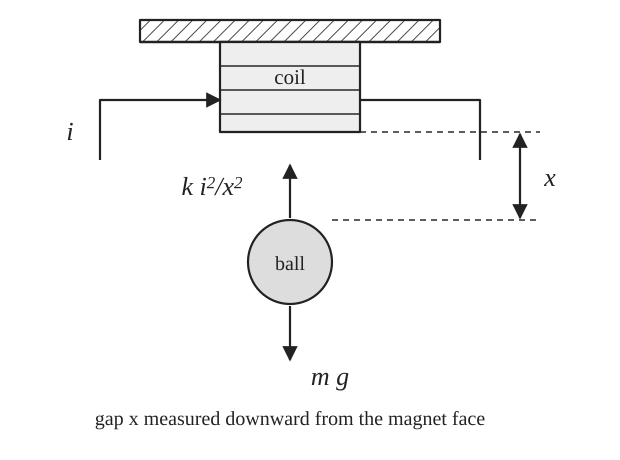
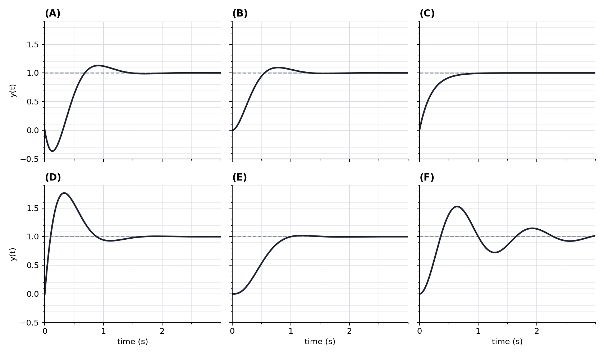

# ME404: Dynamics and Control of Mechanical Systems, Fall 2026
## Problem Set \#4: Midterm Study Guide (Chapters 1–4)

**Due Date**: Before the midterm exam, 3:30 PM November 5, 2026 (electronic submission only)

**Grading**: Full credit requires full effort. Show that you have worked through each problem to completion to receive full credit. No partial credit will be given.

**AI Policy**: AI may be used for MATLAB coding and plotting in the parts marked **(MATLAB)**. You may also ask AI for hints on how to get started on a problem, but you cannot ask the AI to solve the problem for you. Everything else is to be completed by hand, which is how you will have to do it on the exam.

### How this problem set relates to the midterm

The midterm on **Thursday, November 5** covers FPE Chapters 1–4 and the Fourier material from lecture. It is closed book and closed notes. It will consist of the following:

- **five short-answer questions**, drawn from the pool in Problem 1 with the wording changed, and
- **four problems**, each based on one of Problems 2–10 below.

The [formula sheet](formula-sheet.md) attached to this problem set is the one you will be given with the exam. Use it while you work, and tell me before the exam if something you need is missing from it.

Throughout, $D_c(s)$ is the controller, $G(s)$ is the plant, $\mathcal T(s)=Y(s)/R(s)$ is the closed-loop transfer function, and the *system error* is $E=R-Y$, the reference minus the output. System type and the error constants $K_p$, $K_v$, and $K_a$ are defined as in [System Type, §3](../../book-notes/system-type_student.md#section-3). Every steady-state result assumes that the closed loop is stable, so check stability before applying the Final Value Theorem. Measure rise time from 10% to 90% of the final output, overshoot relative to the final output, and settling time with a 1% band, as in the [Time-Domain Specifications notes](../../book-notes/time-domain-specs_student.md).

---

### Problem \#1: Short Answers

Answer each question in at most three sentences or a few lines of algebra. The exam will contain five questions of this kind, chosen from this pool and reworded.

**(a)** Name two things feedback *provides* compared with open-loop control and two things it *costs*. See [Feedback Properties, §7.3](../../book-notes/feedback-properties_student.md#section-7-3).

**(b)** The closed-loop pole pair of a zero-free second-order system, at $-1\pm2j$, is moved radially outward, along the same line through the origin, to $-2\pm4j$. State what happens to the rise time, the overshoot, and the 1% settling time, and why.

**(c)** A stable transfer function has a zero in the right half-plane: $H(s)=\left(1-\dfrac sz\right)H_0(s)$ with $z>0$, where $H_0$ is a zero-free second-order transfer function with positive DC gain. Use the derivative decomposition $H(s)=H_0(s)-\dfrac1z\,sH_0(s)$ to explain why the step response initially moves in the wrong direction.

**(d)** State the condition under which the Final Value Theorem applies. For $Y(s)=\dfrac{3}{s(s^2+9)}$, the limit $\lim_{s\to0}sY(s)=1/3$ exists. Explain why it is *not* the final value of $y(t)$, and say what $y(t)$ actually does.

**(e)** A unity-feedback loop is Type 1. The plant gain then drifts by 20%, with the loop still stable. Explain why the steady-state error to a step is still zero while the steady-state error to a ramp changes.

**(f)** A disturbance $W$ enters at the plant input. One loop has the integrator in the controller $D_c$; another has it in the plant $G$. Which loop rejects a constant disturbance, and why does only one of the two integrators count?

**(g)** Write the identity relating the sensitivity function $S$ and the complementary sensitivity $\mathcal T$. Use it to explain why a loop cannot reject disturbances at the plant output and sensor noise well at the same frequency.

**(h)** Explain why the Ziegler–Nichols ultimate-gain method cannot be applied to the plant $G(s)=\dfrac{1}{(s+1)(s+2)}$ under proportional control. What property of a plant does the method require?

**(i)** Give one reason derivative action is not used on its own for setpoint tracking, and one reason the derivative term of a practical PID controller is filtered.

**(j)** The stable system $G(s)=\dfrac{2}{s+2}$ is driven by $u(t)=4\cos 2t$. Find the steady-state output $y_{ss}(t)$, and state why the word *steady-state* is needed.

---

### Problem \#2: Magnetic Levitation, From Physics to a Transfer Function

*Source: this is the physical model behind the plant $K_0/(s^2-a^2)$ of Problem Set 3, Problem 3 (Franklin, Powell, and Emami-Naeini, 8th ed., Problem 3.56; 7th ed., Problem 3.57).*

A steel ball of mass $m$ hangs below an electromagnet. Let $x$ be the gap between the magnet and the ball, measured **downward** so that $x$ increases when the ball falls, and let $i$ be the coil current. The magnetic force on the ball is upward with magnitude $ki^2/x^2$, so Newton's law gives

$$
m\ddot x=mg-\frac{ki^2}{x^2}.
$$

Use $m=0.1\ \mathrm{kg}$, $k=10^{-4}\ \mathrm{N\cdot m^2/A^2}$, and $g=10\ \mathrm{m/s^2}$, and take the desired operating gap to be $x_0=0.05\ \mathrm m$.

**(a)** Find the constant current $i_0>0$ that holds the ball in equilibrium at $x_0$.

**(b)** Write $x=x_0+\delta x$ and $i=i_0+\delta i$, and linearize the equation of motion about the equilibrium. Show the two partial derivatives you need and their numerical values, and write the linear equation for $\delta x$. In one sentence, say what has been thrown away and when the linear model is trustworthy.

**(c)** Find the transfer function $\delta X(s)/\delta I(s)$ and its poles, and determine whether the open-loop plant is stable. Interpret the sign of the gain and the location of the unstable pole physically: if the ball is displaced $1\ \mathrm{mm}$ and released from rest with the current held at $i_0$, how long does the linear model say the displacement takes to double for the first time, and what does the doubling interval approach once the growing mode dominates?

**(d)** Define the control input as $u=-\delta i$ so that the plant gain is positive, and identify $K_0$ and $a$ in the Problem Set 3 form $K_0/(s^2-a^2)$. Show that proportional feedback $u=-K_P\,\delta x$ cannot make the ball asymptotically stable for any value of $K_P$, and describe what the closed-loop poles do as $K_P$ increases.

**(e)** Now use $\delta i=K_P\,\delta x+K_D\,\delta\dot x$, which requires a measurement of the ball's velocity. Find the closed-loop characteristic polynomial and the conditions on $K_P$ and $K_D$ for stability. Then choose $K_P$ and $K_D$ to place the closed-loop poles at $-20\pm20j$.

> **What the exam may change.** A different physical system, such as the pendulum about either equilibrium, a tank with a nonlinear outflow, or a different choice of output; or a different equilibrium gap. The steps stay the same: equilibrium, partial derivatives, transfer function, poles, and what feedback must add.

---

### Problem \#3: Reading the Response From the Poles and Zeros

*Source: in the style of Franklin, Powell, and Emami-Naeini, 8th ed., Problem 3.45 (7th ed., Problem 3.46).*

Six stable transfer functions, each with unit DC gain, are listed below. Their unit-step responses are plotted in the figure in a scrambled order, labeled (A) through (F).

$$
\begin{aligned}
H_1(s)&=\frac{25}{s^2+6s+25}, &
H_2(s)&=\frac{25}{s^2+2s+25}, &
H_3(s)&=\frac{100}{(s+4)(s^2+6s+25)},\\[8pt]
H_4(s)&=\frac{25(4-s)}{4(s^2+6s+25)}, &
H_5(s)&=\frac{25(s+2)}{2(s^2+6s+25)}, &
H_6(s)&=\frac{5}{s+5}.
\end{aligned}
$$

**(a)** For each $H_i$, list the poles and zeros, and give $\zeta$, $\omega_n$, and $\sigma$ of the dominant pair where one exists. Then predict the rise time, overshoot, and 1% settling time using the formulas on the formula sheet. Where a formula does *not* apply exactly, say so and say in which direction the true value should move: a zero reweights the modes, an extra pole slows the rise, and a first-order system has its own exact formulas.

**(b)** Match each $H_i$ to a panel of the figure. Give a one-line justification for each match that names the feature of the response you used, for example, the undershoot, the oscillation period, or the monotone rise.

**(c)** Which transfer functions meet each specification: (i) $M_p\le10\%$; (ii) $t_r\le0.4\ \mathrm s$; (iii) $t_s\le1.5\ \mathrm s$? Which meet all three? Decide from the figure and your predictions in (a), remembering that $t_s\simeq4.6/\sigma$ is an envelope estimate and the true 1% settling time is often shorter. Flag any case that is too close to call from the figure and resolve it in (d).

**(d)** **(MATLAB)** Use `stepinfo` with `'SettlingTimeThreshold',0.01` and `'RiseTimeLimits',[0.1 0.9]` to measure all three specifications for all six systems, and compare with your predictions in (a). Comment on the two cases where the second-order formulas were furthest off.

> **What the exam may change.** A different set of six transfer functions built from the same ingredients: a dominant pair, a lightly damped pair, an extra real pole, a right-half-plane zero, a left-half-plane zero, and a first-order lag. The exam may ask you to match to plots, to rank by a specification, or both. No MATLAB.

---

### Problem \#4: Laplace Solution of Initial-Value Problems and the Final Value Theorem

Solve each initial-value problem for $t\ge0$ with the unilateral Laplace transform, showing the initial-condition terms explicitly when you transform derivatives. Use the cover-up method for simple poles and coefficient matching for the rest. For each part:

1. **Predict:** identify the natural poles from the homogeneous equation and say whether the natural response decays, persists, or grows. Distinguish them from the poles that the forcing introduces into $Y(s)$.
2. **Solve:** show $Y(s)$, the partial-fraction expansion, and the real-valued $y(t)$.
3. **Verify:** check the initial conditions, and check the Final Value Theorem: state whether its hypothesis holds, compute the formal limit $\lim_{s\to0}sY(s)$, and say whether that number is the final value.

**(a)** $\ddot y+3\dot y+2y=4\cdot1(t)$, with $y(0)=1$ and $\dot y(0)=0$.

**(b)** $\ddot y+4y=8\cdot1(t)$, with $y(0)=0$ and $\dot y(0)=2$.

**(c)** $\dot y+2y=2r(t)$ with $r(t)=t$ and $y(0)=1$: a first-order system with unit DC gain driven by a unit ramp. After you find $y(t)$, find $\lim_{t\to\infty}\bigl[y(t)-r(t)\bigr]$ and interpret the result as a tracking lag, both as an offset and as a time delay. Which term of the partial-fraction expansion of $Y(s)$ is responsible for the lag?

> **What the exam may change.** The coefficients, the initial conditions, or the forcing (step, ramp, or sinusoid), chosen so that the poles are still simple to find by hand. The FVT trap in (b), a limit that exists when the final value does not, may appear in a short-answer question instead.

---

### Problem \#5: A Two-Loop Block Diagram With a Disturbance and a Feedforward Path

In the diagram, the reference $R$ reaches the inner summing junction by two routes: through the outer loop and $G_1$, and directly through a feedforward block $G_3$. An inner feedback path $H_1$ returns $Y$ to that junction with a negative sign. The disturbance $W$ is added just before the plant $G_2$. The outer loop is unity negative feedback.

**(a)** Write the signal equations and solve them for $Y$ in terms of $R$ and $W$. Report $Y/R$ and $Y/W$, and then $E/R$ and $E/W$ for the system error $E=R-Y$. Confirm the result for $Y/R$ by block-diagram reduction.

**(b)** Check two limiting cases directly from the diagram before substituting into your formula: $G_3=0$ (no feedforward) and $H_1=0$ (no inner loop). Setting a block to zero removes its path; it does not replace the block by a wire.

**(c)** Let $G_1=K$, $G_2=\dfrac{1}{s(s+2)}$, $H_1=k_ts$ (rate feedback), and $G_3=0$. Find the closed-loop characteristic polynomial. For $K=25$ and $k_t=3$, report the closed-loop poles, $\zeta$, $\omega_n$, the predicted overshoot of the reference step response, and the steady-state error to a unit-step disturbance.

**(d)** Keep $G_1$, $G_2$, and $H_1$ as in (c) and restore $G_3$. What would $G_3$ have to be for $Y/R$ to equal exactly $1$ at every frequency? Explain in one or two sentences why that $G_3$ cannot be built, and what it would do to noise or sharp corners on the reference signal if it could. See [PID Tuning, §8](../../book-notes/pid-tuning_student.md#section-8).

> **What the exam may change.** Where the disturbance or the feedforward path enters, which signal the inner loop feeds back, or the numerical blocks in (c). The exam will not ask for (d).

---

### Problem \#6: DC Motor Position Control With Rate Feedback and Integral Action

*Source: adapted from Franklin, Powell, and Emami-Naeini, 8th ed., Problem 4.25 (7th ed., Problem 4.25), with the parameters changed and the settling-time specification changed to the 1% criterion used in this course.*

A DC motor with negligible armature inductance and a load torque $w$, taken positive in the direction of positive $\theta_m$, obeys

$$
\ddot\theta_m+a_1\dot\theta_m=b_0v_a+c_0w,
\qquad
a_1=50\ \mathrm{s^{-1}},\quad
b_0=100\ \mathrm{rad/(V\cdot s^2)},\quad
c_0=5\ \mathrm{rad/(N\cdot m\cdot s^2)},
$$

where $\theta_m$ is the shaft angle in radians, $v_a$ is the armature voltage in volts, and $w$ is the load torque in newton-meters. A potentiometer measures the position error $e=\theta_r-\theta_m$, and a tachometer measures the shaft speed $\dot\theta_m$. Consider the control law

$$
v_a=K\left(e-T_D\dot\theta_m\right),
$$

where $K>0$ (V/rad) and $T_D>0$ (s) are gains to be chosen.

**(a)** Draw a block diagram of the closed loop that shows both $\theta_m$ and $\dot\theta_m$ as signals. Derive the closed-loop transfer functions $\Theta_m(s)/\Theta_r(s)$ and $\Theta_m(s)/W(s)$, and note whether either has a zero.

**(b)** Before closing the loop, suppose a constant $v_a=100\ \mathrm V$ is applied with no load torque. What steady-state speed results, in rpm?

**(c)** The specifications for a step change in $\theta_r$ with $w=0$ are an overshoot of at most $5\%$ and a 1% settling time of at most $0.1\ \mathrm s$. Translate them, with the formula-sheet estimates, into an approximate region of the $s$-plane for the closed-loop poles, and sketch it. Show that poles at $s=-50\pm50j$ lie inside the region with some margin, and find the $K$ and $T_D$ that place them there. State whether the overshoot formula is exact for this transfer function.

**(d)** Find $E(s)/\Theta_r(s)$ for your design. Give the system type with respect to the reference, the velocity constant $K_v$, and the steady-state error for a reference step of $1\ \mathrm{rad}$ and for a unit-ramp reference. How does the rate feedback affect $K_v$ compared with proportional control at the same $K$?

**(e)** With $\theta_r=0$, find $E(s)/W(s)$. Give the system type with respect to the disturbance and the steady-state error for a constant load torque $w=1\ \mathrm{N\cdot m}$.

**(f)** Add integral action,

$$
v_a=K\left(e-T_D\dot\theta_m\right)+k_I\int_0^te(\tau)\,d\tau,
$$

keeping $K$ and $T_D$ from part (c). Find the new characteristic polynomial and $E(s)/W(s)$. What is the system type with respect to the disturbance now? Use Routh's criterion to find the range of $k_I$ for which the closed loop is stable, and give the steady-state error to a unit-ramp load torque as a function of $k_I$. Choose $k_I$ at one-tenth of the stability limit and evaluate that error.

**(g)** **(MATLAB)** Plot the unit-step reference response of part (c) with the 1% band marked, and report the measured overshoot and settling time with `stepinfo` and `'SettlingTimeThreshold',0.01`. On a second figure, plot the response of $\theta_m$ to a unit-step load torque with and without integral action, and confirm the steady-state values predicted in parts (e) and (f). Report the closed-loop poles with integral action. Include your code.

> **What the exam may change.** The motor constants, the specification pair (for example, rise time and overshoot instead of overshoot and settling time), or the pole location you are asked to realize. The exam will give you the pole location, as (c) does here, and will not ask for (g).

---

### Problem \#7: Routh's Criterion and Ziegler–Nichols Tuning

*Source: the method of [PID Tuning, §4.3](../../book-notes/pid-tuning_student.md#section-4-3), which follows Franklin, Powell, and Emami-Naeini, 8th ed., Example 4.10 (7th ed., Example 4.9).*

The plant

$$
G(s)=\frac{1}{s(s+1)(s+4)}
$$

is placed in a unity-feedback loop with the controller $D_c(s)$, as in the diagram of Problem 8 with $W=0$.

**(a)** With proportional control $D_c=K$, write the closed-loop characteristic polynomial and the Routh array, and find the range of $K>0$ for which the closed loop is stable.

**(b)** At the upper limit of that range, the loop oscillates. Call the limit the ultimate gain $K_u$. Use the auxiliary polynomial from the Routh array to find the ultimate frequency $\omega_u$ and the ultimate period $P_u=2\pi/\omega_u$. Confirm by factoring the characteristic polynomial at $K=K_u$.

**(c)** Use the ultimate-sensitivity rules on the formula sheet (FPE Table 4.3; the PID row of that table is misprinted in the 7th edition, so use the sheet) to give the P, PI, and PID gains $k_P$, $T_I$, and $T_D$ for the controller

$$
D_c(s)=k_P\left(1+\frac{1}{T_Is}+T_Ds\right).
$$

**(d)** Show that the Ziegler–Nichols PID rule always produces a controller with a *repeated* real zero, and locate it for this plant. (Write the controller as a single fraction and look at the numerator.)

**(e)** For the P and the PI designs, give the system type with respect to the reference, the velocity constant $K_v$ where it is finite, and the steady-state error to a unit-ramp reference. For the P design, confirm stability directly from the Routh array of (a).

**(f)** **(MATLAB)** Plot the unit-step reference responses of the P, PI, and PID designs on one figure and report the overshoot of each. One of the three is barely stable. Identify it, report its closed-loop poles, and explain in a sentence why Ziegler–Nichols tuning is a starting point rather than a final design. Include your code.

> **What the exam may change.** A different third-order plant, chosen so that $\omega_u$ is still a clean number, and which of the P, PI, and PID designs you are asked about. The exam may ask you to confirm the stability of a design by Routh, but only for the third-order case, and will not ask for (f).

---

### Problem \#8: System Type With Respect to the Reference and the Disturbance

*Source: adapted from Franklin, Powell, and Emami-Naeini, 8th ed., Problems 4.13 and 4.15 (7th ed., Problems 4.13 and 4.15).*

The unity-feedback structure below applies to both parts. A disturbance $W$ enters at the plant input; set $W=0$ in Part A.

#### (Part A) A second-order plant with a first-order compensator

Let

$$
G(s)=\frac{1}{(s+1)(s+2)},
\qquad\qquad
D_c(s)=\frac{K(s+a)}{s+b},
$$

with $K>0$ and $a>0$ throughout Part A.

**(i)** Ignoring stability for the moment, what constraint on $b$ makes the closed loop Type 1 with respect to the reference? Give the velocity constant $K_v$ under that constraint.

**(ii)** Write the closed-loop characteristic polynomial under the constraint of (i). Use Routh's criterion to find the condition on $K$ and $a$ that makes the closed loop both stable and Type 1.

**(iii)** What constraint on $a$ makes the closed loop Type 1 *and* stable for every positive value of $K$?

**(iv)** Take $a=1$, $K=4$, and the value of $b$ from (i). Confirm stability, factor the characteristic polynomial, report its roots (the closed-loop poles), note any pole–zero cancellation in $\mathcal T(s)$, and give the steady-state error to a unit-step reference and to a unit-ramp reference.

#### (Part B) Satellite attitude: type depends on the input

A satellite attitude loop has the following plant and controller:

$$
G(s)=\frac{1}{s^2},
\qquad\qquad
D_c(s)=\frac{8(s+1)}{s+4}.
$$

**(i)** Find the closed-loop characteristic polynomial and confirm by Routh's criterion that the closed loop is stable. Factor the polynomial and report the closed-loop poles.

**(ii)** Find the system type with respect to the reference and the corresponding error constant. Give the steady-state error for a unit step, a unit ramp, and the parabola $r(t)=t^2/2$.

**(iii)** A disturbance torque $w(t)$ adds to the control so that the plant input is $u+w$. Find $E(s)/W(s)$, the system type with respect to the disturbance, and the corresponding error constant. Give the steady-state error for a unit-step disturbance torque.

**(iv)** The loop contains two integrators, yet it does not reject a constant disturbance torque. In one or two sentences, explain which integrators count for each input. See [System Type, §7.2](../../book-notes/system-type_student.md#section-7-2).

**(v)** Now suppose instead that the disturbance adds to the *output*, so that $Y=GU+W$ with $W$ a constant offset added to the attitude itself (an output disturbance, not a sensor error). Find the new $E(s)/W(s)$ with $R=0$, and the system type and steady-state error with respect to this disturbance. Why did the type change?

> **What the exam may change.** The plant and controller numbers; where the disturbance enters (plant input or plant output); or a sensor $H(s)$ in the feedback path instead of unity feedback, in which case use $e_{ss}=\lim_{s\to0}\bigl[1-\mathcal T(s)\bigr]/s^k$ as in [System Type, §6](../../book-notes/system-type_student.md#section-6).

---

### Problem \#9: Robustness of System Type and Sensitivity

*Source: adapted from Franklin, Powell, and Emami-Naeini, 8th ed., Problem 4.21 (7th ed., Problem 4.21), with the plant and the ramp-error specification changed, and a sensitivity part added in the spirit of Problem 4.2.*

The two feedback systems below drive the same first-order plant $K_0/(2s+1)$. System (a) uses an integral controller $K_1/s$. System (b) uses a proportional controller $K_3$ preceded by an input gain $K_2$. In both systems the error is $E=R-Y$.

**(a)** Determine values of $K_1$, $K_2$, and $K_3$ so that, with $K_0=1$: (i) both systems have zero steady-state error to a unit-step reference, and (ii) both have a steady-state error of $\tfrac12$ to a unit-ramp reference. For each system, write $E(s)/R(s)$ first and confirm that the loop is stable.

**(b)** Now let the plant gain change to $K_0=1+\delta$ with the controller gains fixed at the values from (a). For each system, find the steady-state errors to a unit step and a unit ramp as functions of $\delta$, and evaluate them for $\delta=0.1$. If an error grows without bound, give its sign and its rate of growth. Which system has a type that is robust to the change, and why?

**(c)** Report the closed-loop poles of both nominal designs. Estimate the overshoot and the 1% settling time of each step response, and comment on the price that system (a) pays for its robust type.

**(d)** Compute the sensitivity $S^{\mathcal T}_{K_0}$ of the closed-loop DC gain $\mathcal T(0)$ to the plant gain $K_0$ for each system at the nominal values, and the sensitivity of $\mathcal T(0)$ to the input gain $K_2$ in system (b). Which parameters does feedback protect, and which does it not?

> **What the exam may change.** The plant time constant, the ramp-error specification, or the controller in system (a) (for example, PI instead of pure integral). The exam may ask (a), (b), and (d), or (a) and (c), but not all four parts.

---

### Problem \#10: Sinusoids, Harmonics, and a Low-Pass Filter

*Source: Franklin, Powell, and Emami-Naeini, 8th ed., §3.1.2 (7th ed., §3.1.2), together with Oppenheim, Willsky, and Nawab, Signals and Systems, 2nd ed., §3.2–3.4 and §3.8 (response of LTI systems to complex exponentials, the Fourier series, and Fourier series through LTI systems).*

A first-order low-pass filter has the transfer function

$$
G(s)=\frac{1}{0.1s+1}.
$$

**(a)** The input is $u(t)=2\cos 10t+\cos\!\left(30t+\tfrac{\pi}{4}\right)$. Find the steady-state output $y_{ss}(t)$ as a sum of two real cosines, giving each amplitude and phase. Why may the two components be treated separately?

**(b)** Now the input is the square wave of amplitude $\pm1$ and fundamental frequency $\omega_0=10\ \mathrm{rad/s}$:

$$
u(t)=\begin{cases}+1,&0\le t<\pi/10,\\-1,&\pi/10\le t<\pi/5,\end{cases}
\qquad u(t+\pi/5)=u(t).
$$

Show that its Fourier coefficients are $c_k=\dfrac{2}{jk\pi}$ for odd $k$ and $c_k=0$ for even $k$, and write the first three nonzero terms of the series as real sinusoids.

**(c)** Explain why the Fourier coefficients of the periodic steady-state output are $d_k=G(jk\omega_0)c_k$. Compute the amplitudes of the first, third, and fifth harmonics at the output. Compare the ratio of the third-harmonic amplitude to the fundamental amplitude at the output with the same ratio at the input, and explain the difference.

**(d)** The series in (c) describes the periodic steady state. Describe the transient that is also present when the square wave is switched on at $t=0$ with $y(0)=0$, give its time constant, and say roughly when the steady-state description becomes accurate.

**(e)** **(MATLAB)** Simulate the response to the square wave with `lsim` over $0\le t\le1.5\ \mathrm s$ and overlay the reconstruction of $y_{ss}$ from (c) that keeps the harmonics through the fifth ($k=1,3,5$). Include your code.

> **What the exam may change.** The filter's time constant, the frequencies in (a), or the question of which harmonic ratio to compute. The exam will not ask for the derivation in (b) or for (e); a sinusoid or a single harmonic computation may appear instead in a short-answer question.
