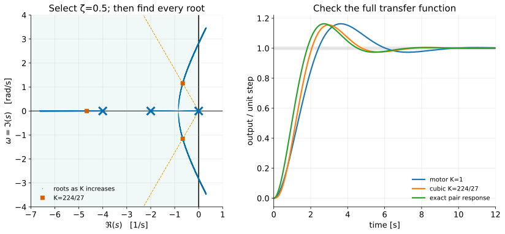

# The Root-Locus Design Method II — Reading the Locus and Selecting Gain

<!--hidden-->

**Audience:** Fourth-year mechanical engineering, ME404.

**Duration:** One 105-minute scheduled meeting: about 75 minutes of core development plus 30 minutes of guided problem work or extensions. This follows the syllabus meeting length; the topic map's hours are a planning guide. Four such meetings cover this series.

# Teaching plan

**Theme:** FPE's illustrative loci, then feasibility, gain selection, and verification.

Work FPE §5.3's examples in the book's order and in the book's RULE 1–5 format; they are the vocabulary for Lectures III and IV. Protect the two boxed conclusions (a zero pulls the locus left; an incoming pole pushes it right), the collocated/noncollocated departure contrast, the all-roots-at-one-gain check, and the distinction between a pole target and a response requirement. Derive the cubic ray intersection by hand; use the partial fractions below if students want an exact response check. If time is short, Example 5.10 and §9's residue discussion are the first to move to reading.

The numbered lecture sections below match the student version, including the examples, assumptions, and numerical values. Complete instructor derivations and review answers follow the lecture. Keep this file outside the public chapter list.

| Time | Activity |
|---|---|
| 0–15 min | Double integrator with P and PD (Ex. 5.3); the circle |
| 15–35 min | Lead pole at 12, 4, 9 (Ex. 5.4–5.7); why the transition is exactly 9 |
| 35–50 min | Collocated versus noncollocated departure angles (Ex. 5.8–5.9) |
| 50–55 min | Complex multiple roots (Ex. 5.10) |
| 55–65 min | Specifications as pole regions; the proportional motor limitation |
| 65–80 min | Cubic damping-ray gain; every pole; full response; error constants |
| 80–105 min | Guided design exercise; inspect approximation errors |

**Preparation:** Open the lecture's figures and runnable scripts in `demos/ch5/`. Use `--show` for an interactive figure; run without it to regenerate SVG and PNG. The demo guide includes MATLAB and Python instructions. Symbolic and independent numerical checks are in `verify_designs.py`.

---

**Instructor lecture notes — FPE 8th ed., Section 5.3, Examples 5.3–5.10; gain selection against specifications**

FPE's illustrative loci show what adding a zero, adding a pole, or adding a flexible mode does to the picture. The root locus then answers a feasibility question: can a single adjustable gain give the required poles? A design must pass a second test: do those poles, together with the zeros and other modes, give the required response?

**Prerequisites:** [I — Root-locus construction](root-locus-construction_instructor.md), [time-domain specifications](time-domain-specs_instructor.md), and [system type](system-type_instructor.md).

**Sources:** FPE 8th ed., §5.3 (Examples 5.3–5.10, numbered identically in the 7th ed.; Example 5.7's tool is `rltool` in the 7th ed. and `sisotool` in the 8th) and §5.2.3, checked against the 7th ed.; Nise 7th ed., §§8.6–8.7, for transient-response design and higher-order verification; Ogata, *Modern Control Engineering*, 5th ed., §6–3 for MATLAB root loci and §6–5 for design preliminaries and dominant-pole assumptions. The normalized motor continues FPE Example 5.1. The cubic calculations are **[course examples]**.

## Learning objectives

1. Apply Rules 1–5 to FPE's double-integrator, lead, flexible-mode, and complex-multiple-root examples, and state what each example teaches about adding a zero, a pole, or a mode.
2. Convert damping, overshoot, and settling requirements into candidate pole regions.
3. Find a gain where the locus intersects a damping-ratio ray.
4. Check every closed-loop root, zeros, steady-state error, and actual transient response.
5. Recognize when gain adjustment cannot meet the specifications.

## Notation and assumptions

Use negative unity feedback, $L=KL_0$, with $G$ the plant and $D_c$ the controller. Write an upper LHP pole as $s=-\sigma+j\omega_d$ with $\sigma>0$. Then $\omega_n=|s|$ and $\zeta=\sigma/\omega_n$. Pole coordinates use seconds. Rise time means **10–90% of the final value**; settling time means **last entry into a ±1% band**, following the earlier course notes and FPE. Fractional overshoot $M_p$ is measured relative to the final value; percent overshoot is $100M_p$.

---

## Where we are, and where this lecture goes

Lecture I gave us Evans's rules and the magnitude condition, and its §5 (FPE §5.2.3) showed how to read the gain for a chosen point off the locus. This lecture has two halves, and FPE's chapter has the same two halves in the same order.

The first half is FPE §5.3, *Selected Illustrative Root Loci*: eight examples built on the double integrator, the model of a satellite's attitude or of a disk drive's read/write arm. FPE uses them to show what the rules predict when a zero is added, when a pole is added and then moved, when a lightly damped flexible mode appears with or without nearby zeros, and when multiple roots occur off the real axis. We work every one of them (§§1–4), because each is a pattern you will meet again in Lectures III and IV and in every design you do afterward.

The second half turns from reading loci to selecting a gain against time-domain specifications. A plot and a gain are not yet a design. Nobody asks for "a pole at $-2/3+1.15j$"; they ask for a joint that settles in a couple of seconds without much overshoot and follows a constant-speed command closely. Three moves connect those requests to the picture, and they recur in every root-locus design you will do:

1. **Translate.** Turn time-domain requirements into a region of the $s$-plane where the dominant poles are allowed to sit (§5).
2. **Intersect.** Find where the locus enters that region and read off the gain (§§6–7). Sometimes the locus never enters it, and then no gain will do. That is a real answer, and it is the one that sends us to Lectures III and IV.
3. **Verify.** Recompute *every* pole at the chosen gain, form the complete transfer function, and check the actual response and the steady-state error (§§8–9). The target region was built from a second-order formula, and the real loop is rarely second order.

The running examples of the second half are the motor, where the second move fails, and the cubic from Lecture I, where it succeeds for damping but fails for tracking accuracy.

## 1. The double integrator with proportional and PD control {#section-1}

FPE §5.3 opens with the simplest plant that matters in practice,

$$
G(s)=\frac1{s^2}.
$$

A satellite's attitude obeys it: torque gives angular acceleration and nothing resists the motion. So does the read/write head of a disk drive, which floats on an air bearing with negligible friction and is driven by a current source, so the motor's back emf does not affect the torque. There is no damping in the plant at all; every bit of damping must come from the controller.

### Proportional control

With unity feedback and $D_c=k_P$, the characteristic equation is $1+k_P/s^2=0$. FPE applies the rules to this "trivial" case:

- **RULE 1.** The locus has two branches that start at $s=0$.
- **RULE 2.** There are no parts of the locus on the real axis.
- **RULE 3.** The two asymptotes intersect at $s=0$ and are at the angles $\pm90^\circ$.
- **RULE 4.** The loci depart from $s=0$ at the angles $\pm90^\circ$.

*Conclusion:* the locus is the imaginary axis, and the transient would be oscillatory for any value of $k_P$. The closed-loop poles are $\pm j\sqrt{k_P}$: the gain sets the frequency and nothing sets the decay. A more useful design results from proportional plus derivative control.

### PD control: FPE Example 5.3

With $D_c=k_P+k_Ds$,

$$
1+\left[k_P+k_Ds\right]\frac1{s^2}=0.
$$

To put this in root-locus form, FPE defines $K=k_D$ and, for the moment, arbitrarily selects the gain ratio $k_P/k_D=1$, so that

$$
1+K\frac{s+1}{s^2}=0.
$$

(In a specific physical system the ratio would be chosen with the rise time or the actuator's control authority in mind; it fixes where the zero sits.) Again by the rules:

- **RULE 1.** Two branches start at $s=0$; one terminates on the zero at $s=-1$ and the other approaches infinity.
- **RULE 2.** The real axis to the left of $s=-1$ is on the locus.
- **RULE 3.** Since $n-m=1$, there is one asymptote, along the negative real axis.
- **RULE 4.** The angles of departure from the double pole at $s=0$ are $\pm90^\circ$.
- **RULE 5.** From Rules 1–4 it should be clear that the locus will curl around the zero, rejoin the real axis to the left of the zero, and terminate as Rule 1 says. It rejoins the axis at $s=-2$, a point of multiple roots, and evaluation of the arrival angles there gives $\pm90^\circ$.

So two branches leave the origin going north and south, curve around without entering the right half-plane, and break in at $s=-2$; from there one branch goes west to infinity and the other east to the zero at $-1$. The path is a circle, as FPE's footnote and Problem 5.18 claim. Write $s+1=e^{j\theta}$, a point at unit distance from the zero. Then $s=-1+e^{j\theta}$ and

$$
K=-\frac{s^2}{s+1}=-\frac{(e^{j\theta}-1)^2}{e^{j\theta}}
=-\left(e^{j\theta}-2+e^{-j\theta}\right)=2(1-\cos\theta)=4\sin^2\frac\theta2,
$$

which is real and non-negative for every $\theta$. Every point of the unit circle centered on the zero is therefore on the locus, and $\theta=\pi$ gives the break-in at $s=-2$ with $K=4$: indeed $s^2+4(s+1)=(s+2)^2$. The left panel of the figure below is this locus.

```matlab
s = tf('s');
sysS = (s+1)/(s^2);
rlocus(sysS)
```

Comparing this case with the simple $1/s^2$, FPE draws the conclusion that drives Lecture III:

> **The addition of the zero has pulled the locus into the LHP**, a point of general importance in constructing a compensation.

## 2. Lead compensation for the satellite: the effect of an added pole {#section-2}

Pure differentiation is not practical, and in practice PD control is approximated by

$$
D_c(s)=k_P+\frac{k_Ds}{s/p+1},
$$

which FPE puts in root-locus form by defining $K=k_P+pk_D$ and $z=pk_P/K$:

$$
D_c(s)=K\frac{s+z}{s+p}.
$$

For reasons that frequency-response design will make clear, this is called a **lead compensator** when $z<p$ (or a lead network, after its electrical implementation). The characteristic equation for the $1/s^2$ plant is

$$
1+K\frac{s+z}{s^2(s+p)}=0.
$$

To evaluate the effect of the added pole, FPE again sets $z=1$ and considers three values of $p$. The three right-hand panels of the figure show them; note that FPE's order is $p=12$, then $4$, then the transition value $9$.


### Example 5.4: a somewhat large value, $p=12$

$$
1+K\frac{s+1}{s^2(s+12)}=0.
$$

- **RULE 1.** Three branches: two start at $s=0$ and one at $s=-12$.
- **RULE 2.** The real-axis segment $-12\le s\le-1$ is part of the locus.
- **RULE 3.** There are $n-m=2$ asymptotes, centered at $\sigma_a=(-12+1)/2=-11/2$, at the angles $\pm90^\circ$.
- **RULE 4.** The departures from $s=0$ are again $\pm90^\circ$; the departure from $s=-12$ is at $0^\circ$.

Several locus shapes are consistent with this guidance, and FPE calls MATLAB the expedient way to discover the actual path:

```matlab
s = tf('s');
sysL = (s+1)/((s^2)*(s+12));
rlocus(sysL)
```

Two branches break vertically from the poles at the origin, curve around to the left without entering the right half-plane, and break in at $s=-2.3$; there one branch goes right to the zero at $-1$ and the other goes left, where it is met by the root that left $-12$. These two form a multiple root at $s=-5.2$, break away there, and approach the vertical asymptotes at $s=-5.5$. (The exact break-in and breakaway points are $-2.314$ at $K=39.5$ and $-5.186$ at $K=43.8$; the derivation is in the box after Example 5.6.) The added pole has distorted the simple circle of PD control, but near the origin the locus is quite similar to the PD case. The situation changes when the pole is brought closer in.

### Example 5.5: a relatively small value, $p=4$

$$
1+K\frac{s+1}{s^2(s+4)}=0.
$$

- **RULE 1.** Three branches: two from $s=0$ and one from $s=-4$.
- **RULE 2.** The segment $-4\le s\le-1$ is part of the locus.
- **RULE 3.** Two asymptotes centered at $\sigma_a=-3/2$, at $\pm90^\circ$.
- **RULE 4.** The branches again depart from the poles at $s=0$ at $\pm90^\circ$.
- **RULE 5.** MATLAB shows that the two branches from the origin break away vertically, curve slightly to the left, and join the asymptotes going north and south. The branch from $s=-4$ goes east and terminates at the zero.

The difference from $p=12$ is that there are no break-in or breakaway points on the real axis. In one case there were both; in the other they have disappeared. FPE asks the natural question, at what value of $p$ did they go away, and answers: at $p=9$.

### Example 5.6: the transition value, $p=9$

$$
1+K\frac{s+1}{s^2(s+9)}=0.
$$

- **RULE 1.** Three branches, from $s=0$ (two) and $s=-9$.
- **RULE 2.** The segment $-9\le s\le-1$ is part of the locus.
- **RULE 3.** Two asymptotes centered at $\sigma_a=-8/2=-4$.
- **RULE 4.** Departures at $\pm90^\circ$ from $s=0$, as before.
- **RULE 5.** The two branches from the origin curl around and rejoin the real axis at $s=-3$ with arrival angles of $\pm60^\circ$, while the branch from $s=-9$ heads east and joins them at $-3$ with an arrival angle of $0^\circ$. Three branches then leave $-3$ at $0^\circ$ and $\pm120^\circ$: one into the zero, two to the northwest toward the asymptotes. Rule 5 confirms these angles: $q=3$ gives six rays separated by $60^\circ$.

This special shape occurs only when the pole-to-zero ratio is exactly $9{:}1$ for this form of $L_0$. (FPE's footnote names the curve a trisectrix of Maclaurin.) It is the transition between the two types of Examples 5.4 and 5.5. When the third pole is near the zero ($p$ near 1) there is only a modest distortion of the two straight branches of $K/s$; as $p$ increases the locus changes until at $p=9$ it breaks in at $-3$ in a triple root; beyond $-9$ the locus shows distinct break-in and breakaway points, approaching the PD circle as $p\to\infty$.

**Why exactly 9? [course derivation]** Along the real axis $K(s)=-s^2(s+p)/(s+1)$, and multiple roots satisfy $dK/ds=0$. Differentiating the quotient and clearing the denominator,

$$
(3s^2+2ps)(s+1)-(s^3+ps^2)=s\left[2s^2+(3+p)s+2p\right]=0.
$$

The factor $s=0$ is the open-loop double pole. The quadratic has real roots exactly when its discriminant is non-negative:

$$
(3+p)^2-16p=p^2-10p+9=(p-1)(p-9)\ge0.
$$

For $1<p<9$ there are no real-axis multiple roots (Example 5.5). For $p>9$ there are two (Example 5.4). At $p=9$ the two coincide at $s=-(3+9)/4=-3$, and the multiple root is triple:

$$
s^2(s+9)+27(s+1)=s^3+9s^2+27s+27=(s+3)^3,\qquad K=27.
$$

The other boundary, $p=1$, is where the pole cancels the zero and the locus reverts to that of $1/s^2$.

### Example 5.7: repeating the examples with an interactive tool

FPE's Example 5.7 is an exercise rather than a calculation: open the PD locus of Example 5.3 in MATLAB's interactive root-locus tool, add a compensator pole at $s=-12$, then drag it slowly toward $-4$ and watch the locus change shape, slowing down near $-9$ where the shape changes very quickly. Dragging a closed-loop pole along a branch shows where the other roots are at the same gain, together with their damping and frequency.

```matlab
s = tf('s');
sysL = (s+1)/(s^2);
rltool(sysL)        % the 7th ed. name; the 8th ed. uses sisotool. Both open Control System Designer.
```

The useful conclusion FPE draws from the exercise is the counterpart of §1's:

> **An additional pole moving in from the far left tends to push the locus branches to the right** as it approaches a given locus.

Together the two boxed statements are the whole intuition behind Lectures III and IV: a zero pulls the locus toward itself, a pole pushes it away.

## 3. Flexibility: collocated and noncollocated cases {#section-3}

The double integrator assumes a rigid body with no friction. A real satellite has flexible solar panels, and a disk drive's head-arm assembly always has flexibility, usually with several lightly damped modes that can often be approximated by one dominant mode. Chapter 2 showed that flexibility adds a pair of complex poles to the $1/s^2$ model. There are two possibilities. If the sensor is on the same rigid body as the actuator, the case is **collocated**, and the transfer function has not only the complex poles but also a pair of nearby complex zeros at a lower natural frequency. If the sensor is on another body, across the flexibility from the actuator, the case is **noncollocated**, and the zeros are absent. The disk drive, with the motor at one end of the arm and the head at the other, is noncollocated. FPE chooses the numbers to illustrate root-locus properties rather than a particular physical model.

### Example 5.8: the collocated case

The plant and the lead controller are

$$
G(s)=\frac{(s+0.1)^2+6^2}{s^2\left[(s+0.1)^2+6.6^2\right]},\qquad
D_c(s)=K\frac{s+1}{s+12},
$$

so $L_0$ has poles at $0,0,-12,-0.1\pm6.6j$ and zeros at $-1,-0.1\pm6j$. Both poles and zeros lie near the imaginary axis, so the departure angles will matter most.

- **RULE 1.** Five branches; three approach the finite zeros and two approach the asymptotes.
- **RULE 2.** The real-axis segment $-12<s<-1$ is part of the locus.
- **RULE 3.** The center of the two asymptotes is
  $$
  \sigma_a=\frac{(-12-0.1-0.1)-(-1-0.1-0.1)}{5-3}=\frac{-12.2+1.2}{2}=-5.5,
  $$
  and their angles are $\pm90^\circ$.
- **RULE 4.** At the pole $-0.1+6.6j$, call the unknown angle $\phi_1$. The zero at $-1$ contributes $\psi_1$, the zeros at $-0.1\pm6j$ contribute $\psi_2=\psi_3=90^\circ$ (they lie directly below), the two poles at the origin and the conjugate pole contribute $\phi_2=\phi_3=\phi_4=90^\circ$ (directly below, to FPE's precision), and the pole at $-12$ contributes $\phi_5$. FPE reads $\psi_1=\tan^{-1}6.6=81.4^\circ$ and $\phi_5=\tan^{-1}(6.6/12)=28.8^\circ$ from the figure, so
  $$
  \phi_1=\psi_1+\psi_2+\psi_3-(\phi_2+\phi_3+\phi_4+\phi_5)-180^\circ
  =81.4^\circ+90^\circ+90^\circ-[90^\circ+90^\circ+90^\circ+28.8^\circ]-180^\circ
  =-217.4^\circ=142.6^\circ.
  $$

The root leaves this pole up and to the left, into the stable region. (With the vectors computed exactly rather than read off a figure, the angle is $141.5^\circ$; the conclusion is the same.) The left panel of the figure below shows the full locus: the flexible branch is a short arc from the pole at $-0.1+6.6j$ to the nearby zero at $-0.1+6j$, and every branch stays in the left half-plane at every gain. FPE notes that all the attributes determined by the simple rules appear on the computer plot, which verifies in part that the data were entered correctly.

> **In the collocated case, the presence of a single flexible mode introduces a lightly damped root to the characteristic equation but does not cause the system to be unstable.**


### Example 5.9: the noncollocated case

Remove the zeros:

$$
G(s)=\frac1{s^2\left[(s+0.1)^2+6.6^2\right]},\qquad
D_c(s)=K\frac{s+1}{s+12}.
$$

- **RULE 1.** Five branches; one approaches the zero at $-1$ and four approach the asymptotes.
- **RULE 2.** The real-axis segment $-12<s<-1$ is part of the locus.
- **RULE 3.** The center of the asymptotes is
  $$
  \sigma_a=\frac{-12-0.2-(-1)}{4}=\frac{-11.2}{4}=-2.8,
  $$
  and the four asymptotic branches are at $\pm45^\circ$ and $\pm135^\circ$.
- **RULE 4.** At $-0.1+6.6j$, with the same angles as before but no flexible zeros,
  $$
  \phi_1=\psi_1-(\phi_2+\phi_3+\phi_4+\phi_5)-180^\circ
  =81.4^\circ-90^\circ-90^\circ-90^\circ-28.8^\circ-180^\circ
  =-397.4^\circ=-37.4^\circ.
  $$

Now the root leaves the pole down and to the right, toward the unstable region, and we expect the system to become unstable soon as the gain increases. (Exact vectors give $-38.5^\circ$.) The middle panel confirms it. Numerically the flexible branches cross the imaginary axis at $K\approx144$ near $6.5$ rad/s, and at that gain the dominant slow roots near the origin sit at about $-0.13\pm0.52j$ with a damping ratio near $0.25$. FPE's verdict: a very lightly damped response with very oscillatory flexible modes, not acceptable with the lead compensator as chosen. The notch filter of Lecture IV §7 is one response to exactly this situation.

```matlab
s = tf('s');
sysG = 1/((s^2)*((s+0.1)^2+6.6^2));
sysD = (s+1)/(s+12);
sysL = sysD*sysG;
rlocus(sysL); rlocfind(sysL)
```

The two examples differ by one thing, the pair of zeros, and that difference is the difference between a design that merely has a lightly damped mode and one that goes unstable. Where the sensor sits is a control decision.

## 4. A locus with complex multiple roots {#section-4}

Break-in and breakaway points so far have been on the real axis. An equation of fourth or higher order can also have multiple roots that are complex. FPE calls this a rare event and an interesting curiosity; it is also a good test of Rules 4 and 5.

### Example 5.10

$$
L_0(s)=\frac1{s(s+2)\left[(s+1)^2+4\right]},\qquad\text{poles }0,\ -2,\ -1\pm2j.
$$

- **RULE 1.** Four branches, all of which approach the four asymptotes.
- **RULE 2.** The real-axis segment $-2\le s\le0$ is on the locus.
- **RULE 3.** The center of the asymptotes is $\sigma_a=(-2-1-1-0)/4=-1$ and the angles are $\pm45^\circ$, $\pm135^\circ$.
- **RULE 4.** At $-1+2j$, the arrow from $0$ has angle $116.6^\circ$, the arrow from $-2$ has angle $63.4^\circ$, and the arrow from $-1-2j$ has angle $90^\circ$, so
  $$
  \phi_{\mathrm{dep}}=-116.6^\circ-63.4^\circ-90^\circ-180^\circ=-450^\circ=-90^\circ.
  $$
  The branch leaves straight down. More than that: for any point on the line $s=-1+j\omega$, the arrows from $0$ and $-2$ are the two base angles of an isosceles triangle and always add to $180^\circ$, so the entire segment between the two complex poles is on the locus.
- **RULE 5.** MATLAB shows multiple roots at $s=-1\pm1.22j$, where branches come together, and Rule 5 says they break away at $0^\circ$ and $180^\circ$.

The right panel shows it. The two real roots leave $0$ and $-2$, meet at $-1$ when $K=4$, and go vertical; the complex poles descend the same line; the pairs meet at $-1\pm1.22j$ when $K=25/4$ and split horizontally toward the asymptotes. The exact values come from a substitution: with $u=(s+1)^2-1=s^2+2s$,

$$
P(s)=s(s+2)\left[(s+1)^2+4\right]+K=u(u+5)+K=u^2+5u+K,
\qquad
\frac{dP}{ds}=(2u+5)(2s+2).
$$

Multiple roots need $dP/ds=0$: either $s=-1$ (then $u=-1$ and $K=4$, the real-axis breakaway, with $P=(s+1)^2(s^2+2s+4)$) or $u=-5/2$ (then $K=25/4$ and $(s+1)^2=-3/2$, so $s=-1\pm j\sqrt{3/2}=-1\pm1.2247j$, with $P=(s^2+2s+5/2)^2$). At $K=25/4$ each complex point is a double root: $2q=4$ rays, arriving vertically and departing horizontally, exactly as Rule 5 requires. This locus is a transition between two types: with the complex poles farther left the branches approach the $\pm135^\circ$ asymptotes, and with them farther right they approach $\pm45^\circ$.

## 5. Translate the specifications into geometry {#section-5}

For the standard second-order transfer function with no finite zero,

$$
\mathcal T_2(s)=\frac{\omega_n^2}{s^2+2\zeta\omega_ns+\omega_n^2},
\qquad
s=-\zeta\omega_n\pm j\omega_n\sqrt{1-\zeta^2},
$$

$$
\omega_n=\sqrt{\sigma^2+\omega_d^2},\qquad
\zeta=\frac{\sigma}{\sqrt{\sigma^2+\omega_d^2}}.
$$

A constant damping ratio is a ray making angle $\cos^{-1}\zeta$ with the **negative real axis**. Larger $\zeta$ lies closer to that axis. Constant $\omega_n$ is a circle centered at the origin. Constant $\sigma$ is a vertical line.

Picture the three shapes on one set of axes. A maximum-overshoot requirement bounds $\zeta$ from below, which keeps the poles inside a wedge around the negative real axis. A settling-time requirement bounds $\sigma$ from below, which keeps them to the left of a vertical line. A rise-time requirement bounds $\omega_n$ from below, which keeps them outside a circle. The admissible region is the intersection: a wedge, cut off on the right by a line and hollowed out near the origin by a circle. The design question becomes geometric: does the locus pass through that region, and at what gain?

The formulas that build the region are the second-order ones from the time-domain lecture, so we restate them with their assumptions.

For $0<\zeta<1$,

$$
M_p=e^{-\pi\zeta/\sqrt{1-\zeta^2}},\qquad
\zeta_{\min}=\frac{-\ln M_{p,\max}}{\sqrt{\pi^2+(\ln M_{p,\max})^2}}.
$$

Ten percent overshoot gives $\zeta_{\min}\approx0.591$. The common estimates

$$
t_s\approx\frac{4.6}{\zeta\omega_n}=\frac{4.6}{\sigma},
\qquad t_r\approx\frac{1.8}{\omega_n}
$$

are design starting points, not exact constraints for arbitrary systems. The 10–90% rise approximation is useful over a moderate damping range, not near every damping ratio. A settling target $t_s\le2$ s suggests poles to the left of $\Re s=-2.3$.

For the standard underdamped pair, a sufficient envelope-based settling bound is

$$
t_{s,\mathrm{env}}=
\frac{-\ln\!\left(0.01\sqrt{1-\zeta^2}\right)}{\zeta\omega_n}.
$$

The actual last band entry can be earlier. If additional poles or zeros contribute significantly, even this two-pole envelope is no longer the response envelope.

## 6. First ask whether gain alone can work {#section-6}

Before any calculation, lay the admissible region over the locus and look. For the motor the complex branches are the vertical line $\Re s=-1/2$. Any requirement that asks for poles to the left of that line is unreachable with proportional control, and no amount of gain tuning will change that. The algebra below says the same thing, but the picture says it first.

For the normalized motor,

$$
\mathcal T=\frac K{s^2+s+K},\qquad
\omega_n=\sqrt K,\qquad \zeta=\frac1{2\sqrt K}.
$$

For all underdamped gains, $\sigma=\zeta\omega_n=1/2$. Increasing $K$ makes the rise faster but lowers damping. It cannot move the complex pair into $\Re s<-1/2$.

A target $\zeta=0.5$ gives $K=1$ and poles $-0.5\pm0.8660j$. The exact second-order overshoot is $16.30\%$; the $4.6/\sigma$ settling estimate is 9.2 s (the actual 1% settling time is about 8.78 s). A target pole $-2+2j$ cannot be reached with proportional gain: it fails the angle condition whatever positive magnitude is assigned to $K$.

If the requirement is at most 10% overshoot, $\zeta\ge0.591$ implies $K\lesssim0.716$ in the underdamped range. The overdamped gains $0<K\le1/4$ also meet that overshoot bound, but are slower. A time-response specification should therefore be checked on the feasible part of the locus, not optimized by gain in isolation.

The lesson is not that the motor is a poor plant. It is that one gain gives one degree of freedom, and the requirements ask for two things at once: speed and damping. The locus makes that count visible. Along the motor's complex branches $\omega_n$ grows with $K$ while $\sigma$ stays put, so faster always means less damped. To move the whole branch we need a second knob, which is what a controller zero will provide in Lecture III.

## 7. Intersect a damping ray with a cubic locus {#section-7}

Now a plant where gain alone *can* meet a damping requirement. The cubic's complex branches leave the real axis at $-0.845$ and curve outward toward the $\pm60^\circ$ asymptotes, so between the breakaway and the imaginary axis they cross every damping ray from $\zeta=1$ down to $\zeta=0$ exactly once. We could read the $\zeta=0.5$ crossing off the plot with a cursor, but for a cubic the algebra is short and exact, and it shows what the plot is doing underneath.

Continue the plant

$$
G(s)=\frac1{s(s+2)(s+4)},\qquad D_c=K,
$$

and request a pole pair with $\zeta=1/2$. Write

$$
s=-\alpha+j\sqrt3\alpha,\qquad \alpha>0.
$$

Substitute into $s^3+6s^2+8s+K=0$. Separating real and imaginary parts gives

$$
\Re P=8\alpha^3-12\alpha^2-8\alpha+K,
\qquad
\Im P=\sqrt3\alpha(8-12\alpha).
$$

The imaginary part must vanish for a real gain. Excluding $\alpha=0$ gives $\alpha=2/3$. The real part then gives

$$
\boxed{K=\frac{224}{27}=8.2963},\qquad
\boxed{s_{1,2}=-\frac23\pm j\frac{2\sqrt3}{3}}.
$$

This calculation is the angle condition expressed algebraically. The magnitude condition independently gives $K=|s(s+2)(s+4)|=224/27$ at either target pole.

### All roots at the same gain

The sum of the roots is $-6$, so the remaining root is

$$
s_3=-6-\left(-\frac43\right)=-\frac{14}{3}.
$$

The exact factorization is

$$
s^3+6s^2+8s+\frac{224}{27}
=\left(s+\frac{14}{3}\right)
\left(s^2+\frac43s+\frac{16}{9}\right).
$$

All poles are in the LHP and $K<48$, consistent with the Routh interval from Lecture I. The third pole decays seven times faster than the pair, making a second-order approximation plausible for much of the response.

This step is the one most often skipped. The gain was chosen for the pair, but the gain multiplies the whole loop, so the third root moves too and arrives at $-14/3$ whether we wanted it or not. The figure in §8 marks all three roots at $K=224/27$. A design that names only the pair has named two-thirds of the closed-loop poles.

## 8. Check the complete step response {#section-8}

Here is the second test. The target region was built from a second-order transfer function with no finite zeros. The loop we actually built is third order. How much does the extra pole change the response we were promised?

The exact transfer function factors as

$$
\mathcal T(s)=
\underbrace{\frac{16/9}{s^2+(4/3)s+16/9}}_{\text{candidate dominant pair}}
\underbrace{\frac{14/3}{s+14/3}}_{\text{additional lag}}.
$$

The second factor has unit DC gain, so the approximation retains the correct final value. It still changes the early transient.

| Quantity | Exact pair response | Complete cubic |
|---|---:|---:|
| Overshoot | $16.30\%$ | $15.54\%$ |
| 10–90% rise time | $1.228$ s | $1.296$ s |
| 1% settling time | $6.586$ s | $6.803$ s |

Both columns use the complete response of the stated model, evaluated on a dense time grid and rounded. The additional pole lengthens the rise and settling times. Separately, the familiar design estimates give $t_r\approx1.8/\omega_n=1.35$ s and $t_s\approx4.6/\sigma=6.9$ s for the pair; their approximation error should not be mistaken for the effect of the third pole.



For a simple pole $p_i$, a term $r_i e^{p_i t}$ appears in the response, with amplitude set by the **residue** $r_i$. In partial fractions of the unit-step response,

$$
\frac{\mathcal T(s)}s=\frac1s+\sum_i\frac{r_i}{s-p_i}.
$$

A slow pole with a tiny residue may scarcely affect a reference step; it may matter much more in another input-output path. A zero near a pole can make that residue small. This is why the rule “other poles five times farther left” is a useful screening rule, not a proof. Do not cancel an unstable mode to justify a design.

## 9. Check steady-state tracking too {#section-9}

A root-locus plot shows transient behavior. It does not display tracking accuracy, which depends on the loop gain at low frequency, so that check must be made separately. For a Type 1 loop the question is the velocity constant.

This loop is Type 1 and is internally stable at the selected gain. Therefore

$$
K_v=\lim_{s\to0}sL(s)=\frac K8=\frac{28}{27}\ \mathrm{s}^{-1},
\qquad e_{ss,\mathrm{step}}=0,
\qquad e_{ss,\mathrm{unit\ ramp}}=\frac1{K_v}=\frac{27}{28}.
$$

Suppose the ramp-error target is $e_{ss}\le0.2$ for unit slope. That requires $K_v\ge5$, hence $K\ge40$. The gain selected for $\zeta=0.5$ does not meet it. In fact the pair's damping is already very small at $K=40$, and instability follows at $K=48$.

Put the three numbers on the locus. The damping ray is crossed at $K\approx8.3$. The accuracy requirement needs $K\ge40$. The imaginary axis is crossed at $K=48$. Transient and accuracy requirements sit at opposite ends of the same branch, and nothing in between satisfies both. Turning one gain up and down cannot resolve this; the shape of the locus has to change.

A compensator can change the locus and low-frequency gain independently enough to resolve some such conflicts. That is the purpose of the next two lectures. Physical limits, noise, unmodeled modes, and actuator saturation still constrain the design.

## 10. A reproducible design procedure {#section-10}

1. Derive the correct signed loop and characteristic equation.
2. Convert specifications to an approximate target region.
3. Intersect that region with the locus; determine a candidate gain.
4. Recompute **every** pole at that gain, and check stability.
5. Form the complete $Y/R$, retaining relevant zeros and other modes.
6. Check step response, error constants, disturbance response, and control effort as required.
7. If the specifications conflict, change controller structure rather than repeatedly adjusting the same gain.

```matlab
s = tf('s');
G = 1/(s*(s+2)*(s+4));
K = 224/27;
T = feedback(K*G,1);            % Negative unity feedback
pole(T)
zero(T)
step(T); grid on
stepinfo(T,'SettlingTimeThreshold',0.01) % Course 1% band; default rise is 10-90%
Kv = K/8;
ramp_error = 1/Kv
```

Run `l2_demo1_gain_design.py` for the numerical comparison. The [demo guide](demos/ch5/guide.md) explains the Python tools and includes a MATLAB script covering the series.

## 11. Mechanical interpretation {#section-11}

For a joint position servo, a pole pair specifies how small tracking errors oscillate and decay. Raising gain may stiffen the apparent joint response without adding enough damping. A motor lag, a flexible link, or sensor dynamics adds poles and can cause a branch to turn toward instability.

Sections 1–4 showed this on FPE's satellite: a flexible mode is a pole pair near the imaginary axis, and Example 5.9's lead design went unstable at modest gain because its departure angle pointed right. For a flexible mode, inspect the departure direction as well as the low-frequency servo pair. A root locus for a rigid-body approximation cannot reveal a mode omitted from that model.

## What to take away

- A zero pulls the locus toward itself and into the left half-plane (Example 5.3); an added pole pushes the branches to the right as it moves in from the far left (Examples 5.4–5.7). Those two sentences are the intuition behind every compensator in Lectures III and IV.
- Moving a pole changes a locus continuously but its *type* can change abruptly: for $(s+1)/[s^2(s+p)]$ real-axis multiple roots exist only when $(p-1)(p-9)\ge0$, and $p=9$ gives a triple root.
- A flexible mode is a pole pair near the imaginary axis, and Rule 4 decides whether feedback pushes it toward or away from instability. Collocated zeros keep it in the left half-plane; without them the mode goes unstable at modest gain (Examples 5.8–5.9).
- Multiple roots can occur off the real axis (Example 5.10); Rule 5 still gives the arrival and departure directions.
- Specifications become a region of the $s$-plane: a damping wedge, a settling line, and a rise-time circle. Build it from the second-order formulas and remember that they are approximations.
- Overlay the region on the locus first. If the locus never enters it, no gain works, and the picture says so immediately. The motor's complex branches are stuck at $\Re s=-1/2$.
- Where the locus does enter, the angle condition or a short algebraic solve gives the gain. The same gain fixes *every* pole; find all of them.
- Verify with the complete transfer function. The extra pole changed the cubic's rise and settling times by a few percent here; it can do far more elsewhere, and a residue tells you how much.
- Transient and accuracy requirements can sit at opposite ends of one branch. When they do, change the controller's structure. That is Lectures III and IV.

## Review questions

1. Which direction from the origin corresponds to $\zeta=0.5$ in the upper LHP?
2. At $K=224/27$, why must the cubic's real pole be $-14/3$?
3. Does matching $\zeta$ guarantee matching overshoot when the closed-loop numerator changes?
4. If a slow pole nearly cancels a zero in $Y/R$, what else should be checked?
5. For the cubic, compute the gain required for unit-ramp error $0.1$. Can proportional control stably achieve it?
6. Why does the PD locus of Example 5.3 lie on a circle, where is its center, and at what gain does it break in?
7. For $1+K(s+1)/[s^2(s+p)]=0$, show that real-axis multiple roots exist only when $p\ge9$ or $p\le1$, and find the triple root at $p=9$.
8. In Examples 5.8 and 5.9 the plants differ only by a pair of zeros. Which rule detects the difference, and what does it say in each case?
9. In Example 5.10, why is the whole segment between $-1+2j$ and $-1-2j$ on the locus, and how do you know the multiple roots at $-1\pm1.22j$ are double rather than triple?

## Optional practice

Apply the same sequence to a different damping ray in Nise 7th ed. §8.6. Use §8.7 to compare the resulting higher-order response with its dominant-pair estimate. State the approximation and verify it numerically. For the FPE §5.3 examples, repeat Example 5.7 with the interactive tool, and compute the arrival angle at the zero $-0.1+6j$ in Example 5.8, which FPE leaves as an exercise. Run `l2_demo2_fpe_satellite.py` and `l2_demo3_fpe_flexible.py`; see the [demo guide](demos/ch5/guide.md).

**Previous:** [I — Construction](root-locus-construction_instructor.md). **Next:** [III — PD and lead compensation](root-locus-lead-pd_instructor.md).

# Instructor derivations and teaching material

## Board derivation 0 — FPE §5.3 examples (lecture §§1–4)

*Example 5.3, the circle.* With $s+1=e^{j\theta}$, $K=-s^2/(s+1)=-(e^{j\theta}-1)^2e^{-j\theta}=-(e^{j\theta}-2+e^{-j\theta})=2-2\cos\theta=4\sin^2(\theta/2)$, real and $\ge0$ for all $\theta$, so the unit circle about the zero is on the positive locus. $\theta=0$ is $K=0$ at the double pole; $\theta=\pm\pi/2$ gives $s=-1\pm j$ at $K=2$; $\theta=\pi$ gives $s=-2$ at $K=4$, and $s^2+4s+4=(s+2)^2$. Generalization worth stating: for $K(s+z)/s^2$ the circle has center $-z$ and radius $z$, and the break-in is at $-2z$ with $K=4z$.

*Examples 5.4–5.6, the discriminant.* $K(s)=-s^2(s+p)/(s+1)$. Then $K'(s)=0$ reduces to $s[2s^2+(3+p)s+2p]=0$, whose quadratic factor has discriminant $(3+p)^2-16p=(p-1)(p-9)$. For $p=12$: $2s^2+15s+24=0$, $s=(-15\pm\sqrt{33})/4=-2.3139,\ -5.1861$, with $K(-2.3139)=39.47$ (break-in) and $K(-5.1861)=43.78$ (breakaway). For $p=4$ the discriminant is $-15$: no real-axis multiple roots, and the asymptote center is $-3/2$. For $p=9$ the double root of the quadratic is $s=-12/4=-3$, and $s^2(s+9)+27(s+1)=(s+3)^3$: a triple closed-loop root at $K=27$. Rule 5 with $q=3$: arrival at $\pm60^\circ$ and $180^\circ$, departure at $0^\circ$ and $\pm120^\circ$. Say: “the type of the locus changes only when the discriminant changes sign, so the transition is exactly $p=9$, not approximately.”

*Examples 5.8–5.9, exact versus read-off angles.* At $p_1=-0.1+6.6j$ the exact vectors are: from the zero at $-1$, $0.9+6.6j$ at $82.23^\circ$; from each zero $-0.1\pm6j$, $90^\circ$; from each pole at $0$, $-0.1+6.6j$ at $90.87^\circ$; from $-0.1-6.6j$, $90^\circ$; from $-12$, $11.9+6.6j$ at $29.01^\circ$. Collocated: $\phi_1=(82.23+90+90)-(90.87+90.87+90+29.01)-180=-218.52^\circ\equiv141.48^\circ$. Noncollocated: $\phi_1=82.23-300.75-180=-398.52^\circ\equiv-38.52^\circ$. FPE reads $\tan^{-1}6.6=81.4^\circ$ and $\tan^{-1}(6.6/12)=28.8^\circ$ from the figure and treats the origin poles as directly below, giving $142.6^\circ$ and $-37.4^\circ$. The one-degree differences do not change either conclusion; point out that the sign of the departure is the robust finding. Numerically (a root sweep over $K\in[10^{-3},10^6]$) the collocated loop never has a root with positive real part, while the noncollocated loop crosses at $K=144.4$ with $\omega=6.525$ rad/s; at that gain the slow pair is $-0.13\pm0.52j$, $\zeta\approx0.25$. The asymptote centers are $(-12.2+1.2)/2=-5.5$ and $(-12.2+1)/4=-2.8$.

*Example 5.10, the substitution.* $u=s^2+2s$ gives $P=u^2+5u+K$ and $P_s=(2u+5)(2s+2)$. $s=-1$: $u=-1$, $K=4$, $P=(s+1)^2(s^2+2s+4)$, so the real-axis breakaway at $-1$ coincides with the complex pair at $-1\pm j\sqrt3$ still on the line. $u=-5/2$: $K=25/4$, $P=(u+5/2)^2=(s^2+2s+5/2)^2$, double roots at $-1\pm j\sqrt{3/2}$. Rule 5 with $q=2$: four rays at $90^\circ$ spacing; the arrivals are along the vertical line (the branch from the real axis going up and the branch from $-1+2j$ coming down), so the departures are horizontal, at $0^\circ$ and $180^\circ$, toward the $\pm45^\circ$ and $\pm135^\circ$ asymptotes. The isosceles-triangle remark: for $s=-1+j\omega$, $\arg(s)+\arg(s+2)=180^\circ$ because the two vectors are mirror images about the vertical line.

All of these identities are checked in `verify_designs.py`, and the figures are produced by `l2_demo2_fpe_satellite.py` and `l2_demo3_fpe_flexible.py`.


## Board derivation A — Specifications and their assumptions

For $s=-\sigma+j\omega_d$, $s\bar s=\sigma^2+\omega_d^2=\omega_n^2$ and $-(s+\bar s)=2\sigma=2\zeta\omega_n$. Hence $\zeta=\sigma/\omega_n$ and the angle from the negative real axis has cosine $\zeta$.

To invert the standard overshoot formula, let $h=-\ln M_p>0$:

$$
h=\frac{\pi\zeta}{\sqrt{1-\zeta^2}},\quad
h^2(1-\zeta^2)=\pi^2\zeta^2,\quad
\zeta=\frac h{\sqrt{\pi^2+h^2}}.
$$

The step error of the standard pair can be written

$$
e(t)=e^{-\sigma t}\left[\cos\omega_dt+\frac\sigma{\omega_d}\sin\omega_dt\right].
$$

The maximum absolute amplitude of the bracket is

$$
\sqrt{1+(\sigma/\omega_d)^2}=\frac1{\sqrt{1-\zeta^2}}.
$$

Requiring this envelope to be at most $0.01$ gives the stated sufficient bound. Dropping the envelope prefactor gives $-\ln(0.01)=\ln100\approx4.6$, the usual decay-time estimate. This shorter rule is not a guaranteed upper bound. Neither accounts for finite zeros, other modal residues, or nonunit final values unless those effects are included separately.

**Board prompt:** Have students mark the region $\zeta\ge0.591$, $\sigma\ge2.3$. Then overlay the motor's complex locus at $\sigma=0.5$. Ask what gain could possibly satisfy the target region; the answer is none. Distinguish this geometric conclusion from a claim about an exact last-band-entry time.

## Board derivation B — Full damping-ray calculation

With $s=\alpha(-1+j\sqrt3)$,

$$
s^2=\alpha^2(-2-2j\sqrt3),\qquad s^3=8\alpha^3.
$$

Therefore

$$
P=8\alpha^3-12\alpha^2-8\alpha+K
+j\sqrt3\alpha(8-12\alpha).
$$

For $\alpha>0$, $\Im P=0$ implies $\alpha=2/3$. Substituting in the real part gives

$$
K=-8\left(\frac23\right)^3+12\left(\frac23\right)^2+8\left(\frac23\right)
=-\frac{64}{27}+\frac{144}{27}+\frac{144}{27}=\frac{224}{27}.
$$

The remaining pole follows either from the root sum or polynomial division. Multiply to check:

$$
\left(s+\frac{14}{3}\right)\left(s^2+\frac43s+\frac{16}{9}\right)
=s^3+6s^2+\left(\frac{16}{9}+\frac{56}{9}\right)s+\frac{224}{27}.
$$

This derivation avoids searching a plotted curve by eye. For an arbitrary damping ratio or a higher-order plant, an angle-condition solve may be more practical, but the same gain must be used for all roots.

## Board derivation C — The full step response by partial fractions

For $K=224/27$,

$$
Y(s)=\frac{224/27}{s(s+14/3)(s^2+4s/3+16/9)}.
$$

Write

$$
Y=\frac1s+\frac A{s+14/3}+\frac{Bs+C}{s^2+4s/3+16/9}.
$$

Evaluating the residue at $-14/3$ gives

$$
A=\frac{224/27}{(-14/3)[196/9-56/9+16/9]}=-\frac4{39}.
$$

The $1/s$ coefficient in the large-$s$ expansion must vanish: $1+A+B=0$, hence $B=-35/39$. The $1/s^2$ coefficient also vanishes because the position response initially has zero slope:

$$
-\frac{14}{3}A+C-\frac43B=0
\quad\Longrightarrow\quad C=-\frac{196}{117}.
$$

Complete the square in the quadratic and separate its shifted numerator:

$$
s^2+\frac43s+\frac{16}{9}=(s+2/3)^2+\frac43,
$$

$$
Bs+C=-\frac{35}{39}(s+2/3)-\frac{14}{13}.
$$

Thus

$$
y(t)=1-\frac4{39}e^{-14t/3}
-\frac{35}{39}e^{-2t/3}\cos\!\left(\frac{2\sqrt3}3t\right)
-\frac{7\sqrt3}{13}e^{-2t/3}\sin\!\left(\frac{2\sqrt3}3t\right).
$$

At $t=0$, the constants sum to zero; differentiation gives zero initial slope. These checks catch sign errors before comparing with a numerical step routine. The demo's complete response and the analytic expression are independently compared in `verify_designs.py`.

## Worked classroom check — Why the accuracy conflict cannot be solved by gain

The cubic's Routh interval is $0<K<48$. The unit-ramp error is $8/K$, so $e_{ss}\le0.1$ requires $K\ge80$, outside that interval.

For the weaker $e_{ss}\le0.2$ requirement, $K\ge40$ is stable only up to 48, but cannot retain the selected damping. To characterize the stable complex branch, factor

$$
P=(s+r)(s^2+2\sigma s+\omega_n^2),
$$

with $r>0$, $\sigma>0$. Coefficient matching yields

$$
r=6-2\sigma,\quad
\omega_n^2=8-12\sigma+4\sigma^2,\quad
K=(6-2\sigma)(8-12\sigma+4\sigma^2).
$$

As the positive-gain complex branch moves from breakaway to the imaginary axis, $\sigma$ decreases from $2-2\sqrt3/3$ to zero and $K$ increases from $16\sqrt3/9$ to 48. Over that interval $\zeta=\sigma/\sqrt{8-12\sigma+4\sigma^2}$ decreases monotonically: differentiating gives a numerator proportional to $8-6\sigma>0$ with respect to $\sigma$. Therefore gains above $224/27$ give less than the target $\zeta=0.5$.

This is a precise argument for changing controller structure. It does not require claiming the approximate overshoot formula is exact for the cubic.

## Review-question answers

1. A $60^\circ$ angle above the negative real axis, or $120^\circ$ counterclockwise from the positive real axis.
2. The pair sums to $-4/3$ and all three roots sum to $-6$.
3. No. The numerator sets modal amplitudes. Lecture III provides three transfer functions with the same target pair and different overshoot.
4. Check internal modes and other paths: plant-input disturbance $GS$, controller output $D_cS$, and noise. A pole nearly absent from one response can be significant in another.
5. $K=80$ is required; it exceeds the stable interval. Merely increasing proportional gain cannot achieve the target stably.
6. Points at unit distance from the zero satisfy $K=4\sin^2(\theta/2)\ge0$, so the locus is the unit circle centered at $-1$; it breaks in at $-2$ with $K=4$.
7. $dK/ds=0$ gives $s[2s^2+(3+p)s+2p]=0$ with discriminant $(p-1)(p-9)$. At $p=9$, $s=-3$ and $s^2(s+9)+27(s+1)=(s+3)^3$.
8. Rule 4. With the zeros at $-0.1\pm6j$ the departure from $-0.1+6.6j$ is about $142^\circ$ (into the LHP); without them it is about $-37^\circ$ (toward the RHP), and the loop goes unstable near $K=144$.
9. For $s=-1+j\omega$ the vectors from $0$ and $-2$ are mirror images, so their angles sum to $180^\circ$ and the phase condition holds. With $u=s^2+2s$, $P=u^2+5u+K$; at $K=25/4$ it is $(u+5/2)^2$, a perfect square in $u$, so each complex root is exactly double.

## Instructor cautions and source checks

- Do not identify a constant-$\omega_n$ circle as a constant-rise-time curve without stating the approximation.
- “Farther left” concerns decay rates, not distance from the origin. A lightly damped high-frequency pole may have large modulus and still decay slowly.
- The third pole being seven times faster is evidence to try an approximation, not proof of a response specification.
- Nise §8.7 and Ogata §6–5 emphasize checking higher-order responses. Our residue calculation makes that warning explicit without invoking complex integration.
- FPE's examples of flexible satellite modes in §5.3 motivate inspecting all branches. We do not reproduce their flexible-plant numerical models here.

## Demonstration index

Run `l2_demo2_fpe_satellite.py` and `l2_demo3_fpe_flexible.py` beside the FPE figures (5.10–5.13, 5.16, 5.18, 5.20); ask students to predict each locus from Rules 1–4 before showing the panel. Then run `l2_demo1_gain_design.py`. First show the damping ray and all three selected poles. Ask students to predict overshoot and settling time before revealing the complete response. The student table and pair-only trace both use the exact second-order response; the rough $1.8/\omega_n$ and $4.6/\sigma$ estimates are stated separately below the table.
