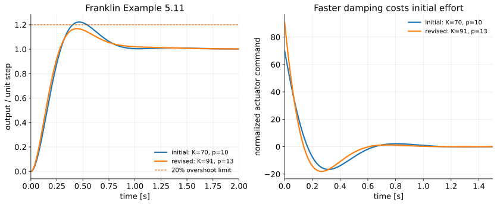

# The Root-Locus Design Method III — PD and Lead Compensation

**Student lecture notes — FPE 8th ed., Section 5.4.1**

When gain alone cannot reach the desired pole region, add controller dynamics. A PD zero changes the root-locus geometry; a lead compensator keeps that useful effect while limiting the controller's high-frequency gain.

**Prerequisites:** [II — Gain selection](root-locus-gain-design_student.md), [PID control](pid-control_student.md), and [derivative implementation](pid-tuning_student.md).

**Sources:** FPE 8th ed., §5.4.1 and Example 5.11, checked against the 7th ed. Nise 7th ed., §9.3, supplies the explicit PD-to-lead design progression; Ogata 5th ed., §6–6, supplies the angle-deficiency construction and the requirement to verify the full response. The exact $-2\pm2j$ design is a **[course example]** on FPE's normalized motor plant. FPE Example 5.11 retains its own parameters and specifications in §6.

## Learning objectives

1. Determine the angle a controller must contribute at a target pole.
2. Design a PD zero and gain, then a finite-pole lead compensator.
3. Verify the complete characteristic polynomial and response.
4. Distinguish controller gain, DC gain, derivative gain, and high-frequency gain.
5. Explain the tradeoff between pole placement, tracking, noise, and control effort.

## Notation and assumptions

Negative unity feedback; $L=D_cG=KL_0$. In $D_c=K(s+z)/(s+p)$, the **locations** are $-z$ and $-p$, with $z,p>0$. Lead has $p>z$. These positive parameters differ from the signed locations $z_i,p_i$ in Lecture I. All models are continuous-time and linear, with no actuator saturation in the plotted responses. Time is in seconds and signals are normalized. Settling times use the course’s 1% band.

---

## Where we are, and where this lecture goes

Lecture II ended with a locus that did not go where the requirements wanted. A single gain only slides the poles along fixed branches. To move the branches themselves we must change the pole-zero pattern that generates them, and that means giving the controller dynamics of its own.

Two facts from Lecture I say what to expect, and FPE's satellite examples in Lecture II made both concrete. Branches *end* at zeros, so a zero added in the left half-plane draws branches toward it: it pulled the double integrator's locus off the imaginary axis onto a circle in the stable region. Branches *start* at poles, and an added pole spreads the asymptotes and pushes branches to the right, as the lead pole did when it was dragged in from $-12$ toward $-4$. Adding a zero is therefore the first move for improving a transient, and the controller that adds a zero is the PD controller from Chapter 4.

The story of this lecture:

1. Ask for a specific pole pair on the motor and count how many degrees of angle the plant is short at that point (§1).
2. Supply the missing angle with a PD zero, and discover that the response is *not* the one the pole formula promised (§2).
3. Make the controller buildable by adding a pole, which turns PD into lead, and redo the design (§§3–4).
4. Ask what the pole costs and what it buys (§5), then watch FPE iterate a lead design against real inequality specifications (§6).

## 1. Start with a pole-placement request {#section-1}

For $G=1/[s(s+1)]$, request $s_d=-2+2j$ and its conjugate. Thus

$$
\omega_n=\sqrt8,\qquad \zeta=\frac1{\sqrt2},\qquad
(s-s_d)(s-\overline{s_d})=s^2+4s+8.
$$

The motor's proportional-gain locus has its complex branches at $\Re s=-1/2$ and cannot reach this point. At $s_d$, the pole-vector angles are

$$
\arg(s_d)=135^\circ,\qquad
\arg(s_d+1)=116.565^\circ.
$$

The plant phase is $-251.565^\circ$. To obtain $-180^\circ$, the controller must contribute

$$
\boxed{\phi_c=71.565^\circ}.
$$

This is the **angle deficiency**: the angle needed to put this particular point on the compensated locus. It is not a phase margin, which will be defined using sinusoidal frequency response in Part V.

Read $71.565^\circ$ as a budget. The two plant arrows at $s_d$ use up $251.565^\circ$ of negative angle, which is $71.565^\circ$ more than the $180^\circ$ the angle condition allows. Something in the controller must give that angle back. An arrow from a zero *adds* to the total; an arrow from a pole *subtracts*. So the controller needs at least one zero, placed so that its arrow to $s_d$ makes exactly the missing angle, and any pole we add later will have to be paid for with a larger zero angle.

The standard no-zero second-order formula predicts $4.32\%$ overshoot for this pair. Treat that as a prediction to test, not as the guaranteed overshoot of the compensated system.

## 2. Full PD design {#section-2}

The simplest controller with a zero is PD. Let $D_c=K(s+z)=k_Ds+k_P$. A single zero must supply $71.565^\circ$, so

$$
\arg(s_d+z)=71.565^\circ,\qquad
\frac2{z-2}=\tan71.565^\circ=3.
$$

Consequently $z=8/3$. The magnitude condition gives

$$
K=\frac{|s_d(s_d+1)|}{|s_d+8/3|}
=\frac{\sqrt{40}}{\sqrt{40/9}}=3.
$$

Hence

$$
\boxed{D_c(s)=3s+8},\qquad k_D=3,\quad k_P=8.
$$

Check by expanding the characteristic equation:

$$
s(s+1)+3s+8=s^2+4s+8.
$$

Coefficient matching gives the same result: $1+k_D=4$ and $k_P=8$. Root-locus geometry explains where the zero belongs; coefficient matching provides an independent check for this low-order model.

### What response did we actually design?

$$
\mathcal T_{PD}(s)=\frac{3s+8}{s^2+4s+8}.
$$

The numerator is not 8. For a unit step,

$$
Y(s)=\frac1s+\frac{-s-1}{s^2+4s+8},
$$

so

$$
\boxed{y(t)=1-e^{-2t}\cos2t+\frac12e^{-2t}\sin2t},\qquad t\ge0.
$$

Differentiating gives $\dot y=e^{-2t}(3\cos2t+\sin2t)$. The first maximum occurs at $2t_p=\pi-\tan^{-1}3$, giving approximately **11.91% overshoot**, not 4.32%. The controller zero changes the modal amplitudes even though the poles are exactly right.

There is a clean way to see why. Factor the numerator:

$$
\mathcal T_{PD}(s)=\frac{8}{s^2+4s+8}\left(1+\frac{3s}{8}\right),
$$

so the PD step response is the standard pair's step response *plus* $3/8$ of its time derivative. The standard response is rising steeply early on, and adding a fraction of that slope lifts the curve: it rises sooner and overshoots more. A zero near the dominant poles always does this to some degree, and the closer the zero, the larger the effect. The poles determine the shape of each mode; the zero determines how much of each mode appears.

### Why an ideal PD is incomplete as hardware

Its magnitude grows without bound as frequency increases. Differentiating a noisy measurement can demand large actuator commands. Differentiating a step reference also demands an impulse: for this example the impulse area in $u$ is $k_D=3$ times the step amplitude. Derivative on the measured output avoids that reference impulse but still needs filtering for noise. Recall the implementation discussion in Chapter 4.

## 3. Full lead design by the angle condition {#section-3}

The fix is to add a pole far enough out that it tames the high-frequency gain but close enough in to be cheap in angle. A pole subtracts angle at $s_d$, so after adding one the zero must supply *more* than $71.565^\circ$, which moves the zero closer to the target. We will choose the zero first, then find where the pole must sit, then set the gain.

Choose a finite-pole controller

$$
D_c(s)=K\frac{s+z}{s+p},\qquad p>z>0.
$$

There are many solutions: after choosing a zero, solve for a pole and then the gain. Choose $z=2$ for straightforward geometry. At $s_d=-2+2j$, the zero vector is $2j$, of angle $90^\circ$. The controller pole must remove the excess angle:

$$
\arg(s_d+p)=90^\circ-71.565^\circ=18.435^\circ.
$$

Thus

$$
\frac2{p-2}=\tan18.435^\circ=\frac13
\quad\Longrightarrow\quad p=8.
$$

Where could the pole have gone? Its arrow to $s_d$ is nearly horizontal when the pole is far to the left and subtracts almost nothing; it steepens, and subtracts more, as the pole approaches the target. The required $18.435^\circ$ lands it at $-8$. Had we chosen the zero closer to the target, the pole would have moved farther out. Had we chosen it farther away, the zero would not supply enough angle and no real pole could rescue it. The optional practice at the end explores that boundary.

The magnitude condition now gives

$$
K=\frac{|s_d(s_d+1)(s_d+8)|}{|s_d+2|}
=\frac{\sqrt{40}\sqrt{40}}2=20.
$$

Therefore

$$
\boxed{D_c(s)=20\frac{s+2}{s+8}}.
$$

Check the gain including every factor. Numerically $G(s_d)(s_d+2)/(s_d+8)=-1/20$; the selected gain makes the loop exactly $-1$.

## 4. Verify the remaining pole and the complete response {#section-4}

Clearing denominators gives

$$
P(s)=s(s+1)(s+8)+20(s+2)
=s^3+9s^2+28s+40
=(s+5)(s^2+4s+8).
$$

The additional pole is $-5$. It is only 2.5 times farther left than the target pair, and the zero at $-2$ is nearby; a pure second-order approximation is not justified without checking. The full response is

$$
\mathcal T_{lead}(s)=\frac{20(s+2)}{(s+5)(s^2+4s+8)},
$$

$$
y(t)=1+\frac{12}{13}e^{-5t}
-\frac{25}{13}e^{-2t}\cos2t
+\frac5{13}e^{-2t}\sin2t.
$$

Numerical evaluation gives:

| Controller / reference path | Overshoot | 10–90% rise | 1% settling |
|---|---:|---:|---:|
| Proportional $D_c=8$ | $56.88\%$ | $0.417$ s | $9.181$ s |
| Forward-path PD $3s+8$ | $11.91\%$ | $0.410$ s | $1.913$ s |
| Lead $20(s+2)/(s+8)$ | $16.45\%$ | $0.449$ s | $2.089$ s |
| Rate feedback with $k_P=8,k_D=3$ | $4.32\%$ | $0.760$ s | $2.329$ s |

Rate feedback means derivative on the measured output rather than on the error; it is developed in Lecture IV’s extension. Its numerator is 8. Equal pole pairs do not mean equal step responses.

For the lead, $K_v=\lim_{s\to0}sD_cG=D_c(0)=5$, so the unit-ramp error is $0.2$. For the PD, $K_v=8$ and the ramp error is $0.125$. Both track a constant reference with zero steady-state error when stable.


The two loci in the figure are worth reading. The PD locus has two poles and one zero, and its complex part is a circle centered on the zero at $-8/3$; the target pair sits on that circle, and every point on it is reachable by some gain. The lead locus has three poles and one zero, so two branches go to infinity along vertical asymptotes through $\sigma_a=(0-1-8+2)/2=-7/2$, and the target pair sits where those branches pass through $-2\pm2j$. The added pole has opened the circle into a pair of branches that head for infinity. Both loci pass through the target; they do not pass through it with the same companions.

## 5. What does the lead pole buy? {#section-5}

If the PD gave less overshoot and a faster rise, why bother with the lead? The answer is in what each controller does at high frequency, where sensor noise lives and where the ideal derivative asks for an impulse.

For our lead design,

$$
D_c(0)=K\frac zp=5,\qquad
\lim_{|s|\to\infty}D_c(s)=K=20.
$$

The high-frequency gain is finite, but it is not zero. To see the filtered derivative explicitly, rewrite a general lead as

$$
D_c(s)=K\frac zp+K\left(1-\frac zp\right)\frac{s}{s+p}
=k_P+\frac{k_Ds}{1+s/p},
$$

$$
k_P=\frac{Kz}{p},\qquad k_D=\frac{K(p-z)}{p^2}.
$$

Here $k_P=5$, $k_D=1.875$, and the derivative filter time constant is $1/8$ s. These are not the ideal PD's gains; the lead was redesigned to recover the target roots after adding a pole.

With sensor noise $N$, $U/N=-D_c/(1+D_cG)$. Because this plant tends to zero at high frequency, the noise-to-command gain approaches $-20$. A unit reference step demands $u(0^+)=20$. Include sensor noise and actuator limits in any physical implementation.

Moving a lead pole farther left while holding $K$ fixed does **not** preserve its low-frequency gain. To approach a fixed ideal PD $k_D(s+z)$, use $D_c=k_Dp(s+z)/(s+p)$ and let $p$ grow. Its high-frequency gain then grows as $k_Dp$.

## 6. Franklin Example 5.11: iterate against actual specifications {#section-6}

So far we chose a pole location and hit it exactly. Real requirements are inequalities on the response, and the designer iterates: pick a target region, design, simulate, adjust. FPE's Example 5.11 shows that loop on the same motor, and it ends with the revised compensator that Lecture IV will build on.

FPE requests at most **20% overshoot** and at most **0.3 s rise time** for the same $G=1/[s(s+1)]$. These are different requirements from our exact pole-placement exercise.

The book first estimates a useful target region, then tries

$$
D_{c,1}=70\frac{s+2}{s+10}.
$$

Its characteristic polynomial and poles are

$$
P_1=s^3+11s^2+80s+140,
\qquad s=-2.3449,\ -4.3276\pm6.4013j.
$$

The complex pair has $\zeta\approx0.560$, but the full response overshoots **22.27%**. The initial design fails the overshoot requirement.

FPE moves the compensator pole and changes the gain:

$$
\boxed{D_{c,2}=91\frac{s+2}{s+13}},\qquad
P_2=s^3+14s^2+104s+182.
$$

Now the poles are $-2.3855$ and $-5.8072\pm6.5245j$. The full response gives **16.86% overshoot** and **0.1895 s 10–90% rise time**, meeting both requirements. Its 1% settling time is about 1.395 s. The first design’s rise time was 0.1953 s and 1% settling time 1.433 s. Here overshoot, rise time, and 1% settling time all improve; the initial command demand increases from 70 to 91, as the figure below shows.

The real pole lies closer to the imaginary axis than the pair in both designs. Its nearby zero reduces its reference-step contribution without removing it. The simulation, not a declaration that the pair is “dominant,” closes the design argument.



## 7. MATLAB and lecture demonstrations {#section-7}

```matlab
s = tf('s');
G = 1/(s*(s+1));
D = 20*(s+2)/(s+8);
rlocus((s+2)/(s*(s+1)*(s+8))); grid on  % Varied gain is K
T = feedback(D*G,1);
pole(T)
stepinfo(T,'SettlingTimeThreshold',0.01)
step(T); grid on
UoverR = feedback(D,G);                % D/(1+D*G)
figure; step(UoverR); grid on
```

Run `l3_demo1_pd_lead.py` for the exact geometry design and `l3_demo2_franklin.py` for Example 5.11. See the [demo guide](demos/ch5/guide.md). The Python scripts print the actual poles and response metrics, then save the figures.

## What to take away

- To move the branches, change the pole-zero pattern. A left-half-plane zero pulls the locus toward it; an added pole pushes it away.
- At a target pole, total the plant's arrow angles. The shortfall from $180^\circ$ is the angle the controller must supply, and a zero supplies it.
- PD places the poles exactly, but the zero appears in the closed-loop numerator and changes the response: the standard pair's $4.32\%$ became $11.91\%$. Poles set the modes; zeros set how much of each mode you get.
- A lead compensator adds a pole to cap the high-frequency gain. It costs angle, so the zero moves in and the gain is redesigned. The added pole is not far from the pair, so check the complete response.
- Design to the actual specification by iteration and simulation, as FPE does. "The pair is dominant" is a hypothesis to test, not a conclusion.

## Review questions

1. Why is the required angle $71.565^\circ$, rather than the magnitude of the plant's principal phase angle?
2. In $D_c=K(s+z)$, which parameter is the proportional gain?
3. Why did adding the lead pole require redesigning the gain?
4. The lead and PD share $-2\pm2j$. Why do they overshoot differently?
5. What changes in the reference transfer function when the derivative acts on the measurement?
6. Does finite high-frequency gain make a lead compensator immune to noise?

## Optional practice

Keep the target $-2+2j$, choose another zero location, and use Ogata 5th ed. §6–6's angle-deficiency procedure to find a valid lead pole. Find the gain and remaining pole, then compare the complete response and initial control demand. Not every arbitrary zero choice produces a finite real pole with $p>z>0$. For this target, $z>8/3$ gives less than the required $71.565^\circ$ from the zero alone, so adding a real pole cannot supply the missing positive angle. For example, $z=3$ supplies only $63.435^\circ$. At $z=8/3$, the required pole angle is zero: the finite-pole construction reaches its ideal-PD limit.

**Previous:** [II — Gain selection](root-locus-gain-design_student.md). **Next:** [IV — Lag, PI, and extensions](root-locus-lag-pi_student.md).
