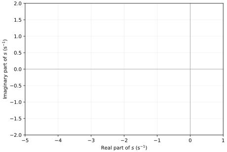
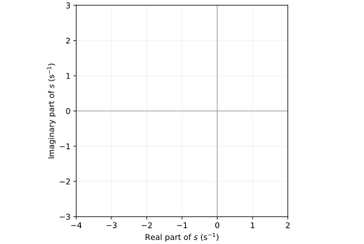
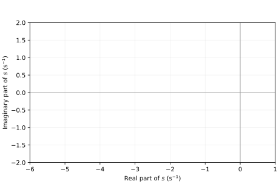
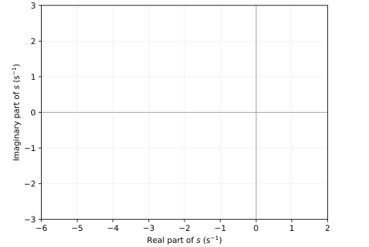
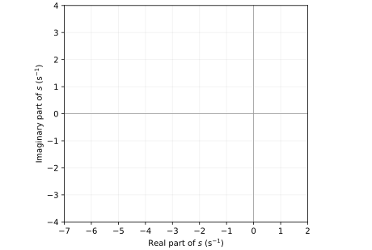
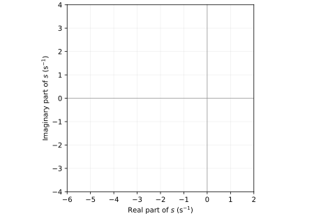
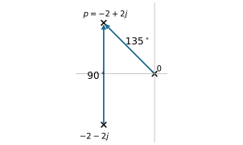

# Root Locus, One Rule at a Time

**ME404 individual activity | about 145 minutes over two meetings**

## 1. Prepare and read what you will deliver

Use a stylus or pencil, a calculator, and the landscape PDF. Work **individually at each checkpoint**, review the class answer, and correct your work. After five construction rules, **Step 6** finds a gain for one chosen point. The instructor uses MATLAB to check all poles at that gain.

Keep your annotated PDF, including all six problems, the meeting 2 retrieval attempt, and three exit responses. Include your selected pole-gain pairs and full pole sets. Put your name on your work.

Download the [landscape worksheets for tablet handwriting](root-locus-five-rules.pdf). Each step has prompts on the left and a plot on the right. The plot includes the preceding construction steps' answers; add only the current step. Stop for class review before advancing. Each problem ends with a worked review of the real point choices and complete pole sets. Optional complex-point exercises are at the back. The prompts below also serve as a text reference.

## 2. Watch the opening example

> A root locus shows all the closed-loop pole locations as gain $K$ varies. For one fixed value of $K$, there is one set of closed-loop poles. The locus collects those sets on the same complex plane. Arrows show increasing gain.

Negative unity feedback gives the characteristic equation

$$1+K\frac{B(s)}{A(s)}=0\quad\Longrightarrow\quad P(s)=A(s)+KB(s)=0.$$

For $L_0(s)=1/(s+1)$, the instructor supplies

$$P(s)=s+1+K=0,\qquad s=-1-K.$$

| Gain $K$ | Closed-loop pole $s$ | Point $(\operatorname{Re}s,\operatorname{Im}s)$ |
|---|---|---|
| 0 | $-1$ | $(-1,0)$ |
| 1 | $-2$ | $(-2,0)$ |
| 3 | $-4$ | $(-4,0)$ |

The horizontal axis is the real part of $s$; the vertical axis is the imaginary part. Gain is the parameter that changes, not either coordinate axis. Watch the instructor plot these points and join them.

**Drawing legend:** a cross marks an open-loop pole (a start at $K=0$); an open circle marks a finite zero (approached as $K\to\infty$). An open square with a gain label marks a selected closed-loop pole. Label coincident roots with their multiplicity. Solid curves are the locus; dashed lines are asymptote guides.

All coefficients are real, so nonreal closed-loop poles occur in conjugate pairs; the locus is symmetric about the real axis.

## 3. Follow the same procedure six times

Use negative unity feedback, $L(s)=K L_0(s)$, and $K\geq0$. Open-loop poles and zeros stay fixed as landmarks; closed-loop poles move with gain. Models are normalized; time is in seconds and pole coordinates are in $\mathrm{s}^{-1}$.

For each checkpoint: work for the indicated **2 or 3 minutes**, stop, review the answer, and correct your page in a second color. Wait for the instructor before continuing. The order is always:

1. Mark starts and count endpoints.
2. Test the real-axis intervals.
3. Draw the far-away guides.
4. Draw departure and arrival directions.
5. Check whether roots meet.
6. Choose a point on the locus, use the magnitude condition to find its gain, and record all poles at that gain.

Plan two meetings: about 70 minutes through Problem 3 and 75 minutes afterward. The second meeting starts with a 3-minute retrieval attempt and immediate review. The roughly 145-minute total includes the short discussion questions within the existing reviews. Work individually; be ready to explain one correction before the full answer is shown.

## Problem 1. One moving pole

$$L_0(s)=\frac1{s+1}.$$

In the landscape PDF, each step's plot contains the preceding construction answers. Add only the current step's features. Blank reference axes:

### Rule 1. Mark starts and count endpoints (2 minutes)

**Rule:** $n$ branches start at the $n$ poles. Of these, $m$ end at finite zeros and $n-m$ go to infinity.

1. Set each denominator factor equal to zero. Pole list, including repeats: $\underline{\hspace{1.4in}}$.
2. Set each numerator factor equal to zero. Zero list: $\underline{\hspace{1.4in}}$. A constant numerator has no finite zeros.
3. Count $n=$ $\underline{\qquad}$ poles and $m=$ $\underline{\qquad}$ zeros.
4. On the sketch, mark crosses at the poles and circles at the zeros. Label the crosses **starts at $K=0$**.
5. Branches: $\underline{\qquad}$. Finite endpoints: $\underline{\qquad}$. Endpoints at infinity, $n-m$: $\underline{\qquad}$.

Remember: $m=0$ means no finite zeros, not a zero at the origin.

**Stop here. Review the answer with the class and correct your work before continuing.**

### Rule 2. Test the real-axis intervals (2 minutes)

1. Put a finger on each test point. Look **to its right**.
2. Count real poles and real zeros there, add the counts, and decide odd or even. Count repeated locations with multiplicity; exclude poles off the real axis.
3. Odd means **on**; even means **off**. Shade only the accepted intervals on your sketch.

| Interval | Test $s$ | Poles right | Zeros right | Total | Odd/even | On? |
|---|---|---|---|---|---|---|
| $(-\infty,-1)$ | $-2$ | ___ | ___ | ___ | ___ | ___ |
| $(-1,\infty)$ | $0$ | ___ | ___ | ___ | ___ | ___ |

**Stop here. Review the answer with the class and correct your work before continuing.**

### Rule 3. Draw the far-away guides (2 minutes)

1. Fill in $N=n-m=$ $\underline{\qquad}$, $\sum p_i=$ $\underline{\qquad}$, and $\sum z_i=$ $\underline{\qquad}$. An empty zero list contributes zero to the sum.
2. Calculate the centroid:

$$\sigma_a=\frac{\sum p_i-\sum z_i}{N}=\underline{\qquad}.$$

3. Use $\ell=0$ in the supplied formula. Angle list: $\underline{\hspace{1.4in}}$.

$$\theta_\ell=\frac{180^\circ+360^\circ\ell}{N}.$$

4. Mark the centroid and draw dashed rays at these angles. Label them **large-$K$ guides**. Measure counterclockwise from the positive real axis.

The centroid is a guide location. It need not be on the locus.

**Stop here. Review the answer with the class and correct your work before continuing.**

### Rule 4. Draw departure and arrival directions (2 minutes)

1. At each simple real pole, use your **corrected Rule 2 table** to identify the allowed neighboring interval.
2. Fill in the direction and draw a short arrow into that interval. Left is $180^\circ$; right is $0^\circ$.

| Starting pole | Left or right? | Angle |
|---|---|---|
| $-1$ | ___ | ___ |

**Stop here. Review the answer with the class and correct your work before continuing.**

### Rule 5. Check whether roots meet (2 minutes)

**Rule:** Solve $dK/ds=0$. For the **real-axis meetings here**, keep real candidates on accepted Rule 2 intervals with $K>0$; check $P=A+KB=0$. A **breakaway** leaves the real axis; a **break-in** returns to it.

Use the supplied gain and derivative:

$$K(s)=-(s+1),\qquad \frac{dK}{ds}=-1.$$

The derivative is always $-1$. Can it equal zero? Record whether there is a real-axis meeting.

**Record:** positive-gain meeting location and gain, or **none**: $\underline{\qquad}$.

During review, complete the sketch and increasing-$K$ arrows. After Step 6, compare with the instructor's MATLAB plot.

**Stop here. Review the answer with the class and correct your work before continuing.**

### Step 6. Choose a point and find its gain (3 minutes)

The **magnitude condition** labels a valid locus point with its gain. Write $L_0=B/A$, with numerator $B$ and denominator $A$. For these models:

$$K=\frac1{|L_0(s_d)|}=\frac{|A(s_d)|}{|B(s_d)|}
=\frac{\text{product of pole distances}}{\text{product of zero distances}}.$$

1. **Choose one supplied point** $s_d$ from $-2$, $-3$. Use a real choice for the core interval. Record $s_d=$ $\underline{\hspace{1.4in}}$.
2. **Confirm membership first.** For a real point, record its accepted Rule 2 interval: $\underline{\hspace{1.4in}}$. For a complex point, use the supplied check below or check that zero angles minus pole angles is an odd multiple of $180^\circ$. Dashed asymptotes are guides, not exact branches.
3. **Find distances.** If $s_d=x+jy$ and a landmark is $a+jb$, its distance is $\sqrt{(x-a)^2+(y-b)^2}$. Fill the table, counting repeated poles separately.

| Landmark | Location | Distance to your chosen point |
|---|---|---|
| Pole 1 | $-1$ | ________________ |

4. **Calculate the gain.** Multiply pole distances and divide by zero distances. With no finite zeros, the denominator product is $1$. $K=$ $\underline{\hspace{1.4in}}$.
5. **Check and label.** For a real choice, evaluate the signed $K(s)$ from Rule 5; it must match and be real and positive. A magnitude alone gives a positive number even for an off-locus point. Mark $s_d$ and label $(s_d,K)$ on your plot.
6. **During the instructor/MATLAB check**, record **all** closed-loop poles at your gain below. Mark them with the same gain label. Your selected point is one pole in that full set.

$$\text{All poles: }\underline{\hspace{4in}}.$$

**Extension after review:** choose your own confirmed locus point away from poles and zeros, and find its gain.

**Stop here. Review the answer with the class and correct your work before continuing.**

## Problem 2. Two poles meet

$$L_0(s)=\frac1{s(s+2)}.$$

In the landscape PDF, each step's plot contains the preceding construction answers. Add only the current step's features. Blank reference axes:

### Rule 1. Mark starts and count endpoints (2 minutes)

**Rule:** $n$ branches start at the $n$ poles. Of these, $m$ end at finite zeros and $n-m$ go to infinity.

1. Set each denominator factor equal to zero. Pole list, including repeats: $\underline{\hspace{1.4in}}$.
2. Set each numerator factor equal to zero. Zero list: $\underline{\hspace{1.4in}}$. A constant numerator has no finite zeros.
3. Count $n=$ $\underline{\qquad}$ poles and $m=$ $\underline{\qquad}$ zeros.
4. On the sketch, mark crosses at the poles and circles at the zeros. Label the crosses **starts at $K=0$**.
5. Branches: $\underline{\qquad}$. Finite endpoints: $\underline{\qquad}$. Endpoints at infinity, $n-m$: $\underline{\qquad}$.

Remember: $m=0$ means no finite zeros, not a zero at the origin.

**Stop here. Review the answer with the class and correct your work before continuing.**

### Rule 2. Test the real-axis intervals (2 minutes)

1. Put a finger on each test point. Look **to its right**.
2. Count real poles and real zeros there, add the counts, and decide odd or even. Count repeated locations with multiplicity; exclude poles off the real axis.
3. Odd means **on**; even means **off**. Shade only the accepted intervals on your sketch.

| Interval | Test $s$ | Poles right | Zeros right | Total | Odd/even | On? |
|---|---|---|---|---|---|---|
| $(-\infty,-2)$ | $-3$ | ___ | ___ | ___ | ___ | ___ |
| $(-2,0)$ | $-1$ | ___ | ___ | ___ | ___ | ___ |
| $(0,\infty)$ | $1$ | ___ | ___ | ___ | ___ | ___ |

**Stop here. Review the answer with the class and correct your work before continuing.**

### Rule 3. Draw the far-away guides (2 minutes)

1. Fill in $N=n-m=$ $\underline{\qquad}$, $\sum p_i=$ $\underline{\qquad}$, and $\sum z_i=$ $\underline{\qquad}$. An empty zero list contributes zero to the sum.
2. Calculate the centroid:

$$\sigma_a=\frac{\sum p_i-\sum z_i}{N}=\underline{\qquad}.$$

3. Use $\ell=0,1$ in the supplied formula. Angle list: $\underline{\hspace{1.4in}}$.

$$\theta_\ell=\frac{180^\circ+360^\circ\ell}{N}.$$

4. Mark the centroid and draw dashed rays at these angles. Label them **large-$K$ guides**. Measure counterclockwise from the positive real axis.

The centroid is a guide location. It need not be on the locus.

**Stop here. Review the answer with the class and correct your work before continuing.**

### Rule 4. Draw departure and arrival directions (2 minutes)

1. At each simple real pole, use your **corrected Rule 2 table** to identify the allowed neighboring interval.
2. Fill in the direction and draw a short arrow into that interval. Left is $180^\circ$; right is $0^\circ$.

| Starting pole | Left or right? | Angle |
|---|---|---|
| $-2$ | ___ | ___ |
| $0$ | ___ | ___ |

**Stop here. Review the answer with the class and correct your work before continuing.**

### Rule 5. Check whether roots meet (3 minutes)

**Rule:** Solve $dK/ds=0$. For the **real-axis meetings here**, keep real candidates on accepted Rule 2 intervals with $K>0$; check $P=A+KB=0$. A **breakaway** leaves the real axis; a **break-in** returns to it.

Use the supplied gain and derivative:

$$K(s)=-s(s+2),\qquad \frac{dK}{ds}=-2s-2.$$

Solve $-2s-2=0$. Candidate $s=$ $\underline{\qquad}$. Check Rule 2, then evaluate $K=-s(s+2)=$ $\underline{\qquad}$. Draw two real branches moving toward the meeting. After it, draw one branch upward and one downward. Circle **breakaway / break-in**.

**Record:** positive-gain meeting location and gain, or **none**: $\underline{\qquad}$.

During review, complete the sketch and increasing-$K$ arrows. After Step 6, compare with the instructor's MATLAB plot.

**Stop here. Review the answer with the class and correct your work before continuing.**

### Step 6. Choose a point and find its gain (3 minutes)

The **magnitude condition** labels a valid locus point with its gain. Write $L_0=B/A$, with numerator $B$ and denominator $A$. For these models:

$$K=\frac1{|L_0(s_d)|}=\frac{|A(s_d)|}{|B(s_d)|}
=\frac{\text{product of pole distances}}{\text{product of zero distances}}.$$

1. **Choose one supplied point** $s_d$ from $- \frac{1}{2}$, $- \frac{3}{2}$; optional complex choice $-1 + j$. Use a real choice for the core interval. Record $s_d=$ $\underline{\hspace{1.4in}}$.
2. **Confirm membership first.** For a real point, record its accepted Rule 2 interval: $\underline{\hspace{1.4in}}$. For a complex point, use the supplied check below or check that zero angles minus pole angles is an odd multiple of $180^\circ$. Dashed asymptotes are guides, not exact branches.
3. **Find distances.** If $s_d=x+jy$ and a landmark is $a+jb$, its distance is $\sqrt{(x-a)^2+(y-b)^2}$. Fill the table, counting repeated poles separately.

| Landmark | Location | Distance to your chosen point |
|---|---|---|
| Pole 1 | $0$ | ________________ |
| Pole 2 | $-2$ | ________________ |

4. **Calculate the gain.** Multiply pole distances and divide by zero distances. With no finite zeros, the denominator product is $1$. $K=$ $\underline{\hspace{1.4in}}$.
5. **Check and label.** For a real choice, evaluate the signed $K(s)$ from Rule 5; it must match and be real and positive. A magnitude alone gives a positive number even for an off-locus point. Mark $s_d$ and label $(s_d,K)$ on your plot.
6. **During the instructor/MATLAB check**, record **all** closed-loop poles at your gain below. Mark them with the same gain label. Your selected point is one pole in that full set.

$$\text{All poles: }\underline{\hspace{4in}}.$$

**Decide before the answer is shown:** a student selects $s=+1$, multiplies the pole distances $1\cdot3$, and claims it is a closed-loop pole at $K=3$. Is the claim correct? Explain using Rule 2, the signed gain, or $P(1)$: $\underline{\hspace{1.4in}}$.

**Complex extension after review:** at $-1+j$, pole angles are $135^\circ,45^\circ$, so the loop angle is $-180^\circ$. Both pole distances are $\sqrt2$.

**Extension after review:** choose your own confirmed locus point away from poles and zeros, and find its gain.

**Stop here. Review the answer with the class and correct your work before continuing.**

### Review together: pole snapshots

**Review together: one gain selects both poles.** Use the supplied formula $s=-1\pm\sqrt{1-K}$. Mark each pair on the large review plot with one shared gain label or color.

| Gain $K$ | Both roots to mark together |
|---|---|
| $0$ | $0,-2$ |
| $3/4$ | $-1/2,-3/2$ |
| $1$ | $-1,-1$ (double root) |
| $2$ | $-1+j,-1-j$ |

At $K=3/4$, can one pole be $-1/2$ while the other is $-1+j$? Explain: $\underline{\hspace{1.4in}}$. At $K=1$, label the single plotted location **double root**: two roots still count.

## Problem 3. A finite zero is an endpoint

$$L_0(s)=\frac{s+2}{(s+1)(s+3)}.$$

In the landscape PDF, each step's plot contains the preceding construction answers. Add only the current step's features. Blank reference axes:

### Rule 1. Mark starts and count endpoints (2 minutes)

**Rule:** $n$ branches start at the $n$ poles. Of these, $m$ end at finite zeros and $n-m$ go to infinity.

1. Set each denominator factor equal to zero. Pole list, including repeats: $\underline{\hspace{1.4in}}$.
2. Set each numerator factor equal to zero. Zero list: $\underline{\hspace{1.4in}}$. A constant numerator has no finite zeros.
3. Count $n=$ $\underline{\qquad}$ poles and $m=$ $\underline{\qquad}$ zeros.
4. On the sketch, mark crosses at the poles and circles at the zeros. Label the crosses **starts at $K=0$**.
5. Branches: $\underline{\qquad}$. Finite endpoints: $\underline{\qquad}$. Endpoints at infinity, $n-m$: $\underline{\qquad}$.

Remember: $m=0$ means no finite zeros, not a zero at the origin.

**Stop here. Review the answer with the class and correct your work before continuing.**

### Rule 2. Test the real-axis intervals (2 minutes)

1. Put a finger on each test point. Look **to its right**.
2. Count real poles and real zeros there, add the counts, and decide odd or even. Count repeated locations with multiplicity; exclude poles off the real axis.
3. Odd means **on**; even means **off**. Shade only the accepted intervals on your sketch.

| Interval | Test $s$ | Poles right | Zeros right | Total | Odd/even | On? |
|---|---|---|---|---|---|---|
| $(-\infty,-3)$ | $-4$ | ___ | ___ | ___ | ___ | ___ |
| $(-3,-2)$ | $-2.5$ | ___ | ___ | ___ | ___ | ___ |
| $(-2,-1)$ | $-1.5$ | ___ | ___ | ___ | ___ | ___ |
| $(-1,\infty)$ | $0$ | ___ | ___ | ___ | ___ | ___ |

**Stop here. Review the answer with the class and correct your work before continuing.**

### Rule 3. Draw the far-away guides (2 minutes)

1. Fill in $N=n-m=$ $\underline{\qquad}$, $\sum p_i=$ $\underline{\qquad}$, and $\sum z_i=$ $\underline{\qquad}$. An empty zero list contributes zero to the sum.
2. Calculate the centroid:

$$\sigma_a=\frac{\sum p_i-\sum z_i}{N}=\underline{\qquad}.$$

3. Use $\ell=0$ in the supplied formula. Angle list: $\underline{\hspace{1.4in}}$.

$$\theta_\ell=\frac{180^\circ+360^\circ\ell}{N}.$$

4. Mark the centroid and draw dashed rays at these angles. Label them **large-$K$ guides**. Measure counterclockwise from the positive real axis.

The centroid is a guide location. It need not be on the locus.

**Stop here. Review the answer with the class and correct your work before continuing.**

### Rule 4. Draw departure and arrival directions (3 minutes)

1. At each simple real pole, use your **corrected Rule 2 table** to identify the allowed neighboring interval.
2. Fill in the direction and draw a short arrow into that interval. Left is $180^\circ$; right is $0^\circ$.

| Starting pole | Left or right? | Angle |
|---|---|---|
| $-3$ | ___ | ___ |
| $-1$ | ___ | ___ |

**Arrival at the simple zero $z=-2$.** Measure $\psi$ **from the zero to nearby branch points** as $K$ grows large:

$$\psi=180^\circ+\Theta_p-\Theta_{z,\mathrm{other}}.$$

Sum pole-to-$z$ angles in $\Theta_p$ and other-zero-to-$z$ angles in $\Theta_{z,\mathrm{other}}$.

3. The pole-to-zero vectors $-1\to-2$ and $-3\to-2$ have angles $180^\circ$ and $0^\circ$. No other zeros remain: $\Theta_p=180^\circ+0^\circ$, $\Theta_{z,\mathrm{other}}=0^\circ$.
4. Calculate $\psi=180^\circ+(180^\circ+0^\circ)-0^\circ=\underline{\qquad}$. Subtract $360^\circ$: $\psi=\underline{\qquad}$.
5. Nearby branch points are **left / right** of the zero. The increasing-$K$ arrow points **left / right** toward the zero. Label $\psi$ and draw the motion arrow.

**Stop here. Review the answer with the class and correct your work before continuing.**

### Rule 5. Check whether roots meet (2 minutes)

**Rule:** Solve $dK/ds=0$. For the **real-axis meetings here**, keep real candidates on accepted Rule 2 intervals with $K>0$; check $P=A+KB=0$. A **breakaway** leaves the real axis; a **break-in** returns to it.

Use the supplied gain and derivative:

$$K(s)=-\frac{(s+1)(s+3)}{s+2},\qquad \frac{dK}{ds}=-\frac{(s+2)^2+1}{(s+2)^2}.$$

A square is nonnegative. Can $(s+2)^2+1=0$ for real $s$? $\underline{\qquad}$. Exclude $s=-2$, where $K(s)$ is undefined.

**Record:** positive-gain meeting location and gain, or **none**: $\underline{\qquad}$.

During review, complete the sketch and increasing-$K$ arrows. After Step 6, compare with the instructor's MATLAB plot.

**Stop here. Review the answer with the class and correct your work before continuing.**

### Step 6. Choose a point and find its gain (3 minutes)

The **magnitude condition** labels a valid locus point with its gain. Write $L_0=B/A$, with numerator $B$ and denominator $A$. For these models:

$$K=\frac1{|L_0(s_d)|}=\frac{|A(s_d)|}{|B(s_d)|}
=\frac{\text{product of pole distances}}{\text{product of zero distances}}.$$

1. **Choose one supplied point** $s_d$ from $- \frac{3}{2}$, $-4$. Use a real choice for the core interval. Record $s_d=$ $\underline{\hspace{1.4in}}$.
2. **Confirm membership first.** For a real point, record its accepted Rule 2 interval: $\underline{\hspace{1.4in}}$. For a complex point, use the supplied check below or check that zero angles minus pole angles is an odd multiple of $180^\circ$. Dashed asymptotes are guides, not exact branches.
3. **Find distances.** If $s_d=x+jy$ and a landmark is $a+jb$, its distance is $\sqrt{(x-a)^2+(y-b)^2}$. Fill the table, counting repeated poles separately.

| Landmark | Location | Distance to your chosen point |
|---|---|---|
| Pole 1 | $-1$ | ________________ |
| Pole 2 | $-3$ | ________________ |
| Zero 1 | $-2$ | ________________ |

4. **Calculate the gain.** Multiply pole distances and divide by zero distances. With no finite zeros, the denominator product is $1$. $K=$ $\underline{\hspace{1.4in}}$.
5. **Check and label.** For a real choice, evaluate the signed $K(s)$ from Rule 5; it must match and be real and positive. A magnitude alone gives a positive number even for an off-locus point. Mark $s_d$ and label $(s_d,K)$ on your plot.
6. **During the instructor/MATLAB check**, record **all** closed-loop poles at your gain below. Mark them with the same gain label. Your selected point is one pole in that full set.

$$\text{All poles: }\underline{\hspace{4in}}.$$

**Extension after review:** choose your own confirmed locus point away from poles and zeros, and find its gain.

**Stop here. Review the answer with the class and correct your work before continuing.**

## Start meeting 2: try a familiar pattern (3 minutes)

Work individually before reopening the worked examples.

$$L_0(s)=\frac1{s(s+4)},\qquad K\geq0.$$

Without worked tables, mark the starts, accepted real-axis interval, and increasing-gain arrows. Use the supplied derivative $dK/ds=-2s-4$ to find the real-axis meeting and its gain. Label it breakaway or break-in.

Meeting location and gain: $\underline{\hspace{1.4in}}$. Explanation of your arrows: $\underline{\hspace{1.4in}}$.

If time permits, add the centroid and asymptotes.

**Stop. Review immediately with the class, then correct one part of your attempt and explain the correction.**

## Problem 4. Three poles and a candidate check

$$L_0(s)=\frac1{s(s+2)(s+4)}.$$

In the landscape PDF, each step's plot contains the preceding construction answers. Add only the current step's features. Blank reference axes:

### Rule 1. Mark starts and count endpoints (2 minutes)

**Rule:** $n$ branches start at the $n$ poles. Of these, $m$ end at finite zeros and $n-m$ go to infinity.

1. Set each denominator factor equal to zero. Pole list, including repeats: $\underline{\hspace{1.4in}}$.
2. Set each numerator factor equal to zero. Zero list: $\underline{\hspace{1.4in}}$. A constant numerator has no finite zeros.
3. Count $n=$ $\underline{\qquad}$ poles and $m=$ $\underline{\qquad}$ zeros.
4. On the sketch, mark crosses at the poles and circles at the zeros. Label the crosses **starts at $K=0$**.
5. Branches: $\underline{\qquad}$. Finite endpoints: $\underline{\qquad}$. Endpoints at infinity, $n-m$: $\underline{\qquad}$.

Remember: $m=0$ means no finite zeros, not a zero at the origin.

**Stop here. Review the answer with the class and correct your work before continuing.**

### Rule 2. Test the real-axis intervals (2 minutes)

1. Put a finger on each test point. Look **to its right**.
2. Count real poles and real zeros there, add the counts, and decide odd or even. Count repeated locations with multiplicity; exclude poles off the real axis.
3. Odd means **on**; even means **off**. Shade only the accepted intervals on your sketch.

| Interval | Test $s$ | Poles right | Zeros right | Total | Odd/even | On? |
|---|---|---|---|---|---|---|
| $(-\infty,-4)$ | $-5$ | ___ | ___ | ___ | ___ | ___ |
| $(-4,-2)$ | $-3$ | ___ | ___ | ___ | ___ | ___ |
| $(-2,0)$ | $-1$ | ___ | ___ | ___ | ___ | ___ |
| $(0,\infty)$ | $1$ | ___ | ___ | ___ | ___ | ___ |

**Stop here. Review the answer with the class and correct your work before continuing.**

### Rule 3. Draw the far-away guides (2 minutes)

1. Fill in $N=n-m=$ $\underline{\qquad}$, $\sum p_i=$ $\underline{\qquad}$, and $\sum z_i=$ $\underline{\qquad}$. An empty zero list contributes zero to the sum.
2. Calculate the centroid:

$$\sigma_a=\frac{\sum p_i-\sum z_i}{N}=\underline{\qquad}.$$

3. Use $\ell=0,1,2$ in the supplied formula. Angle list: $\underline{\hspace{1.4in}}$.

$$\theta_\ell=\frac{180^\circ+360^\circ\ell}{N}.$$

4. Mark the centroid and draw dashed rays at these angles. Label them **large-$K$ guides**. Measure counterclockwise from the positive real axis.

The centroid is a guide location. It need not be on the locus.

**Stop here. Review the answer with the class and correct your work before continuing.**

### Rule 4. Draw departure and arrival directions (2 minutes)

1. At each simple real pole, use your **corrected Rule 2 table** to identify the allowed neighboring interval.
2. Fill in the direction and draw a short arrow into that interval. Left is $180^\circ$; right is $0^\circ$.

| Starting pole | Left or right? | Angle |
|---|---|---|
| $-4$ | ___ | ___ |
| $-2$ | ___ | ___ |
| $0$ | ___ | ___ |

**Stop here. Review the answer with the class and correct your work before continuing.**

### Rule 5. Check whether roots meet (3 minutes)

**Rule:** Solve $dK/ds=0$. For the **real-axis meetings here**, keep real candidates on accepted Rule 2 intervals with $K>0$; check $P=A+KB=0$. A **breakaway** leaves the real axis; a **break-in** returns to it.

Use the supplied gain and derivative:

$$K(s)=-s(s+2)(s+4),\qquad \frac{dK}{ds}=-3s^2-12s-8.$$

Use the supplied candidates and gains below. Check each point against Rule 2 and $K>0$; decide **keep / reject**. At the retained point, draw horizontal arrivals and vertical departures.

| Candidate $s$ | Gain $K$ (supplied) | On a Rule 2 interval? | Keep/reject |
|---|---|---|---|
| $-0.8453$ | $+3.0792$ | ___ | ___ |
| $-3.1547$ | $-3.0792$ | ___ | ___ |

**Record:** positive-gain meeting location and gain, or **none**: $\underline{\qquad}$.

During review, complete the sketch and increasing-$K$ arrows. After Step 6, compare with the instructor's MATLAB plot.

**Stop here. Review the answer with the class and correct your work before continuing.**

### Step 6. Choose a point and find its gain (3 minutes)

The **magnitude condition** labels a valid locus point with its gain. Write $L_0=B/A$, with numerator $B$ and denominator $A$. For these models:

$$K=\frac1{|L_0(s_d)|}=\frac{|A(s_d)|}{|B(s_d)|}
=\frac{\text{product of pole distances}}{\text{product of zero distances}}.$$

1. **Choose one supplied point** $s_d$ from $- \frac{1}{2}$, $-5$. Use a real choice for the core interval. Record $s_d=$ $\underline{\hspace{1.4in}}$.
2. **Confirm membership first.** For a real point, record its accepted Rule 2 interval: $\underline{\hspace{1.4in}}$. For a complex point, use the supplied check below or check that zero angles minus pole angles is an odd multiple of $180^\circ$. Dashed asymptotes are guides, not exact branches.
3. **Find distances.** If $s_d=x+jy$ and a landmark is $a+jb$, its distance is $\sqrt{(x-a)^2+(y-b)^2}$. Fill the table, counting repeated poles separately.

| Landmark | Location | Distance to your chosen point |
|---|---|---|
| Pole 1 | $0$ | ________________ |
| Pole 2 | $-2$ | ________________ |
| Pole 3 | $-4$ | ________________ |

4. **Calculate the gain.** Multiply pole distances and divide by zero distances. With no finite zeros, the denominator product is $1$. $K=$ $\underline{\hspace{1.4in}}$.
5. **Check and label.** For a real choice, evaluate the signed $K(s)$ from Rule 5; it must match and be real and positive. A magnitude alone gives a positive number even for an off-locus point. Mark $s_d$ and label $(s_d,K)$ on your plot.
6. **During the instructor/MATLAB check**, record **all** closed-loop poles at your gain below. Mark them with the same gain label. Your selected point is one pole in that full set.

$$\text{All poles: }\underline{\hspace{4in}}.$$

**Extension after review:** choose your own confirmed locus point away from poles and zeros, and find its gain.

**Stop here. Review the answer with the class and correct your work before continuing.**

## Problem 5. Two branches start at the same pole

$$L_0(s)=\frac{s+1}{s^2}.$$

In the landscape PDF, each step's plot contains the preceding construction answers. Add only the current step's features. Blank reference axes:

### Rule 1. Mark starts and count endpoints (2 minutes)

**Rule:** $n$ branches start at the $n$ poles. Of these, $m$ end at finite zeros and $n-m$ go to infinity.

The factor $s^2=s\cdot s$ gives two poles at the same location. Write both in your list; annotate the cross with multiplicity 2.

1. Set each denominator factor equal to zero. Pole list, including repeats: $\underline{\hspace{1.4in}}$.
2. Set each numerator factor equal to zero. Zero list: $\underline{\hspace{1.4in}}$. A constant numerator has no finite zeros.
3. Count $n=$ $\underline{\qquad}$ poles and $m=$ $\underline{\qquad}$ zeros.
4. On the sketch, mark crosses at the poles and circles at the zeros. Label the crosses **starts at $K=0$**.
5. Branches: $\underline{\qquad}$. Finite endpoints: $\underline{\qquad}$. Endpoints at infinity, $n-m$: $\underline{\qquad}$.

Remember: $m=0$ means no finite zeros, not a zero at the origin.

**Stop here. Review the answer with the class and correct your work before continuing.**

### Rule 2. Test the real-axis intervals (2 minutes)

1. Put a finger on each test point. Look **to its right**.
2. Count real poles and real zeros there, add the counts, and decide odd or even. Count repeated locations with multiplicity; exclude poles off the real axis.
3. Odd means **on**; even means **off**. Shade only the accepted intervals on your sketch.

| Interval | Test $s$ | Poles right | Zeros right | Total | Odd/even | On? |
|---|---|---|---|---|---|---|
| $(-\infty,-1)$ | $-2$ | ___ | ___ | ___ | ___ | ___ |
| $(-1,0)$ | $-0.5$ | ___ | ___ | ___ | ___ | ___ |
| $(0,\infty)$ | $1$ | ___ | ___ | ___ | ___ | ___ |

**Stop here. Review the answer with the class and correct your work before continuing.**

### Rule 3. Draw the far-away guides (2 minutes)

1. Fill in $N=n-m=$ $\underline{\qquad}$, $\sum p_i=$ $\underline{\qquad}$, and $\sum z_i=$ $\underline{\qquad}$. An empty zero list contributes zero to the sum.
2. Calculate the centroid:

$$\sigma_a=\frac{\sum p_i-\sum z_i}{N}=\underline{\qquad}.$$

3. Use $\ell=0$ in the supplied formula. Angle list: $\underline{\hspace{1.4in}}$.

$$\theta_\ell=\frac{180^\circ+360^\circ\ell}{N}.$$

4. Mark the centroid and draw dashed rays at these angles. Label them **large-$K$ guides**. Measure counterclockwise from the positive real axis.

The centroid is a guide location. It need not be on the locus.

**Before reveal:** does centroid $+1$ imply a pole there for some $K>0$? Rule 2 reason: $\underline{\hspace{1in}}$.

**Stop here. Review the answer with the class and correct your work before continuing.**

### Rule 4. Draw departure and arrival directions (3 minutes)

A **departure angle** is the initial direction away from a pole as $K$ increases from zero. At a pole $p$ of multiplicity $q$:

$$\phi_\ell=\frac{180^\circ+\Theta_z-\Theta_p+360^\circ\ell}{q},
\qquad \ell=0,\ldots,q-1.$$

$\Theta_z$ sums vector angles **from zeros to $p$**; $\Theta_p$ sums angles **from other poles to $p$**, excluding all $q$ copies of $p$. The departure angle is counted $q$ times, hence division by $q$.

1. Here $p=0$, $q=2$: use $\ell=0,1$ for the two branches.
2. The vector from the zero $-1$ to the double pole at $s=0$ points right: $\Theta_z=0^\circ$. Exclude both origin poles; no other poles remain: $\Theta_p=0^\circ$.
3. Calculate $\phi_0=180^\circ/2=\underline{\qquad}$ and $\phi_1=(180^\circ+360^\circ)/2=\underline{\qquad}$.
4. Measure counterclockwise from the positive real axis; draw one short arrow per angle. These are initial tangents; the branches can curve.

**Stop here. Review the answer with the class and correct your work before continuing.**

### Rule 5. Check whether roots meet (3 minutes)

**Rule:** Solve $dK/ds=0$. For the **real-axis meetings here**, keep real candidates on accepted Rule 2 intervals with $K>0$; check $P=A+KB=0$. A **breakaway** leaves the real axis; a **break-in** returns to it.

Use the supplied gain and derivative:

$$K(s)=-\frac{s^2}{s+1},\qquad \frac{dK}{ds}=-\frac{s(s+2)}{(s+1)^2}.$$

The numerator gives candidates $s=0,-2$. Evaluate their gains in the table; distinguish a start from a positive-gain meeting. Mark the retained point and draw vertical arrivals and horizontal departures. Circle **breakaway / break-in**.

| Candidate $s$ | Gain $K$ | Start or positive-gain meeting? |
|---|---|---|
| $0$ | ___ | ___ |
| $-2$ | ___ | ___ |

During review, complete the sketch and increasing-$K$ arrows. After Step 6, compare with the instructor's MATLAB plot.

**Stop here. Review the answer with the class and correct your work before continuing.**

### Step 6. Choose a point and find its gain (3 minutes)

The **magnitude condition** labels a valid locus point with its gain. Write $L_0=B/A$, with numerator $B$ and denominator $A$. For these models:

$$K=\frac1{|L_0(s_d)|}=\frac{|A(s_d)|}{|B(s_d)|}
=\frac{\text{product of pole distances}}{\text{product of zero distances}}.$$

1. **Choose one supplied point** $s_d$ from $-3$, $- \frac{3}{2}$; optional complex choice $-1 + j$. Use a real choice for the core interval. Record $s_d=$ $\underline{\hspace{1.4in}}$.
2. **Confirm membership first.** For a real point, record its accepted Rule 2 interval: $\underline{\hspace{1.4in}}$. For a complex point, use the supplied check below or check that zero angles minus pole angles is an odd multiple of $180^\circ$. Dashed asymptotes are guides, not exact branches.
3. **Find distances.** If $s_d=x+jy$ and a landmark is $a+jb$, its distance is $\sqrt{(x-a)^2+(y-b)^2}$. Fill the table, counting repeated poles separately.

| Landmark | Location | Distance to your chosen point |
|---|---|---|
| Pole 1 | $0$ | ________________ |
| Pole 2 | $0$ | ________________ |
| Zero 1 | $-1$ | ________________ |

4. **Calculate the gain.** Multiply pole distances and divide by zero distances. With no finite zeros, the denominator product is $1$. $K=$ $\underline{\hspace{1.4in}}$.
5. **Check and label.** For a real choice, evaluate the signed $K(s)$ from Rule 5; it must match and be real and positive. A magnitude alone gives a positive number even for an off-locus point. Mark $s_d$ and label $(s_d,K)$ on your plot.
6. **During the instructor/MATLAB check**, record **all** closed-loop poles at your gain below. Mark them with the same gain label. Your selected point is one pole in that full set.

$$\text{All poles: }\underline{\hspace{4in}}.$$

**Discuss during review: return to gain design.** Problem 5 is the PD loop from the next activity. At the same gain $K=2$:

| Control of $1/s^2$ | Closed-loop poles at $K=2$ |
|---|---|
| Proportional: $L_0=1/s^2$ | $\pm j\sqrt2$ |
| PD: $L_0=(s+1)/s^2$ | $-1\pm j$ |

Which system's free oscillations decay? Which pole coordinate explains this? $\underline{\hspace{1.4in}}$.

**Complex extension after review:** at $-1+j$, pole angles are $135^\circ,135^\circ$ and the zero angle is $90^\circ$. The loop angle is $-180^\circ$. Pole distances: $\sqrt2,\sqrt2$; zero distance: $1$.

**Extension after review:** choose your own confirmed locus point away from poles and zeros, and find its gain.

**Stop here. Review the answer with the class and correct your work before continuing.**

## Problem 6. A complex starting pair

$$L_0(s)=\frac1{s[(s+2)^2+4]}.$$

In the landscape PDF, each step's plot contains the preceding construction answers. Add only the current step's features. Blank reference axes:

### Rule 1. Mark starts and count endpoints (2 minutes)

**Rule:** $n$ branches start at the $n$ poles. Of these, $m$ end at finite zeros and $n-m$ go to infinity.

For the quadratic factor, $(s+2)^2=-4$, so $s+2=\pm2j$. Use this supplied step to find the two complex poles.

1. Set each denominator factor equal to zero. Pole list, including repeats: $\underline{\hspace{1.4in}}$.
2. Set each numerator factor equal to zero. Zero list: $\underline{\hspace{1.4in}}$. A constant numerator has no finite zeros.
3. Count $n=$ $\underline{\qquad}$ poles and $m=$ $\underline{\qquad}$ zeros.
4. On the sketch, mark crosses at the poles and circles at the zeros. Label the crosses **starts at $K=0$**.
5. Branches: $\underline{\qquad}$. Finite endpoints: $\underline{\qquad}$. Endpoints at infinity, $n-m$: $\underline{\qquad}$.

Remember: $m=0$ means no finite zeros, not a zero at the origin.

**Stop here. Review the answer with the class and correct your work before continuing.**

### Rule 2. Test the real-axis intervals (2 minutes)

1. Put a finger on each test point. Look **to its right**.
2. Count real poles and real zeros there, add the counts, and decide odd or even. Count repeated locations with multiplicity; exclude poles off the real axis.
3. Odd means **on**; even means **off**. Shade only the accepted intervals on your sketch.

| Interval | Test $s$ | Poles right | Zeros right | Total | Odd/even | On? |
|---|---|---|---|---|---|---|
| $(-\infty,0)$ | $-1$ | ___ | ___ | ___ | ___ | ___ |
| $(0,\infty)$ | $1$ | ___ | ___ | ___ | ___ | ___ |

**Stop here. Review the answer with the class and correct your work before continuing.**

### Rule 3. Draw the far-away guides (2 minutes)

Use the supplied complex-pole sum: $0+(-2+2j)+(-2-2j)=-4$.

1. Fill in $N=n-m=$ $\underline{\qquad}$, $\sum p_i=$ $\underline{\qquad}$, and $\sum z_i=$ $\underline{\qquad}$. An empty zero list contributes zero to the sum.
2. Calculate the centroid:

$$\sigma_a=\frac{\sum p_i-\sum z_i}{N}=\underline{\qquad}.$$

3. Use $\ell=0,1,2$ in the supplied formula. Angle list: $\underline{\hspace{1.4in}}$.

$$\theta_\ell=\frac{180^\circ+360^\circ\ell}{N}.$$

4. Mark the centroid and draw dashed rays at these angles. Label them **large-$K$ guides**. Measure counterclockwise from the positive real axis.

The centroid is a guide location. It need not be on the locus.

**Stop here. Review the answer with the class and correct your work before continuing.**

### Rule 4. Draw departure and arrival directions (3 minutes)

Use the same departure-angle formula as in Problem 5:

$$\phi_\ell=\frac{180^\circ+\Theta_z-\Theta_p+360^\circ\ell}{q}.$$

Sum vector angles **from zeros to $p$** in $\Theta_z$ and **from other poles to $p$** in $\Theta_p$; exclude the pole being examined.

1. At the real pole $0$, use Rule 2 to draw the allowed initial arrow.
2. At $p=-2+2j$, use $q=1$ and $\ell=0$: this pole occurs once. Its conjugate is at a different location, not a repeated copy.
3. There are no finite zeros, so $\Theta_z=0^\circ$. The supplied vectors from the other poles to $p$ have angles $90^\circ$ and $135^\circ$: $\Theta_p=90^\circ+135^\circ=\underline{\qquad}$.
4. Substitute: $\phi_0=[180^\circ+0^\circ-(90^\circ+135^\circ)]/1=\underline{\qquad}$.
5. Circle **up-left / up-right / down-left / down-right**; draw the upper arrow. Negative angles are clockwise from the positive real axis.
6. Reflect the arrow for the lower pole. Lower departure angle: $\underline{\qquad}$.

**Stop here. Review the answer with the class and correct your work before continuing.**

### Rule 5. Check whether roots meet (2 minutes)

**Rule:** Solve $dK/ds=0$. For the **real-axis meetings here**, keep real candidates on accepted Rule 2 intervals with $K>0$; check $P=A+KB=0$. A **breakaway** leaves the real axis; a **break-in** returns to it.

Use the supplied gain and derivative:

$$K(s)=-s[(s+2)^2+4],\qquad \frac{dK}{ds}=-\left[3\left(s+\frac43\right)^2+\frac83\right].$$

For real $s$, the supplied bracket is strictly positive. Can the derivative equal zero? $\underline{\qquad}$.

**Record:** positive-gain meeting location and gain, or **none**: $\underline{\qquad}$.

During review, complete the sketch and increasing-$K$ arrows. After Step 6, compare with the instructor's MATLAB plot.

**Stop here. Review the answer with the class and correct your work before continuing.**

### Step 6. Choose a point and find its gain (3 minutes)

The **magnitude condition** labels a valid locus point with its gain. Write $L_0=B/A$, with numerator $B$ and denominator $A$. For these models:

$$K=\frac1{|L_0(s_d)|}=\frac{|A(s_d)|}{|B(s_d)|}
=\frac{\text{product of pole distances}}{\text{product of zero distances}}.$$

1. **Choose one supplied point** $s_d$ from $-1$, $-2$; optional complex choice $-1 + \sqrt{3} j$. Use a real choice for the core interval. Record $s_d=$ $\underline{\hspace{1.4in}}$.
2. **Confirm membership first.** For a real point, record its accepted Rule 2 interval: $\underline{\hspace{1.4in}}$. For a complex point, use the supplied check below or check that zero angles minus pole angles is an odd multiple of $180^\circ$. Dashed asymptotes are guides, not exact branches.
3. **Find distances.** If $s_d=x+jy$ and a landmark is $a+jb$, its distance is $\sqrt{(x-a)^2+(y-b)^2}$. Fill the table, counting repeated poles separately.

| Landmark | Location | Distance to your chosen point |
|---|---|---|
| Pole 1 | $0$ | ________________ |
| Pole 2 | $-2 + 2 j$ | ________________ |
| Pole 3 | $-2 - 2 j$ | ________________ |

4. **Calculate the gain.** Multiply pole distances and divide by zero distances. With no finite zeros, the denominator product is $1$. $K=$ $\underline{\hspace{1.4in}}$.
5. **Check and label.** For a real choice, evaluate the signed $K(s)$ from Rule 5; it must match and be real and positive. A magnitude alone gives a positive number even for an off-locus point. Mark $s_d$ and label $(s_d,K)$ on your plot.
6. **During the instructor/MATLAB check**, record **all** closed-loop poles at your gain below. Mark them with the same gain label. Your selected point is one pole in that full set.

$$\text{All poles: }\underline{\hspace{4in}}.$$

**Complex extension after review:** at $-1+j\sqrt3$, pole angles are $120^\circ,-15^\circ,75^\circ$, giving loop angle $-180^\circ$. Pole distances, in table order: $2,\sqrt6-\sqrt2,\sqrt6+\sqrt2$.

**Extension after review:** choose your own confirmed locus point away from poles and zeros, and find its gain.

**Stop here. Review the answer with the class and correct your work before continuing.**

## Finish: three exit responses

1. Complete: “A root locus shows ____. For a fixed gain, the closed-loop poles are ____.”
2. Return to Problem 3. At the interior test point $s=-2.5$, count the **real poles and zeros strictly to its right**. Is this point on a real-axis portion of the locus? Give the count and the reason.
3. From one of Problems 2-6, report your chosen point, its gain, and one other closed-loop pole at that same gain.

Check that each problem has a corrected sketch, a selected point and gain, and the full pole set at that gain.

## Sources and next activity

The five-rule numbering and gain selection follow Franklin, Powell, and Emami-Naeini, *Feedback Control of Dynamic Systems*, 8th edition, §§5.2.1-5.2.3, checked against the corresponding 7th-edition sections. The pole snapshots adapt Nise, *Control Systems Engineering*, 7th edition, §8.2, Table 8.1 and Figure 8.5, to Problem 2; §§8.3-8.5 supplement the geometric explanations. Problems 1 and 3 and the retrieval check are course examples; Problem 2 rescales FPE Example 5.1; Problem 4 is the course cubic; Problem 5 uses FPE Example 5.3; Problem 6 halves the pole locations of FPE Eq. (5.20).

For explanation, see [Root Locus I: Construction](../book-notes/root-locus-construction_student.md). Next: [Root Locus: Read, Predict, and Check](root-locus-gain-design.md).

