# Root locus: read, predict, and check

[Download the landscape worksheet (PDF)](root-locus-gain-design.pdf)

**ME404 individual activity | 105 minutes (one full lecture)**

Use root loci to determine what an adjustable gain can accomplish and when a controller change is needed.

The six rounds connect pole locations to stability, transient response, and tracking accuracy.

Check every closed-loop pole and the complete response before accepting a gain.

Work individually with a stylus or pencil and a calculator.

The instructor runs the MATLAB demonstrations.

Use a second color for corrections, and keep your named worksheet with all six rounds and four exit responses.

Each round opens with a 1-minute introduction to its context, tasks, and learning objectives.

It closes with a 1-minute regroup that connects the results to another concept or a mechanical application.

These two pages have no written-response prompts.

Each checkpoint has fill-in-the-blank prompts and space for calculations.

Work individually for 2 minutes.

Review the first three checkpoints for 1 minute each, and review the fourth during the instructor demonstration.

Correct your work in a second color.

The next checkpoint includes the corrected plot from the preceding steps, so add only the features requested at the current checkpoint.

Some pages provide model or response formulas instead of a plot.

## Follow the 105-minute schedule

The opening 5 minutes introduce the procedure and review the toolkit.

Keep the toolkit available as a reference.

Table 0.1 gives the repeated 15-minute sequence, and Table 0.2 shows the full lecture schedule.

**Table 0.1.** Work and review intervals within each round.

| Within the round | Activity |
|---|---|
| 0–1 min | Introduction: context, tasks, and learning objectives |
| 1–3 min | Checkpoint 1: individual work |
| 3–4 min | Class review and correction |
| 4–6 min | Checkpoint 2: individual work |
| 6–7 min | Class review and correction |
| 7–9 min | Checkpoint 3: individual work |
| 9–10 min | Class review and correction |
| 10–12 min | Checkpoint 4: individual work |
| 12–14 min | Review checkpoint 4 during the instructor's MATLAB demonstration |
| 14–15 min | Regroup: results and connections |

**Table 0.2.** Schedule for the 105-minute lecture.

| Elapsed lecture time | Task |
|---|---|
| 0–5 min | Prepare and review the toolkit |
| 5–20 min | 1. A controller zero supplies damping |
| 20–35 min | 2. An added controller pole |
| 35–50 min | 3. Flexible modes and sensor location |
| 50–65 min | 4. Multiple roots off the real axis |
| 65–80 min | 5. Motor gain and a performance target |
| 80–95 min | 6. Cubic gain, complete response, and tracking |
| 95–103 min | Four exit responses, 2 minutes each |
| 103–105 min | Final class review and corrections |

The schedule totals $5+6(1+3\times(2+1)+2+2+1)+4\times2+2=105$ minutes.

Supplied intermediate calculations keep each checkpoint focused on one task.

Complete the optional derivations after class.

## Assumptions and hand-work toolkit

All rounds use linear, continuous-time models with negative unity feedback and normalized signals. Forced responses assume zero initial conditions. Time is in seconds, and pole coordinates are in $\mathrm{s}^{-1}$.

For each locus, $K\ge0$ varies while all other parameters remain fixed. Select a positive operating gain and check stability. At $K=0$, retain the full characteristic polynomial before cancellation. Zero gain is a locus endpoint, but these integrator plants are not asymptotically stable there.

Write $L=KL_0=KB/A$, with gain excluded from $L_0$. The polynomials $A$ and $B$ have no common factor, and $L_0$ has a positive leading coefficient. Then

$$P(s)=A(s)+KB(s),\qquad \mathcal T(s)=\frac{KB(s)}{A(s)+KB(s)}.$$

For a point away from poles and zeros, first confirm

$$\arg L_0(s)=(2\ell+1)180^\circ,$$

then use $K=1/|L_0(s)|$. Equivalently, $K=-A(s)/B(s)$ must be real and positive.

**Plot legend:** crosses mark open-loop poles, circles mark finite zeros, and open squares mark closed-loop poles at a specified gain. Count repeated roots separately. Arrows show increasing $K$, and dashed lines mark asymptotes. Nonreal roots occur in conjugate pairs.

### Locus geometry

Use these rules to construct the locus from its fixed open-loop poles and zeros.

- $n$ branches start at the $n$ poles. They end at $m$ finite zeros and $n-m$ infinite endpoints.
- A real-axis point is on the locus when an odd number of real poles and zeros lies to its right, counting multiplicity.
- Asymptotes, when $n>m$:

$$\sigma_a=\frac{\sum p_i-\sum z_i}{n-m},\qquad
\theta_\ell=\frac{(2\ell+1)180^\circ}{n-m}.$$

- At a simple pole $p_i$, measure vectors from the other poles and zeros to $p_i$:

$$\phi=180^\circ+\sum_j\arg(p_i-z_j)-\sum_{k\ne i}\arg(p_i-p_k).$$

Use the correct quadrant, $\arg(x+jy)=\operatorname{atan2}(y,x)$. At a repeated starting pole, use the local characteristic equation instead.

- A repeated closed-loop root satisfies $P=0$ and $P_s=\partial P/\partial s=0$. Where $B\ne0$, find candidates from $d(-A/B)/ds=0$. Keep candidates with a real positive gain on the locus, and verify multiplicity by substituting into $P$.

A breakaway occurs when roots leave the real axis. A break-in occurs when roots return to it.

### Response and tracking

For $s=-\sigma+j\omega_d$, $\sigma>0$,

$$\omega_n=\sqrt{\sigma^2+\omega_d^2},\qquad\zeta=\sigma/\omega_n.$$

The damping ray makes angle $\cos^{-1}\zeta$ with the negative real axis. For the standard second-order model without finite zeros,

$$\mathcal T_2=\frac{\omega_n^2}{s^2+2\zeta\omega_ns+\omega_n^2},$$
$$M_p=e^{-\pi\zeta/\sqrt{1-\zeta^2}},\qquad0<\zeta<1.$$

$M_p$ is fractional overshoot. Multiply by 100 for percent overshoot. Use $t_s\approx4.6/\sigma$ to estimate 1% settling time and $t_r\approx1.8/\omega_n$ to estimate 10–90% rise time at moderate damping. Extra poles or zeros require a complete-response check.

Settling time is the last entry into the $\pm1\%$ band about the final value. Set MATLAB's settling threshold to 1% because its default is 2%.

For a stable Type 1 unity-feedback loop, which has one uncanceled integrator,

$$K_v=\lim_{s\to0}sL(s),\qquad e_{ss,\rm ramp}=1/K_v,$$

for a unit-slope ramp. The unit-step steady-state error is zero. Check stability before using these final-value results.

## Round 1. Can a controller zero supply damping?

### Introduction (1 minute)

**What this round is about**

Can a controller zero supply damping?

Compare proportional and proportional-derivative (PD) control of a normalized rigid satellite or frictionless joint with $G(s)=1/s^2$.

The controllers are $D_c=K$ and $D_c=K(s+1)$.

Both PD terms act on the tracking error $e=r-y$, so $u=Ke+K\dot e$.

Their numerical coefficients agree, but their physical units differ.

Round 2 replaces ideal differentiation with a proper controller, whose numerator degree does not exceed its denominator degree.

**Tasks**

1. Write the characteristic equations for proportional and PD control.
2. Sketch the PD locus and locate its real-axis meeting.
3. Select a gain for a damping ratio of $1/2$.
4. Compare two step responses with the same poles in the instructor demonstration.

**Learning objectives**

By the end of this round, you should be able to:

- Explain how a controller zero can change the damping of a double-integrator plant.
- Use pole locations to select a gain, then explain why the numerator still matters for the response.

### Checkpoint 1. Write the two characteristic equations (2 minutes + 1-minute review)

Use $1+D_cG=0$ and clear the denominator.

**Table 1.1.** Characteristic polynomials for proportional and PD control.

| Controller | Characteristic polynomial $P(s)$ |
|---|---|
| Proportional, $D_c=K$ | $s^2+$ $\underline{\hspace{0.65in}}$ |
| PD, $D_c=K(s+1)$ | $s^2+$ $\underline{\hspace{0.65in}}$ $s+$ $\underline{\hspace{0.65in}}$ |

For proportional control, $s^2=-K$, so $s=\pm$ $\underline{\hspace{0.65in}}$ for $K>0$.

Draw its locus and increasing-$K$ arrows on the upper axes in Figure 1.1.

Does any $K>0$ make motion decay?

**Yes / No**.

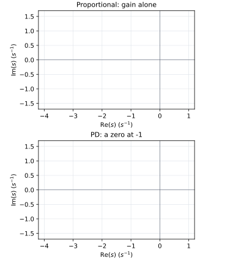

**Figure 1.1.** Root-locus diagrams for proportional and PD control.

**Stop. Review with the class for 1 minute and correct your work before advancing.**

### Checkpoint 2. Mark the PD landmarks and initial directions (2 minutes + 1-minute review)

For $L_0=(s+1)/s^2$:

- Poles, with multiplicity: $\underline{\hspace{0.65in}}$, $\underline{\hspace{0.65in}}$; zero: $\underline{\hspace{0.65in}}$.
- Branches: $\underline{\hspace{0.65in}}$; finite endpoints: $\underline{\hspace{0.65in}}$; infinite endpoints: $\underline{\hspace{0.65in}}$.
- Real-axis test: left of $-1$, the count to the right is $\underline{\hspace{0.65in}}$; between $-1$ and $0$, it is $\underline{\hspace{0.65in}}$.\
  Shade the accepted interval.

Near the double pole at the origin, use the supplied approximation $s^2+K\approx0$.

Initial directions: $\underline{\hspace{0.65in}}$ degrees and $\underline{\hspace{0.65in}}$ degrees.

Mark the poles, zero, and short departure arrows on the lower axes in Figure 1.2.

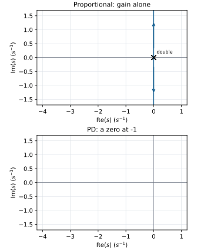

**Figure 1.2.** Root-locus diagrams for proportional and PD control.

**Stop. Review with the class for 1 minute and correct your work before advancing.**

### Checkpoint 3. Find where the PD roots meet (2 minutes + 1-minute review)

Use the supplied expressions:

$$K(s)=-\frac{s^2}{s+1},\qquad K'(s)=-\frac{s(s+2)}{(s+1)^2}.$$

1. Apart from the start $s=0$, $K'=0$ gives $s=$ $\underline{\hspace{0.65in}}$ and $K=$ $\underline{\hspace{0.65in}}$.
2. Substitute this gain: $P(s)=(s+$ $\underline{\hspace{0.65in}}$ $)^2$.
3. Circle **break-in / breakaway**.\
   After the meeting, one root moves toward $\underline{\hspace{0.65in}}$, and the other moves toward $\underline{\hspace{0.65in}}$.

**Supplied shape:** the curved branches follow $(x+1)^2+y^2=1$, where $s=x+jy$.

Complete the sketch with increasing-$K$ arrows.

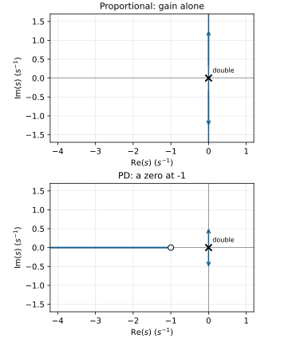

**Figure 1.3.** Root-locus diagrams for proportional and PD control.

**Stop. Review with the class for 1 minute and correct your work before advancing.**

### Checkpoint 4. Select damping and predict the zero's effect (2 minutes; review during the demonstration)

Match the PD denominator to $s^2+2\zeta\omega_ns+\omega_n^2$:

$$\omega_n^2=K,\qquad 2\zeta\omega_n=K.$$

Thus $\omega_n=$ $\underline{\hspace{0.65in}}$ and $\zeta=$ $\underline{\hspace{0.65in}}$.

For $\zeta=1/2$, $K=$ $\underline{\hspace{0.65in}}$ and both poles are $\underline{\hspace{0.65in}}$ .

Mark the pair.

At this gain, compare

$$\mathcal T_{\rm PD}=\frac{s+1}{s^2+s+1},\qquad
\mathcal T_2=\frac1{s^2+s+1}.$$

The two models have the same poles and zero-frequency (DC) gain, $\mathcal T(0)$.

Must they have the same overshoot?

**Yes / No**.

The feature that may change the response is $\underline{\hspace{0.65in}}$ .

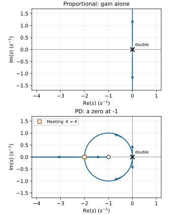

**Figure 1.4.** Root-locus diagrams for proportional and PD control.

**Stop after 2 minutes. Review this prediction during the instructor demonstration.**

### Instructor check. Observe, compare, and correct (2-minute demonstration, including checkpoint 4 review)

Watch the instructor's 2-minute MATLAB demonstration.

Record the measured overshoot:

**Table 1.5.** Step-response overshoot at $K=1$.

| Model | Overshoot |
|---|---|
| Complete PD | $\underline{\hspace{0.65in}}$% |
| Same poles, no zero | $\underline{\hspace{0.65in}}$% |

The zero supplies damping relative to proportional control, but it also changes $\underline{\hspace{0.65in}}$ .

Correct your prediction using the demonstrated response.

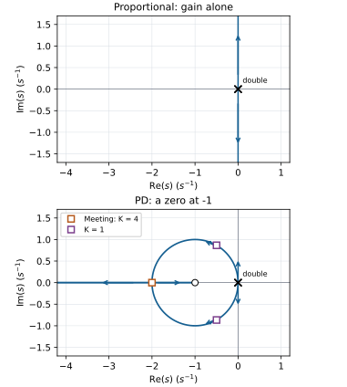

**Figure 1.5.** Root-locus diagrams for proportional and PD control.

**Proceed to the regroup page for the final 1 minute of this round.**

### Regroup (1 minute)

**What you accomplished**

- Proportional control leaves the poles on the imaginary axis.\
  Increasing gain changes the oscillation frequency without creating decay.
- The PD zero bends the locus into the left half-plane.\
  At $K=1$, the poles have damping ratio $1/2$.
- With those same poles, the complete PD response has 29.84% overshoot, compared with 16.30% for the model without a zero.

**Why it matters**

For a rigid satellite or frictionless joint, position feedback acts like a restoring spring.

The derivative term adds a damping term to the closed-loop equation.

Here, PD acts on the tracking error, so differentiation also acts on the reference.

That choice changes the numerator and helps explain why matching poles does not guarantee matching step responses.

**Connection to what follows**

The next round adds a controller pole to replace ideal differentiation and examines how that pole changes the locus.

## Round 2. How does a controller pole change the locus?

### Introduction (1 minute)

**What this round is about**

How does a controller pole change the locus?

Adding a pole makes the PD controller proper and changes the locus.

Keep $G(s)=1/s^2$ and use the lead controller

$$D_c(s)=K\frac{s+1}{s+p},\qquad p\in\{12,9,4\}.$$

Hold $p$ fixed while varying $K$.

A positive $p$ places the controller pole at $-p$.

**Tasks**

1. Locate the common poles, zero, real-axis segment, and asymptotes.
2. Compare the repeated-root events for controller-pole parameters $p=12$, $9$, and $4$.
3. Check stability with the supplied Routh first column.
4. Compare the three loci on equal scales in the instructor demonstration.

**Learning objectives**

By the end of this round, you should be able to:

- Predict how an added controller pole changes branch geometry and repeated-root behavior.
- Distinguish stability from useful damping and account for the gain scaling when comparing with PD control.

### Checkpoint 1. Identify the common geometry (2 minutes + 1-minute review)

Use the characteristic polynomial $P=s^3+ps^2+Ks+K$.

Poles: $\underline{\hspace{0.65in}}$, $\underline{\hspace{0.65in}}$, $\underline{\hspace{0.65in}}$; finite zero: $\underline{\hspace{1.6in}}$.

There are $\underline{\hspace{0.65in}}$ branches, of which $\underline{\hspace{0.65in}}$ go to infinity.

The accepted real-axis interval is $\underline{\hspace{0.65in}}$ .

For $p>1$, calculate the asymptote centroid and angles:

$$\sigma_a=\frac{-p-(-1)}{2}=\underline{\qquad},\qquad
\theta=\pm\underline{\qquad}^{\circ}.$$

Mark the poles, zero, and asymptotes for $p=12,9,4$.

The two branches from the origin depart at $\pm90^\circ$, and the branch from $-p$ departs right.

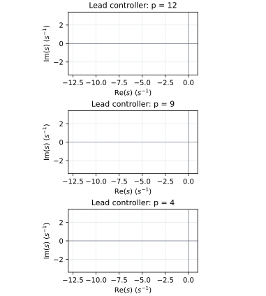

**Figure 2.1.** Lead-controller loci for $p=12$, $9$, and $4$.

**Stop. Review with the class for 1 minute and correct your work before advancing.**

### Checkpoint 2. Order the two events for p = 12 (2 minutes + 1-minute review)

Use $K(s)=-s^2(s+p)/(s+1)$.

Excluding the zero-gain start, $K'=0$ reduces to

$$2s^2+(p+3)s+2p=0.$$

Table 2.2 gives the candidate locations and gains for $p=12$.

**Table 2.2.** Repeated-root candidates and gains for $p=12$.

| Location | Gain | First or second? |
|---|---|---|
| $-2.31386$ | $39.47079$ | $\underline{\hspace{0.65in}}$ |
| $-5.18614$ | $43.77921$ | $\underline{\hspace{0.65in}}$ |

Both lie on the accepted interval and have positive gain.

The pair from the origin reaches the first event: **break-in / breakaway**.

At the second event two real roots leave the axis: **break-in / breakaway**.

Add both events and arrows.

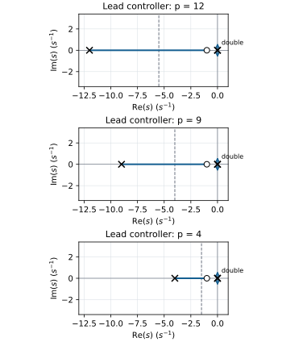

**Figure 2.2.** Lead-controller loci for $p=12$, $9$, and $4$.

**Stop. Review with the class for 1 minute and correct your work before advancing.**

### Checkpoint 3. Recognize the transition at p = 9 (2 minutes + 1-minute review)

At $p=9$, the stationary equation is $2(s+3)^2=0$.

Meeting location $s=$ $\underline{\hspace{0.65in}}$ .

With $K=-s^2(s+9)/(s+1)$, gain $K=$ $\underline{\hspace{0.65in}}$ .

Complete the factorization:

$$s^3+9s^2+27s+27=(s+\underline{\qquad})^{\underline{\qquad}}.$$

How many roots coincide? $\underline{\hspace{0.65in}}$ .

**Supplied local result:** after this event, one root departs right and two depart at $\pm120^\circ$.

Mark the repeated point and these short arrows.

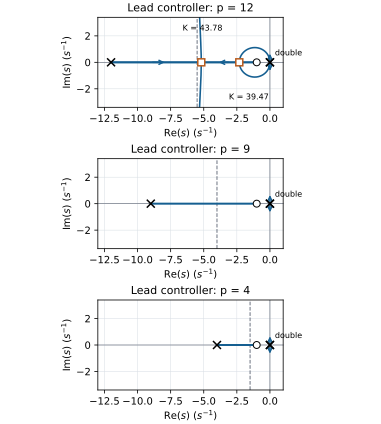

**Figure 2.3.** Lead-controller loci for $p=12$, $9$, and $4$.

**Stop. Review with the class for 1 minute and correct your work before advancing.**

### Checkpoint 4. Compare p = 4 and check stability (2 minutes; review during the demonstration)

The stationary equation's discriminant is supplied:

$$\Delta=(p-1)(p-9).$$

At $p=4$, $\Delta=$ $\underline{\hspace{0.65in}}$ .

Nonzero real meeting candidates: **none / two**.

For all three controllers the Routh first column is

$$1,\quad p,\quad \frac{K(p-1)}p,\quad K.$$

For $K>0$, are all three designs stable?

**Yes / No**.

The centroid moves **left / right** as $p$ decreases from 12 to 4.

Does stability alone guarantee useful damping?

**Yes / No**.

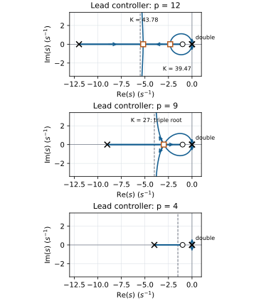

**Figure 2.4.** Lead-controller loci for $p=12$, $9$, and $4$.

**Stop after 2 minutes. Review this prediction during the instructor demonstration.**

### Instructor check. Observe, compare, and correct (2-minute demonstration, including checkpoint 4 review)

Watch the instructor's 2-minute demonstration.

Match each plot to its behavior:

**Table 2.5.** Real-axis meeting behavior for each controller pole.

| $p$ | Two meetings / triple meeting / no real meeting |
|---|---|
| 12 | $\underline{\hspace{0.65in}}$ |
| 9 | $\underline{\hspace{0.65in}}$ |
| 4 | $\underline{\hspace{0.65in}}$ |

Moving the controller pole closer to the zero can reduce the available $\underline{\hspace{0.65in}}$ .

For $|s|\ll p$, $D_c\approx(K/p)(s+1)$.

Equal numerical gains here and in Round 1 do not give equal effective PD gains.

Correct your comparison using the demonstrated loci.

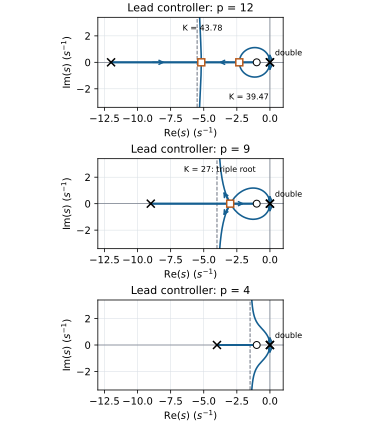

**Figure 2.5.** Lead-controller loci for $p=12$, $9$, and $4$.

**Proceed to the regroup page for the final 1 minute of this round.**

### Regroup (1 minute)

**What you accomplished**

- The added pole creates a third branch.\
  Its location changes the asymptote centroid and the available damping.
- The $p=12$ locus has two real-axis meetings.\
  At $p=9$, three roots meet at $-3$.\
  At $p=4$, there is no positive-gain real-axis meeting.
- All three models are stable for every positive gain, but their pole configurations differ.

**Why it matters**

The controller pole is part of the dynamics that must be designed.

Unlike ideal PD control, this proper lead controller has a finite high-frequency gain.

At low frequency, $D_c\approx(K/p)(s+1)$.

Changing $p$ therefore changes both the locus geometry and the effective PD gain.

Copying a numerical gain from Round 1 does not preserve the same loop behavior.

**Connection to what follows**

The next round keeps this lead controller and adds structural flexibility, including the effect of sensor location.

## Round 3. Can sensor location change the stability risk?

### Introduction (1 minute)

**What this round is about**

Can sensor location change the stability risk?

A flexible mode adds a lightly damped pole pair to the rigid-body model.

Compare the two supplied plants using $D_c=K(s+1)/(s+12)$.

A collocated sensor and actuator are on the same rigid body.

In the noncollocated model, they are on different bodies connected by a flexible element.

These models illustrate how nearby zeros affect the locus.

Their conclusions apply to the stated plants.

**Tasks**

1. Count branches and asymptotes for both flexible models.
2. Calculate departure from the upper flexible pole without the nearby zeros.
3. Add the nearby zeros and compare the departure direction.
4. Check all five closed-loop poles at the demonstrated gains.

**Learning objectives**

By the end of this round, you should be able to:

- Explain how zeros associated with sensor location can change flexible-mode motion.
- Distinguish an initial departure direction from a stability conclusion at a finite gain.

### Checkpoint 1. Count the branches and locate the asymptotes (2 minutes + 1-minute review)

Use the supplied pole and zero lists, counting repeated locations separately.

**Table 3.1.** Branch and endpoint counts for the flexible models.

| Model | Branches $n$ | Zeros $m$ | $n-m$ |
|---|---|---|---|
| Collocated | $\underline{\hspace{0.65in}}$ | $\underline{\hspace{0.65in}}$ | $\underline{\hspace{0.65in}}$ |
| Noncollocated | $\underline{\hspace{0.65in}}$ | $\underline{\hspace{0.65in}}$ | $\underline{\hspace{0.65in}}$ |

The pole sum is $-12.2$.

The zero sums are $-1.2$ and $-1$, respectively.

Using $\sigma_a=(\sum p_i-\sum z_i)/(n-m)$, find the two centroids: $\underline{\hspace{0.65in}}$ and $\underline{\hspace{0.65in}}$ .

The two-asymptote angles are $\pm90^\circ$; the four-asymptote angles are $45^\circ,135^\circ,225^\circ,315^\circ$.

**Supplied plants**

$$G_c=\frac{(s+0.1)^2+6^2}{s^2[(s+0.1)^2+6.6^2]},$$

$$G_n=\frac1{s^2[(s+0.1)^2+6.6^2]}.$$

**Shared poles:** $0,0,-12,-0.1\pm6.6j$.

**Collocated zeros:** $-1,-0.1\pm6j$.

**Noncollocated zero:** $-1$.

The common real-axis segment is $-12<s<-1$.

The low-frequency plant gains differ by a factor of $36.01$. Equal numerical $K$ does not mean equal low-frequency loop gain. A positive rescaling changes gain labels, but not locus shapes or departure angles.

**Stop. Review with the class for 1 minute and correct your work before advancing.**

### Checkpoint 2. Calculate the noncollocated departure (2 minutes + 1-minute review)

At $p_f=-0.1+6.6j$, use vectors from each other landmark to $p_f$.

Their angles are supplied:

**Table 3.2.** Vector angles at the upper flexible pole.

| Landmark | Angle |
|---|---|
| Zero $-1$ | $82.23483^\circ$ |
| Each origin pole (count twice) | $90.86805^\circ$ |
| Pole $-12$ | $29.01371^\circ$ |
| Lower flexible pole | $90^\circ$ |

$$\phi_n=180+82.23483-[2(90.86805)+29.01371+90].$$

Departure $\phi_n=$ $\underline{\hspace{0.65in}}$ degrees.

Initially **left / right**?

Add an arrow at the upper pole in the noncollocated panel of Figure 3.2.

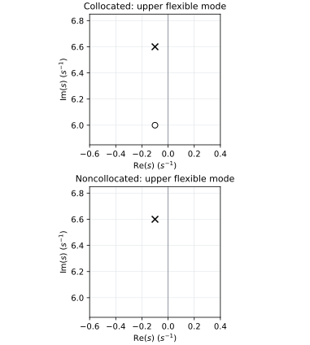

**Figure 3.2.** Local views of the upper flexible-mode branches.

**Stop. Review with the class for 1 minute and correct your work before advancing.**

### Checkpoint 3. Add the collocated zeros (2 minutes + 1-minute review)

Each additional zero contributes $90^\circ$ at the upper flexible pole:

$$p_f-(-0.1+6j)=0.6j,$$
$$p_f-(-0.1-6j)=12.6j.$$

Using your corrected $\phi_n$,

$$\phi_c=\phi_n+90^\circ+90^\circ=\underline{\qquad}^{\circ}.$$

The upper collocated branch moves **left / right**.

Add its departure arrow.

By conjugate symmetry, the lower branch moves **up-left / down-left / up-right / down-right**.

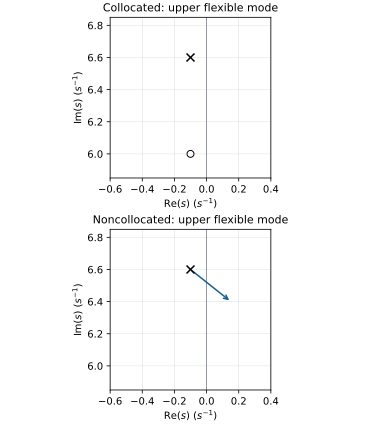

**Figure 3.3.** Local views of the upper flexible-mode branches.

**Stop. Review with the class for 1 minute and correct your work before advancing.**

### Checkpoint 4. Separate direction from stability (2 minutes; review during the demonstration)

The flexible poles start at real part $-0.1$.

1. A branch moving right is immediately unstable for every $K>0$: **True / False**.
2. A branch initially moving left proves stability at every gain: **True / False**.
3. At a proposed gain, check **two / five** poles and require their real parts to be $\underline{\hspace{0.65in}}$ .

Prediction: the model more likely to expose a flexible-mode instability as gain grows is $\underline{\hspace{0.65in}}$ .

A rigid-body $1/s^2$ model omits $\underline{\hspace{0.65in}}$ .

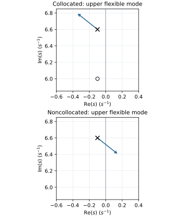

**Figure 3.4.** Local views of the upper flexible-mode branches.

**Stop after 2 minutes. Review this prediction during the instructor demonstration.**

### Instructor check. Observe all five poles (2-minute demonstration, including checkpoint 4 review)

Watch the instructor's 2-minute demonstration.

Record the largest real part among all five poles, then classify stability.

**Table 3.5.** Stability based on all five poles at each gain.

| Model | $K$ | Largest real part | Stable? |
|---|---|---|---|
| Collocated | 100 | $\underline{\hspace{0.65in}}$ | $\underline{\hspace{0.65in}}$ |
| Collocated | 200 | $\underline{\hspace{0.65in}}$ | $\underline{\hspace{0.65in}}$ |
| Noncollocated | 100 | $\underline{\hspace{0.65in}}$ | $\underline{\hspace{0.65in}}$ |
| Noncollocated | 200 | $\underline{\hspace{0.65in}}$ | $\underline{\hspace{0.65in}}$ |

The instability missed by a rigid-body model comes from $\underline{\hspace{0.65in}}$ .

These checks apply to the stated models and gains.

Correct your stability prediction using all five poles.

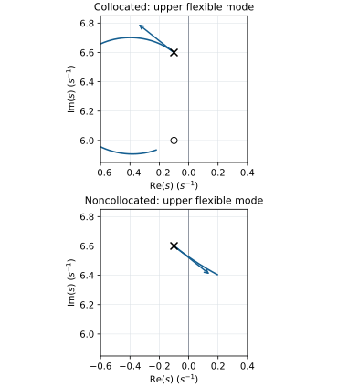

**Figure 3.5.** Local views of the upper flexible-mode branches.

**Proceed to the regroup page for the final 1 minute of this round.**

### Regroup (1 minute)

**What you accomplished**

- The nearby zeros reverse the initial departure of the upper flexible branch in the supplied models.
- At $K=100$, both models are stable.\
  At $K=200$, the noncollocated model has an unstable flexible pair, while the collocated model remains stable.
- Initial direction alone does not establish stability.\
  All five poles must be checked at the selected gain.

**Why it matters**

A flexible robot arm can move at both the driven joint and a remote measurement point.

The sensor location affects which motion the feedback loop measures, so a rigid-body model can miss a flexible-mode instability.

These results apply to the supplied plants.

Their low-frequency gains differ, so equal numerical gains do not establish an equal-performance comparison or a general rule for every sensor arrangement.

**Connection to what follows**

The next round follows several interacting branches and checks repeated roots that occur away from the real axis.

## Round 4. Can two roots meet off the real axis?

### Introduction (1 minute)

**What this round is about**

Can two roots meet off the real axis?

Rounds 1 and 2 had repeated roots on the real axis.

Check where roots meet in the fourth-order loop

$$L_0(s)=\frac1{s(s+2)[(s+1)^2+4]},\qquad L=KL_0.$$

The supplied substitution $q=(s+1)^2$ reduces the repeated-root calculation to two cases.

**Tasks**

1. Sketch the starting geometry of a fourth-order locus.
2. Use the supplied substitution to find the real repeated root.
3. Find the conjugate complex repeated roots and count their multiplicities.
4. Predict and check the branch motion between the two events.

**Learning objectives**

By the end of this round, you should be able to:

- Use $P=0$ and $P_s=0$ to identify repeated roots, including nonreal roots.
- Distinguish multiplicity, local departure direction, and the later shape of a branch.

### Checkpoint 1. Mark the starting geometry (2 minutes + 1-minute review)

Starting poles: $\underline{\hspace{0.65in}}$, $\underline{\hspace{0.65in}}$, $\underline{\hspace{0.65in}}$, $\underline{\hspace{0.65in}}$ .

Finite zeros: $\underline{\hspace{0.65in}}$ .

The real-axis segment is $(-2,0)$.

The centroid is supplied: $\sigma_a=-1$.

Draw the four asymptotes at $45^\circ,135^\circ,225^\circ,315^\circ$.

For the upper pole, supplied other-pole angles give

$$\phi=180^\circ-(116.56505^\circ+63.43495^\circ+90^\circ).$$

Departure $\phi=$ $\underline{\hspace{0.65in}}$ .

Draw it and reflect for the lower pole.

Draw the real branches toward each other.

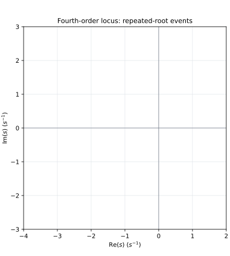

**Figure 4.1.** Fourth-order locus and repeated-root locations.

**Stop. Review with the class for 1 minute and correct your work before advancing.**

### Checkpoint 2. Find the real-axis meeting (2 minutes + 1-minute review)

Set $q=(s+1)^2$.

The algebra is supplied:

$$P=q^2+3q-4+K,\qquad P_s=2(s+1)(2q+3).$$

A repeated root requires both $P=0$ and $P_s=0$, where $P_s=\partial P/\partial s$.

First use $s+1=0$.

Then $s=$ $\underline{\hspace{0.65in}}$, $q=$ $\underline{\hspace{0.65in}}$, and $K=$ $\underline{\hspace{0.65in}}$ .

At this gain,

$$P=(s+1)^2[(s+1)^2+3].$$

List all four roots, counting repeats: $\underline{\hspace{1.6in}}$ .

Mark the double root and both other roots with a common gain label.

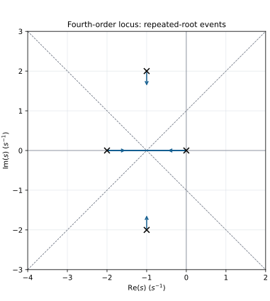

**Figure 4.2.** Fourth-order locus and repeated-root locations.

**Stop. Review with the class for 1 minute and correct your work before advancing.**

### Checkpoint 3. Find the complex meetings (2 minutes + 1-minute review)

Use the other factor of $P_s$: $2q+3=0$.

Then $q=$ $\underline{\hspace{0.65in}}$ and

$$P=\frac94-\frac92-4+K=0\quad\Rightarrow\quad K=\underline{\qquad}.$$

Solve $(s+1)^2=-3/2$: $s=$ $\underline{\hspace{0.65in}}$ .

At this gain, the factorization is supplied:

$$P=(s^2+2s+5/2)^2.$$

Each complex location has multiplicity $\underline{\hspace{0.65in}}$, giving a total of $\underline{\hspace{0.65in}}$ roots.

Mark the two meeting locations.

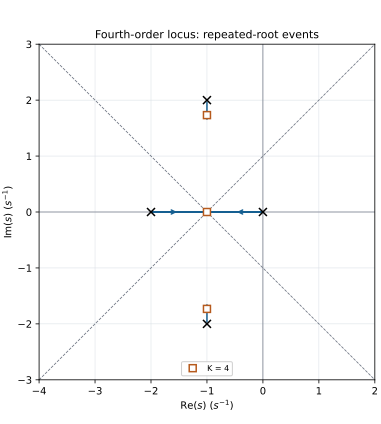

**Figure 4.3.** Fourth-order locus and repeated-root locations.

**Stop. Review with the class for 1 minute and correct your work before advancing.**

### Checkpoint 4. Predict the sequence between events (2 minutes; review during the demonstration)

Use the supplied quadratic solution:

$$q_\pm=\frac{-3\pm\sqrt{25-4K}}2,\qquad s=-1\pm\sqrt q.$$

**Table 4.4.** Root motion between repeated-root events.

| Gain interval | Complete the motion |
|---|---|
| $0<K<4$ | Real pair approaches $\underline{\hspace{0.65in}}$ |
| $4<K<6.25$ | All four roots lie on $\Re s=$ $\underline{\hspace{0.65in}}$ |
| $K>6.25$ | Roots initially split **left/right / up/down** |

For the last row, let $\delta=s-s_0$ be the displacement from either complex meeting point $s_0$.

Use the supplied result $\delta^2\approx(K-6.25)/6$.

Add increasing-$K$ arrows.

A horizontal departure gives the local tangent direction, and the branch can curve afterward.

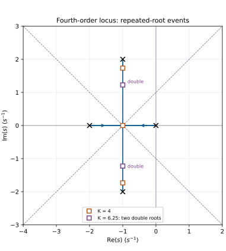

**Figure 4.4.** Fourth-order locus and repeated-root locations.

**Stop after 2 minutes. Review this prediction during the instructor demonstration.**

### Instructor check. Observe both repeated-root events (2-minute demonstration, including checkpoint 4 review)

Watch the instructor's 2-minute demonstration.

**Table 4.5.** Repeated-root locations and multiplicities.

| Gain | Repeated locations | Multiplicity at each |
|---|---|---|
| $4$ | $\underline{\hspace{0.65in}}$ | $\underline{\hspace{0.65in}}$ |
| $25/4$ | $\underline{\hspace{0.65in}}$ | $\underline{\hspace{0.65in}}$ |

Does the numerical plot agree with the event order and the arrows?

**Yes / No**.

Correction, if needed: $\underline{\hspace{0.65in}}$ .

Use the exact factorization to interpret small numerical differences between repeated roots.

Compare the observed branch directions with your checkpoint 4 prediction.

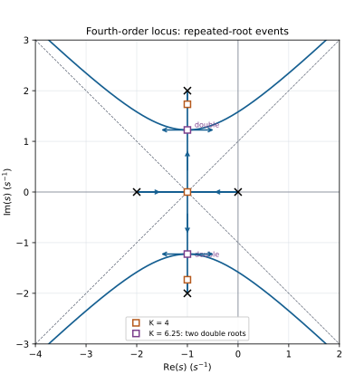

**Figure 4.5.** Fourth-order locus and repeated-root locations.

**Proceed to the regroup page for the final 1 minute of this round.**

### Regroup (1 minute)

**What you accomplished**

- At $K=4$, the real roots meet at $s=-1$, forming one double root.
- At $K=25/4$, roots meet at $s=-1\pm j\sqrt{3/2}$.\
  Each location is a double root, accounting for all four roots.
- Between the events, all four roots lie on the line with real part $-1$.\
  After the complex meetings, the branches initially split left and right, then curve.

**Why it matters**

Repeated transfer-function poles connect this locus to the critically damped oscillator studied earlier.

In the time response, a repeated pole can introduce a factor of $t$ multiplying an exponential.

Repeated complex poles can similarly produce $t$ times a damped oscillation.

Near a repeated root, a numerical solver may display slightly separated roots.

Exact factorization distinguishes the true multiplicity from numerical splitting.

The local tangent describes only the initial motion after the meeting.

**Connection to what follows**

The next round uses locus geometry to decide whether proportional gain can meet a motor-position performance target.

## Round 5. Can motor gain meet the target?

### Introduction (1 minute)

**What this round is about**

Can motor gain meet the target?

Use the locus to assess whether gain alone can meet a transient-response requirement.

The normalized motor-position plant is $G(s)=1/[s(s+1)]$, with proportional control $D_c=K$.

The requirements are at most 10% overshoot and a 1% settling time of at most 2 s.

**Tasks**

1. Locate the motor poles as proportional gain changes.
2. Translate overshoot and settling requirements into a target pole region.
3. Select a damping gain and check a proposed off-locus pole.
4. Compare the step responses at two gains in the instructor demonstration.

**Learning objectives**

By the end of this round, you should be able to:

- Use a locus to assess whether gain alone can reach a performance target.
- Apply the angle condition before the magnitude condition and distinguish response estimates from measured metrics.

### Checkpoint 1. Locate the poles as gain changes (2 minutes + 1-minute review)

Complete the closed-loop model:

$$P=s^2+s+\underline{\qquad},\qquad
\mathcal T=\frac{\underline{\qquad}}{s^2+s+K}.$$

The supplied roots are $s=(-1\pm\sqrt{1-4K})/2$.

Set the square-root argument to zero: meeting gain $K=$ $\underline{\hspace{0.65in}}$, location $s=$ $\underline{\hspace{0.65in}}$ .

For $K>1/4$, every complex pole has real part $\underline{\hspace{0.65in}}$ .

Sketch the locus and increasing-$K$ arrows.

For $0<K<1/4$, the slower pole lies between $\underline{\hspace{0.65in}}$ and $\underline{\hspace{0.65in}}$ .

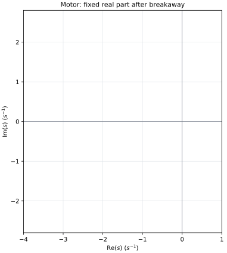

**Figure 5.1.** Motor locus and the specified pole region.

**Stop. Review with the class for 1 minute and correct your work before advancing.**

### Checkpoint 2. Translate the specifications into a pole region (2 minutes + 1-minute review)

The overshoot calculation is supplied:

$$\zeta_{\min}=\frac{-\ln0.1}{\sqrt{\pi^2+(\ln0.1)^2}}=0.5912.$$

The damping wedge lies within $53.76^\circ$ of the negative real axis.

Shade that wedge in Figure 5.2.

Using the approximate 1% rule $t_s\approx4.6/\sigma$, a limit of 2 s requires $\sigma\ge$ $\underline{\hspace{0.65in}}$ .

Draw the line $\Re s=$ $\underline{\hspace{0.65in}}$ and shade left.

Does either locus portion offer the requested dominant decay rate?

**Yes / No**.

This pole-region test uses an **estimate / exact settling-time formula**.

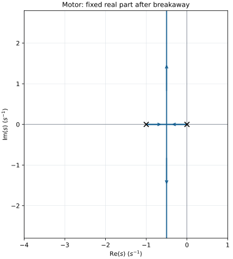

**Figure 5.2.** Motor locus and the specified pole region.

**Stop. Review with the class for 1 minute and correct your work before advancing.**

### Checkpoint 3. Select a damping gain and predict the response (2 minutes + 1-minute review)

For this second-order system without finite zeros, coefficient matching gives

$$\omega_n=\sqrt K,\qquad\zeta=\frac1{2\sqrt K}.$$

For $\zeta=1/2$, gain $K=$ $\underline{\hspace{0.65in}}$ .

Both poles: $\underline{\hspace{1.6in}}$ .

Mark them.

Use $e^{-\pi/\sqrt3}=0.1630$:

- Predicted overshoot: $\underline{\hspace{0.65in}}$%.
- Estimated 1% settling time: $4.6/(1/2)=$ $\underline{\hspace{0.65in}}$ s.

Does this choice meet the original specifications?

**Yes / No**.

If $K$ increases, $\zeta$ **increases / decreases** while the real part stays $\underline{\hspace{0.65in}}$ .

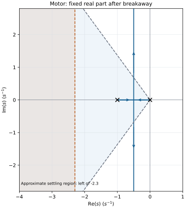

**Figure 5.3.** Motor locus and the specified pole region.

**Stop. Review with the class for 1 minute and correct your work before advancing.**

### Checkpoint 4. Reject an off-locus pole request (2 minutes; review during the demonstration)

A proposed pole is $s_d=-2+2j$.

The product is supplied:

$$s_d(s_d+1)=(-2+2j)(-1+2j)=-2-6j.$$

The signed gain required by $P(s_d)=0$ is

$$K=-s_d(s_d+1)=\underline{\qquad}.$$

Is this a real positive gain?

**Yes / No**.

Magnitude alone returns $|-2-6j|=\sqrt{40}$.

Does that put $s_d$ on the positive-gain locus?

**Yes / No**.

The condition that must pass before magnitude is the $\underline{\hspace{0.65in}}$ condition.

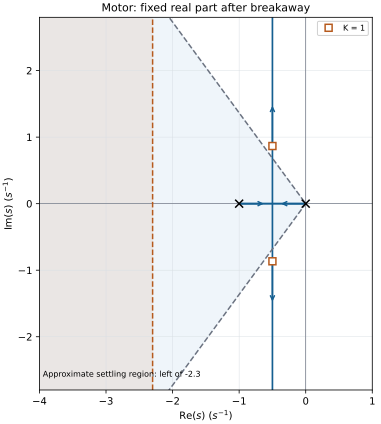

**Figure 5.4.** Motor locus and the specified pole region.

**Stop after 2 minutes. Review this prediction during the instructor demonstration.**

### Instructor check. Observe what larger gain changes (2-minute demonstration, including checkpoint 4 review)

Watch the instructor's 2-minute demonstration.

**Table 5.5.** Motor pole real parts and overshoot at two gains.

| Gain | Complex poles' real part | Overshoot |
|---|---|---|
| 1 | $\underline{\hspace{0.65in}}$ | $\underline{\hspace{0.65in}}$% |
| 5 | $\underline{\hspace{0.65in}}$ | $\underline{\hspace{0.65in}}$% |

At $K=1$, the measured 1% settling time is $\underline{\hspace{0.65in}}$ s.

Compare this result with your estimate of $\underline{\hspace{0.65in}}$ s.

Increasing gain changed frequency and overshoot, but did not move the poles $\underline{\hspace{0.65in}}$ .

Correct your response prediction using the measured values.

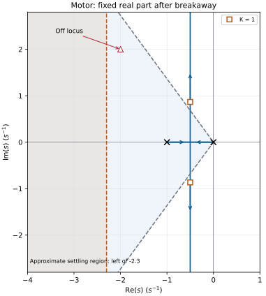

**Figure 5.5.** Motor locus and the specified pole region.

**Proceed to the regroup page for the final 1 minute of this round.**

### Regroup (1 minute)

**What you accomplished**

- Once the motor poles become complex, their real part remains $-1/2$.\
  Increasing gain cannot move these branches farther left.
- At $K=1$, overshoot is 16.30% and the measured 1% settling time is about 8.781 s.\
  This choice fails the original requirements.
- The proposed pole $-2+2j$ requires $K=2+6j$, which fails the requirement for a real positive gain.\
  Taking its magnitude cannot make the point reachable.

**Why it matters**

For a motor-position servo, increasing proportional gain changes the balance between oscillation frequency and damping.

In this model, larger gain increases overshoot without increasing the complex poles' decay rate.

A PD or lead controller can change the locus itself.

After choosing that structure, check the complete response against the actual specifications because the pole-region settling rule is an estimate.

**Connection to what follows**

The next round adds a third plant pole and a tracking requirement, so the gain must be assessed against both transient behavior and steady-state error.

## Round 6. Can one gain meet damping and tracking requirements?

### Introduction (1 minute)

**What this round is about**

Can one gain meet damping and tracking requirements?

A gain selected for damping also sets the tracking error.

Use $G(s)=1/[s(s+2)(s+4)]$ with $D_c=K$ to check both requirements.

First select a gain for a complex pair with $\zeta=1/2$.

Then test the unit-ramp steady-state error requirement $e_{ss}\le0.2$.

**Tasks**

1. Intersect the cubic locus with the ray for a damping ratio of $1/2$.
2. Find the third pole and check the stable gain interval.
3. Predict the dominant-pair response and calculate unit-ramp error.
4. Compare the complete response and inspect the poles at the gain required for tracking.

**Learning objectives**

By the end of this round, you should be able to:

- Verify a dominant-pair approximation against all poles and the complete response.
- Explain why a gain that meets a tracking bound can conflict with a damping target.

### Checkpoint 1. Intersect the damping ray (2 minutes + 1-minute review)

The polynomial is $P=s^3+6s^2+8s+K$.

On the upper $\zeta=1/2$ ray, set $s=-\alpha+j\sqrt3\alpha$, $\alpha>0$.

The substitution is supplied:

$$\Im P=\sqrt3\alpha(8-12\alpha),$$
$$\Re P=8\alpha^3-12\alpha^2-8\alpha+K.$$

Set $\Im P=0$, excluding $\alpha=0$: $\alpha=$ $\underline{\hspace{0.65in}}$ .

Set $\Re P=0$: $K=-8\alpha^3+12\alpha^2+8\alpha=$ $\underline{\hspace{0.65in}}$ .

Both selected poles are $\underline{\hspace{1.6in}}$ .

Mark them on the supplied locus in Figure 6.1.

The imaginary-part test enforces a real gain.

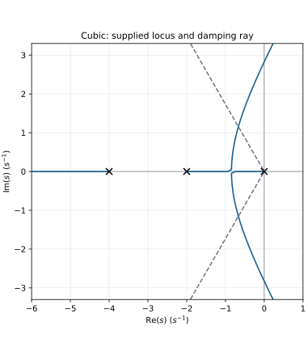

**Figure 6.1.** Cubic locus and the $\zeta=1/2$ damping rays.

**Stop. Review with the class for 1 minute and correct your work before advancing.**

### Checkpoint 2. Find every pole and check stability (2 minutes + 1-minute review)

Use the corrected pair $-2/3\pm j2\sqrt3/3$ and $K=224/27$.

The sum of all roots is $-6$:

$$s_3=-6-(-4/3)=\underline{\qquad}.$$

Complete $P=(s+$ $\underline{\hspace{0.65in}}$ $)(s^2+4s/3+16/9)$ and mark the third root.

The Routh first column is supplied:

$$1,\quad6,\quad(48-K)/6,\quad K.$$

Stable interval: $\underline{\hspace{0.65in}}$ $<K<$ $\underline{\hspace{0.65in}}$ .

Does the selected gain satisfy it?

**Yes / No**.

Third-pole decay rate / pair decay rate $=(14/3)/(2/3)=$ $\underline{\hspace{0.65in}}$ .

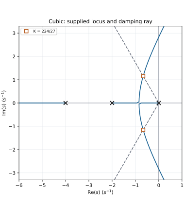

**Figure 6.2.** Cubic locus and the $\zeta=1/2$ damping rays.

**Stop. Review with the class for 1 minute and correct your work before advancing.**

### Checkpoint 3. Predict the response of the pair (2 minutes + 1-minute review)

For the pair, $\sigma=2/3$, $\zeta=1/2$, and $\omega_n=\sigma/\zeta=$ $\underline{\hspace{0.65in}}$ .

Use $e^{-\pi/\sqrt3}=0.1630$ and fill in:

**Table 6.3.** Response predictions from the selected pole pair.

| Pair prediction | Value |
|---|---|
| Overshoot | $\underline{\hspace{0.65in}}$% |
| Approximate rise, $1.8/\omega_n$ | $\underline{\hspace{0.65in}}$ s |
| Approximate 1% settling, $4.6/\sigma$ | $\underline{\hspace{0.65in}}$ s |

The models are supplied on the right.

Both have DC gain $\underline{\hspace{0.65in}}$ .

Which model must be checked before accepting the design?

**Pair / Complete cubic**.

**Keep the complete model**

$$\mathcal T(s)=\frac{224/27}{(s+14/3)(s^2+4s/3+16/9)}.$$

**Compare a unit-DC-gain pair**

$$\mathcal T_2(s)=\frac{16/9}{s^2+4s/3+16/9}.$$

Their relation makes the omitted mode explicit:

$$\mathcal T(s)=\mathcal T_2(s)\frac{14/3}{s+14/3}.$$

The extra pole can change the response even though the dominant pair agrees.

**Space for your calculation and prediction:**

**Stop. Review with the class for 1 minute and correct your work before advancing.**

### Checkpoint 4. Check the tracking requirement (2 minutes; review during the demonstration)

For this stable Type 1 loop, the supplied formulas are

$$K_v=K/8,\qquad e_{ss,\rm ramp}=8/K.$$

At $K=224/27$, $K_v=$ $\underline{\hspace{0.65in}}$ and $e_{ss}=$ $\underline{\hspace{0.65in}}$ .

Does it meet $e_{ss}\le0.2$?

**Yes / No**.

Solve $8/K\le0.2$: $K\ge$ $\underline{\hspace{0.65in}}$ .

Is this boundary gain inside $0<K<48$?

**Yes / No**.

**Predict:** meeting the tracking bound by increasing gain may worsen $\underline{\hspace{0.65in}}$ .

MATLAB must check the full pole set at the new gain.

Zero step steady-state error does not guarantee that the ramp-error requirement is met.

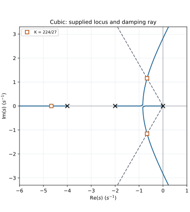

**Figure 6.4.** Cubic locus and the $\zeta=1/2$ damping rays.

**Stop after 2 minutes. Review this prediction during the instructor demonstration.**

### Instructor check. Observe the response and the accuracy tradeoff (2-minute demonstration, including checkpoint 4 review)

Watch the instructor's 2-minute demonstration.

**Table 6.5.** Simulated responses of the pair and complete cubic.

| Simulated metric | Pair | Complete cubic |
|---|---|---|
| Overshoot (%) | $\underline{\hspace{0.65in}}$ | $\underline{\hspace{0.65in}}$ |
| 10–90% rise (s) | $\underline{\hspace{0.65in}}$ | $\underline{\hspace{0.65in}}$ |
| 1% settling (s) | $\underline{\hspace{0.65in}}$ | $\underline{\hspace{0.65in}}$ |

At $K=40$, the instructor shows all three poles.

The complex pair's real part is $\underline{\hspace{0.65in}}$ and damping ratio is $\underline{\hspace{0.65in}}$ .

Does it retain $\zeta=1/2$?

**Yes / No**.

Compare these poles with the tracking prediction from checkpoint 4.

**Figure 6.5.** Cubic locus and the $\zeta=1/2$ damping rays.

**Proceed to the regroup page for the final 1 minute of this round.**

### Regroup (1 minute)

**What you accomplished**

- The damping choice $K=224/27$ gives the selected pair and a third pole at $-14/3$.\
  The complete response is close to, but differs from, the pair response.
- At this gain, unit-ramp error is $27/28$, exceeding the $0.2$ bound.\
  Meeting that bound requires $K\ge40$.
- At $K=40$, the loop is stable, but the pair has damping ratio about $0.03652$.\
  The tracking requirement and the original damping target are not both met.

**Why it matters**

A robot joint following a constant-speed reference receives a ramp position command.

Zero steady-state error to a fixed position does not guarantee a small error while the target keeps moving.

Lag or proportional-integral (PI) control can improve low-frequency tracking.

Either change requires another check of stability, added modes, and the complete transient response, including any slow tail.

**Connection to what follows**

The exit responses connect these examples: zeros affect the response, phase limits reachable poles, and one gain determines every closed-loop mode.

## Synthesis and exit responses (95–105 minutes)

**1. A zero changed the conclusion (95–97 min).**

In Round $\underline{\hspace{0.65in}}$, adding the zero(s) changed $\underline{\hspace{0.65in}}$ .

My evidence is $\underline{\hspace{0.65in}}$ .

Explain using a pole direction or a response measurement.

**2. Magnitude is not enough (97–99 min).**

For the motor's trial point $-2+2j$, the signed required gain was $\underline{\hspace{0.65in}}$ .

It failed the $\underline{\hspace{0.65in}}$ condition.

Taking a magnitude cannot fix this because $\underline{\hspace{0.65in}}$ .

**3. One gain sets all modes (99–101 min).**

The selected pole or pair is not the whole design.

In Round $\underline{\hspace{0.65in}}$, checking the other poles or the full response showed $\underline{\hspace{0.65in}}$ .

**4. Choose what the controller must change (101–103 min).**

The motor's transient conflict motivates $\underline{\hspace{0.65in}}$ or $\underline{\hspace{0.65in}}$ .

The cubic's tracking conflict motivates $\underline{\hspace{0.65in}}$ or $\underline{\hspace{0.65in}}$ .

After either change, I would verify $\underline{\hspace{0.65in}}$ .

**Final class review (103–105 min):** correct your answers in a second color.

Keep all round pages, observations, and exit responses with your name.

## Sources and further reading

Rounds 1–4 adapt Franklin, Powell, and Emami-Naeini (FPE), *Feedback Control of Dynamic Systems*, 8th edition, §5.3, Examples 5.3–5.10, checked against the 7th edition, §5.3, pp. 252–264. The motor uses the normalized model from FPE Example 5.1. The cubic is a course example.

Nise, *Control Systems Engineering*, 7th edition, §§8.6–8.7, supports gain selection and verification of higher-order responses. Use the calculated vector angles and exact repeated-root factorizations when approximate readings from a reference figure differ.

For more explanation, see [Root Locus I](../book-notes/root-locus-construction_student.md), [Root Locus II](../book-notes/root-locus-gain-design_student.md), [Root Locus III: PD and Lead](../book-notes/root-locus-lead-pd_student.md), and [Root Locus IV: Lag and PI](../book-notes/root-locus-lag-pi_student.md).

## Optional work after class

The following extensions develop the calculations supplied during class. They are outside the 105-minute schedule.

- Round 1: separate real and imaginary parts of $s^2+Ks+K=0$ and derive the circular locus.
- Round 2: derive the stationary-gain equation and use its discriminant to locate the transition at $p=9$ for $p>1$.
- Round 4: derive the local departure directions from each repeated root, then show that the outgoing curves satisfy $y^2-(x+1)^2=3/2$.
- Round 6: could proportional control achieve unit-ramp error at most $0.1$ while retaining stability?

### Repeat a MATLAB demonstration

The [MATLAB demonstration helper](root_locus_check.m) requires Control System Toolbox. Download it into MATLAB's Current Folder, and run `which root_locus_check` and `ver('control')` to confirm that the file and toolbox are available.

Use the gain calculated in the corresponding round when calling `root_locus_check(1,K)`, `root_locus_check(4,K)`, `root_locus_check(5,K)`, or `result = root_locus_check(6,K)`. Rounds 2 and 3 can be run without a gain argument using `root_locus_check(2)` and `root_locus_check(3)`.

The helper uses a 1% settling band and a default simulation duration of 30 s. It reports `NaN` for unverified metrics when the response has not settled. For the slow stable cubic at the gain required by the accuracy bound, extend the duration with `root_locus_check(6,40,120)`. Inspect the resulting response, and extend the simulation if necessary. A finite simulation cannot rule out every later departure from the settling band. Do not assign settling metrics to unstable cases.
